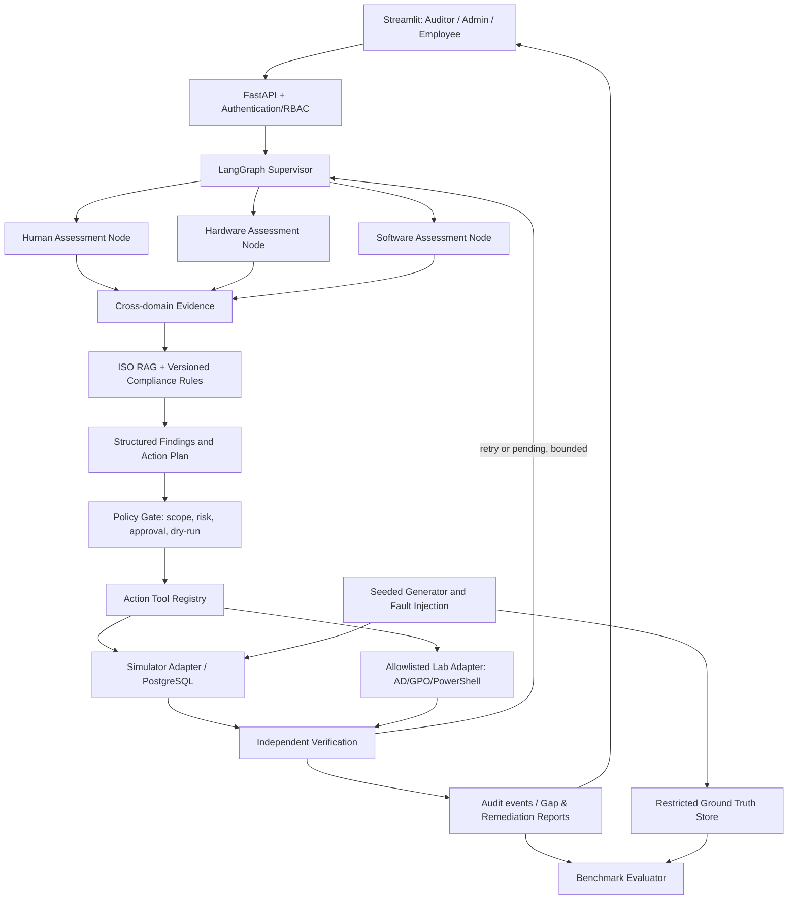

# CODEX BUILD SPECIFICATION

## Xây dựng hệ thống AI Agent đánh giá tuân thủ an toàn thông tin theo ISO/IEC 27001:2022

**Phiên bản đặc tả:** 1.0 | **Phạm vi:** từ khởi tạo đến nghiệm thu | **Ngôn ngữ sản phẩm:** tiếng Việt (mã nguồn và API sử dụng tiếng Anh).

**Đối tượng sử dụng:** Codex và người phát triển đồ án. Đây là tài liệu yêu cầu xây dựng sản phẩm, không phải mã nguồn đã hoàn thành, chứng nhận ISO hay kết quả thực nghiệm.

---

## 0. Chỉ thị thực hiện dành cho Codex

Đọc toàn bộ tài liệu này và `AGENTS.md` trước khi sửa repository. Thực hiện lần lượt 15 giai đoạn, mỗi giai đoạn phải có mã nguồn, kiểm thử, tài liệu, kết quả chạy và tiêu chí nghiệm thu. Nếu repository đã có mã nguồn, khảo sát hiện trạng, bảo toàn công việc hiện có và lập kế hoạch thay đổi tương thích; không tự ý xóa hay ghi đè dữ liệu.

**Mục tiêu cuối cùng:** sản phẩm chạy được từ đầu đến cuối theo chu trình quan sát → đánh giá → phát hiện → lập kế hoạch → hành động → xác minh → báo cáo → tiếp tục giám sát. Không chỉ xây dựng chatbot hoặc dashboard tĩnh. Hệ thống phải đánh giá và thực hiện/điều phối hành động trên ba trụ cột Con người – Phần cứng – Phần mềm, trọng tâm là con người, trong môi trường doanh nghiệp giả lập đa tenant và phòng lab máy ảo được cho phép.

- Ưu tiên một vertical slice hoàn chỉnh (NV015 nghỉ việc còn tài khoản và laptop) trước khi mở rộng.
- Mỗi giai đoạn cập nhật `docs/IMPLEMENTATION_STATUS.md` với trạng thái NOT_STARTED / IN_PROGRESS / PASS / BLOCKED, lệnh kiểm thử thực sự đã chạy, kết quả, hạn chế và bước tiếp theo.
- Không đánh dấu PASS nếu chưa có bằng chứng. Không tạo log, kết quả benchmark, trích dẫn ISO hay kết quả thực thi lab giả để làm như dữ liệu thật. Mọi seed data, mock provider và dry-run phải được gắn nhãn rõ.
- Khi thiếu khóa API, bản tiêu chuẩn được cấp phép, VM hoặc quyền truy cập, hoàn thành phần có thể kiểm thử offline; đánh dấu phần còn lại BLOCKED và ghi rõ điều kiện để tiếp tục. Không tự ý kết nối hệ thống thật.
- Thực hiện toàn bộ 15 giai đoạn trong phạm vi môi trường cho phép, không dừng ở việc lập kế hoạch. Kiểm tra và sửa lỗi ngay khi gặp; không bỏ qua test bằng cách hạ tiêu chuẩn nghiệm thu.

## 1. Định hướng học thuật và phạm vi

### 1.1. Bài toán

Tương tự kiểm tra PCCC tại một cơ sở: kiểm kê đối tượng, đối chiếu tiêu chí, phát hiện thiếu sót (ví dụ thiếu bình chữa cháy), yêu cầu bổ sung, thực hiện bổ sung, kiểm tra lại, lập biên bản. Với ATTT, thay bình chữa cháy bằng hồ sơ đào tạo, quyền truy cập, thiết bị, bản vá và cấu hình bảo mật. AI Agent cần chủ động gọi công cụ, thu thập bằng chứng, liên kết ngữ cảnh, lập kế hoạch có kiểm soát, xác minh và tạo báo cáo.

| Trụ cột | Phạm vi nghiệp vụ | Hành động điển hình |
|---|---|---|
| Con người (ưu tiên) | Vòng đời nhân sự, NDA, nhận thức, đào tạo, báo cáo sự kiện, quyền truy cập, làm việc từ xa | Giao đào tạo, phỏng vấn thích ứng, yêu cầu ký NDA, lập yêu cầu thu hồi quyền, xác minh hồ sơ |
| Phần cứng | Kiểm kê, cấp phát, hoàn trả, thiết bị ngoài cơ sở, USB, thanh lý, bảo vệ thiết bị đầu cuối | Tạo phiếu kiểm kê/thu hồi, điều phối bảo vệ thiết bị, xác minh biên bản và cấu hình |
| Phần mềm | Định danh, tài khoản, MFA, đặc quyền, bản vá, antivirus, cấu hình chuẩn, nhật ký, quản lý thay đổi | Yêu cầu đăng ký MFA, lập kế hoạch vá lỗi, áp dụng cấu hình đã phê duyệt, thu hồi quyền trong lab |

Ba trụ cột là cách nhóm đối tượng của nghiên cứu, không phải cách phân loại chính thức của ISO. Một biện pháp kiểm soát có thể liên quan nhiều trụ cột; lưu một mã kiểm soát chuẩn và dùng mapping, không đếm trùng khi tính điểm tổng.

### 1.2. Giới hạn và chuẩn tham chiếu

- ISO/IEC 27001:2022: yêu cầu đối với ISMS; Điều 4–10 là bối cảnh nghiệp vụ, không tuyên bố đánh giá toàn bộ các điều khoản này hoặc chứng nhận ISO. Tập trung vào 26 mã Annex A trong danh mục ở mục 5; không tự động áp dụng mọi kiểm soát cho mọi doanh nghiệp.
- ISO/IEC 27002:2022: hướng dẫn thực hiện kiểm soát; ISO/IEC 27007:2020: hướng dẫn đánh giá ISMS. Không gọi ISO 27002 là chuẩn kiểm toán.
- Cấu hình chuẩn (security baseline) do từng doanh nghiệp giả lập xác định, được phiên bản hóa. Ví dụ khóa màn hình 5 phút, chu kỳ đào tạo 365 ngày, hạn thu hồi tài khoản, phiên bản bản vá là chính sách minh họa do đề tài chọn, không phải ngưỡng bắt buộc do ISO quy định.
- SoA (Statement of Applicability) ghi nhận biện pháp cần thiết, lý do áp dụng, trạng thái triển khai và lý do loại trừ kiểm soát Annex A; phạm vi demo chỉ hỗ trợ bản SoA mẫu/bản trích có kiểm soát, không tự sinh SoA hoàn chỉnh hay chứng nhận. Gap Report và Remediation Report là hai đầu ra riêng.
- Chỉ nhập tài liệu ISO mà người dùng có quyền sử dụng. Không tải lậu hoặc chép toàn văn ISO vào repository, không dựng nội dung giả như trích dẫn chính thức. Khi chưa có tài liệu, dùng rubric do đề tài soạn, ghi `source_type=research_rubric`, chỉ viện dẫn mã tham chiếu; thông báo chế độ thiếu nguồn chuẩn.
- Không sử dụng dữ liệu nhân viên thật nếu chưa có sự đồng ý và cơ chế bảo vệ phù hợp. Không dùng AI làm căn cứ tuyển dụng, kỷ luật hoặc đánh giá hiệu suất. Điểm nhận thức không đồng nghĩa với tính cách, mức độ đáng tin hay kết luận tuân thủ của cả doanh nghiệp.

### 1.3. Câu hỏi nghiên cứu

| RQ | Câu hỏi | Minh chứng |
|---|---|---|
| RQ1 | AI Agent phát hiện sai lệch có chính xác hơn baseline rule-based trên các ca có ngữ cảnh, thiếu bằng chứng và dữ liệu mâu thuẫn không? | Precision, Recall, F1, FPR, chất lượng bằng chứng, theo từng nhóm ca |
| RQ2 | Phỏng vấn thích ứng có đánh giá được câu trả lời tự do về ATTT một cách nhất quán không? | Rubric chuyên gia, macro-F1, mức đồng thuận; kiểm tra trước/sau nếu có người tham gia thật |
| RQ3 | Agent có thể chọn hành động an toàn, thực thi và xác minh kết quả không? | Tỷ lệ hành động đúng, thành công, sai, bị chặn, thất bại/rollback, trạng thái chờ và thời gian |
| RQ4 | Hệ thống có thích ứng với doanh nghiệp khác nhau về quy mô, chính sách và SoA không? | Benchmark đa tenant, kết quả phân tầng theo quy mô/nhóm lỗi |
| RQ5 | RAG, Rules và Verification cải thiện chất lượng kết luận/hành động đến mức nào? | Đối chứng cùng bộ test, phiên bản model và chi phí; phân tích ablation nếu đủ thời gian |

Giả thuyết chỉ là kỳ vọng. Không khẳng định AI vượt trội trước khi có kết quả. Với hồ sơ mô phỏng, không suy ra hiệu quả thay đổi hành vi của người thật. Thử nghiệm người tự nguyện 10–20 người là phần mở rộng, cần đồng ý tham gia và tuân thủ quy định của cơ sở đào tạo.

### 1.4. Sản phẩm tối thiểu (MVP) và đích cuối

MVP: một tenant ABC Technology có 50 hồ sơ nhân viên giả lập, API có trạng thái, ≥ 20 họ kịch bản kiểm thử (12 người, 4 thiết bị, 4 phần mềm), AI Agent với công cụ được kiểm soát, phỏng vấn tự do, hành động ít rủi ro, phê duyệt hành động nhạy cảm, xác minh và báo cáo. Đích cuối: sinh và benchmark mặc định 20–30 doanh nghiệp, tùy chọn 50–100; phòng lab riêng gồm 1 Windows Server AD/GPO và 2–3 Windows client (tối thiểu có 1 client để trình diễn); dashboard và kết quả nghiên cứu có thể tái lập.

Không bắt buộc xây dựng 100 mạng doanh nghiệp thật. Không cần huấn luyện LLM từ đầu. Không làm SOC/SIEM hoàn chỉnh, pentest, EDR hay tự động hóa mọi tính năng Windows. Các chức năng VPN/email/MFA/phần mềm kế toán có thể dùng adapter mô phỏng, ghi rõ backend thực thi. Wazuh, Ansible, Ubuntu, React, SimPy là tùy chọn, không chặn MVP.

## 2. Kiến trúc mục tiêu



### 2.1. Công nghệ và lựa chọn mặc định

| Lớp | Công nghệ | Quyết định |
|---|---|---|
| Runtime | Python 3.11+ (chọn phiên bản tương thích thực tế) | `pyproject.toml`, dependency lock; không đặt version giả định không kiểm thử |
| API | FastAPI, Pydantic, SQLAlchemy, Alembic | REST, OpenAPI; giao dịch và schema chặt chẽ |
| Data | PostgreSQL + pgvector | Một database chính; RLS hoặc kiểm soát tenant tương đương có kiểm thử; vector index có filter quyền |
| AI | LangGraph, adapter LLM GPT/Gemini/Ollama | Một model configurable; mock deterministic cho test, không ghi mock thành AI thật |
| RAG | LangChain hoặc retriever trực tiếp + pgvector | Một cách duy nhất trong MVP; tài liệu cấp phép, metadata, nguồn và quyền |
| Simulator | Python, Faker, state machine | Seed tái lập, API đọc và ghi độc lập, lỗi/hành động có delay, thất bại |
| UI | Streamlit | Dashboard quản trị, phỏng vấn, phê duyệt, báo cáo; chỉ gọi API |
| Lab | VMware/VirtualBox, Windows Server, AD/GPO, PowerShell | Mạng lab cô lập, adapter riêng, allowlist máy/OU; không thực thi lệnh tự sinh |
| QA | Pytest, lint, type checking, CI, Docker Compose | Unit/integration/E2E, benchmark, migrations; Docker chỉ cho các dịch vụ Linux |

Kiểm tra phiên bản thư viện tương thích bằng môi trường thực tế. Không giả định Codex có quyền truy cập cloud/API, Windows hay Internet. Docker Compose không tạo máy ảo Windows; lab cần người dùng chuẩn bị hệ điều hành, giấy phép, cấu hình và quyền phù hợp.

### 2.2. Repository đề xuất

```text
.
├── AGENTS.md
├── CODEX_BUILD_SPEC.md
├── README.md
├── pyproject.toml
├── .env.example
├── .gitignore
├── compose.yaml
├── Makefile                         # kèm lệnh Python thay thế trên Windows
├── alembic.ini
├── migrations/
├── src/compliance_ai/
│   ├── config.py
│   ├── api/                         # routes, dependencies, auth, schemas
│   ├── domain/                      # entities, enums, policies, ports
│   ├── db/                          # models, repositories, tenant session
│   ├── rules/                       # rubric loader, predicates, scoring
│   ├── simulator/                   # generator, injector, adapter, state machine
│   ├── tools/                       # registry, read/write schemas, policy gate
│   ├── rag/                         # ingest, chunk, retrieve, citations
│   ├── agents/                      # graph, state, prompts, specialist nodes
│   ├── workflows/                   # approval, action execution, verification
│   ├── lab/                         # allowlist, remote adapter, approved scripts
│   ├── reports/                     # gap, remediation, score, exports
│   ├── benchmark/                   # baselines, evaluator, runner, metrics
│   └── cli.py
├── ui/streamlit_app.py
├── configs/
│   ├── controls.yaml                # 26 control references
│   ├── criteria.yaml                # machine-executable research rubric
│   ├── policies/abc.yaml            # example versioned tenant baseline
│   ├── scenarios.yaml               # 20+ test families
│   └── lab.example.yaml             # no real hosts or credentials
├── knowledge/README.md              # import instructions; no ISO licensed text
├── tests/{unit,integration,e2e,security,benchmark}/
├── scripts/                         # reproducible entry points
├── docs/{IMPLEMENTATION_STATUS,ARCHITECTURE,DATA_MODEL,API,LAB,USER_GUIDE,EXPERIMENT}.md
└── artifacts/                       # generated outputs; gitignore sensitive data
```

Codex may adapt directory naming to an existing repo if documented. Keep domain logic independent of UI, model provider and execution adapter. Default execution mode is `SIMULATION`; `LAB` requires separate explicit enablement by authorized operator. No `PRODUCTION` mode.

## 3. User roles, tenant boundary and use cases

| Role | Allowed | Prohibited |
|---|---|---|
| Auditor | Start read-only assessments in assigned tenant, view findings, evidence, reports, propose actions | Approve own high-risk action; alter baseline or ground truth |
| Admin / Approver | Manage tenant policies, approve scoped action requests, start permitted execution, see audit events | Change evidence retroactively; bypass policy gate; access unrelated tenant |
| Employee | View own assigned training, own interviews, submit answers/evidence and acknowledgement | Access other employee data, self-approve findings or change training result |
| Benchmark runner | Create isolated synthetic test tenants; reset snapshots; run offline evaluations | Access lab, production credentials or real people data |
| Benchmark evaluator (service role) | Read isolated ground truth and compare outputs | Expose ground truth to assessors, prompts, RAG or public APIs |

Use case paths: create/switch assigned tenant → seed enterprise → select assessment scope → start scan → review findings and evidence → approve allowed plan → execute simulation or authorized lab action → verify → export reports. Employee use case: receive task → complete lesson → answer independent scenario → evaluate via rubric → human review if unclear → verify → close. Admin cannot simply force a compliant result.

Authentication: use server-issued identity, password hashing (Argon2/bcrypt) or suitable local auth library, short-lived signed tokens, hashed storage of secrets, no default admin password in production-like startup. Demo accounts created with explicit seed command and documented local-only defaults if necessary. Use DB session tenant context set on every request/worker. Never trust a user-provided company_id or an LLM tool argument as proof of authorization. Ground truth separate credentials/schema or database. Test cross-tenant isolation for reads, lists, writes, vector search, report exports, job IDs, approvals and lab mapping. UI never connects directly to privileged DB.

## 4. Data model and contracts

All IDs are UUIDs except stable criterion/control/scenario codes. All operational records use `company_id` where applicable, UTC timezone-aware timestamps, and version/revision fields. Establish composite tenant-scoped foreign keys or equivalent checked constraints. Store only necessary employee data; synthetic names by default.

| Entity | Core fields / relationships |
|---|---|
| companies | id, name, industry, size_profile, maturity_profile (generator setting, not certified maturity), seed, execution_mode, active_policy_version |
| users, memberships | user_id, role, company_id, employee_id nullable, active; unique membership scope |
| employees | company_id, id, code, department, role, employment_status (active/terminated/transfer), start_date, termination_effective_at, manager_id, remote_allowed |
| employee_records | employee_id, screening_status, contract_record, confidentiality_ack, disciplinary_process_record_ref, post_employment_obligation_ack; evidence IDs, dates, applicable exception |
| trainings, assignments | course_id, employee_id, assigned_at, due_at, completion_at, assessment_score, status, verified_attempt_id; version of course/rubric |
| interviews, interview_turns | employee_id, criterion_id, scenario_id, question, answer, rubric results, cited evidence, followup_count, reviewer decision; no raw hidden chain of thought |
| devices, assignments_assets | device_id, employee_id, asset_tag, inventory_state, assigned_at, returned_at, return_receipt_ref, custody_status, platform, lab_binding nullable |
| endpoint_observations | device_id, collected_at, source, firewall, antivirus, screen_lock_seconds, disk_encryption, usb_policy, installed software, patch identifiers, config version, time_sync, status, raw_evidence_ref |
| accounts, entitlements | employee_id, system, account_id, enabled, MFA registration/enforcement evidence, role/grants, last_review, privileged, expiry, identity link |
| software_installations | device_id, name, version, approved, patch status and source; do not conflate version with vulnerability proof |
| security_events | affected target, event_type, time, reported_at, report_channel, evidence_ref, outcome, synthetic flag |
| policies, policy_versions | company_id, version, effective_from, applicability, role/asset policy, thresholds, approved patch catalog, allowlist, exceptions, change approval; immutable historical snapshot |
| soa_entries | company_id, control_id, policy_version, applicable, inclusion/exclusion rationale, implementation state, risk reference, reviewer |
| controls, criteria | control_id, short paraphrase, pillar_primary, mappings, criterion_id, evidence schema, predicate/rubric, tool reference, risk class, verification, weight, version |
| evidence | company_id, source, source_type, source_record_id, collected_at, valid_until, hash, redacted_payload, storage_ref, reliability, provenance, execution_mode |
| assessment_runs | id, company_id, actor, scope, policy_version, model/run mode, seed, started_at, status, graph_checkpoint_id |
| findings | run_id, criterion_id, target_type/id, status, severity, explanation, evidence_ids, missing_evidence, source_citations, policy_version, reviewer_id |
| action_requests | finding_id, target_id, tool_name, normalized args, risk, state, plan_hash, requested_by, approved_by, approval expiry, preconditions, idempotency_key, before_snapshot_ref |
| action_attempts | action_id, attempt, execution_backend, started/finished, outcome, error_code, result_ref, rollback status, correlation_id |
| verification_results | action_id, fresh evidence_ids, observed before/after, criterion_result, pass flag, verified_at, reason |
| audit_events | company_id, actor, event_type, entity, before/after hashes, time, correlation, previous_hash optional; append-only permissions, no raw credentials or unrestricted PII |
| benchmark_runs | seed set, model config, scenario distribution, policy/data version, cost metadata, results path |
| ground_truth (restricted) | benchmark-only: case_id, target_id, criterion_id, expected status, expected eligible action set, failure modes, rationale, seed, split/version |

Evidence is not a boolean typed by LLM. It is a separately retrieved observation with provenance and timestamp. `compliance_status` and `action_status` must be different fields.

```text
ComplianceStatus = COMPLIANT | NON_COMPLIANT | PARTIAL | INSUFFICIENT_EVIDENCE | NOT_APPLICABLE
ActionStatus = NOT_REQUESTED | PROPOSED | WAITING_APPROVAL | APPROVED | RUNNING |
               WAITING_EXTERNAL | SUCCEEDED | FAILED | REJECTED | EXPIRED |
               ROLLED_BACK | VERIFIED | VERIFICATION_FAILED | CANCELLED
RunStatus = QUEUED | RUNNING | WAITING_APPROVAL | WAITING_EXTERNAL | COMPLETED | FAILED | CANCELLED
```

`PENDING_REMEDIATION` is a UI label derived from action state; never overwrites the original compliance finding. A completed scan can contain unremediated findings. Retain historical findings and before/after observations; a reassessment produces new findings rather than rewriting evidence. A `SUCCEEDED` tool result only means the executor returned success; `VERIFIED` requires an independent fresh read after execution and policy/rule validation. If data are stale, contradictory, inaccessible or incomplete, mark insufficient evidence or send for expert review instead of assuming a pass.

## 5. Compliance rubric and ISO mappings (research-specific)

### 5.1. Definition of a criterion

Create `configs/controls.yaml` and `configs/criteria.yaml`. Each criterion defines `id`, `control_ids`, `primary_pillar`, `target_type`, `applies_when`, `policy_keys`, `required_evidence`, `evidence_freshness`, `predicate_or_rubric`, `status_mapping`, `severity`, `read_tool`, `allowed_actions`, `risk_class`, `verification_tool`, `weight`, `source_ref`, `version`. Store structured predicates or registered Python functions, not executable strings or LLM-generated code. For absent policy or unapproved exceptions, return insufficient evidence; NA requires documented applicability decision. One control may have several criteria; separate counts by criterion and by unique control.

The following 26 rows are the initial catalog and implementation rubric. Names are concise paraphrases, not copyrighted official text. Each row must map to executable assessment or a documented manual-evidence workflow. A manual-only criterion cannot be silently marked compliant. `H` = people, `D` = hardware, `S` = software, `M` = shared control (assigned once for scoring).

### 5.2. People-first catalog

| ID / ISO | Required evidence and pass condition | Safe action / independent verification |
|---|---|---|
| H01 / A.6.1 | In-scope role; approved screening requirement and completion record before start or valid exception; collect status/reference only, no sensitive background details | Create HR review ticket; verify authorized HR record, not conduct screening via AI |
| H02 / A.6.2 | Employment terms/ATTT obligations acknowledged under approved policy, version and date recorded | Request acknowledgement; verify signed/acknowledged record |
| H03 / A.6.3 | Required training assignment, completion within policy period and valid assessment if required; separately evaluate scenario answers against rubric | Assign training, adaptive interview and later retest; verify completed record + scored attempt; do not toggle completion |
| H04 / A.6.4 | Approved disciplinary process exists, responsibilities communicated, sample evidence of process where applicable; do not infer employee misconduct | Request HR policy review/ack; verify policy/authorized evidence; no automated discipline |
| H05 / A.6.5 | Employment transition effective date and documented continuing obligations; cross-check applicable access/asset tasks | Create offboarding/transfer checklist; verify obligation record and linked tasks; no assumption that access revoked |
| H06 / A.6.6 | Applicable confidentiality agreement with correct version and documented acknowledgement/signature | Request signature via task; verify actual accepted evidence |
| H07 / A.6.7 | Remote work authorization, training and relevant approved safeguards for remote access; evidence of policy | Assign guidance, request review; verify authorization and fresh safeguard evidence |
| H08 / A.6.8 | Reporting channel documented and communicated; scenario answer recognizes event, takes appropriate safe step and reports through approved channel; event timing evidence where available | Give feedback, create training/ticket; verify new independent response or report record |
| H09 / A.5.16 | HR record linked to unique managed identity; active/terminated lifecycle and approved exceptions checked | Request identity reconciliation; authorized provision/disable through separate approval; verify identity/HR record |
| M01 / A.5.18 | Role-to-rights policy, active grants, review history and effective transfer/termination date; no unjustified or expired grants | Create review, propose revoke/adjust access; approval for changes; reread grants independently |

### 5.3. Hardware and physical assets catalog

| ID / ISO | Required evidence and pass condition | Safe action / independent verification |
|---|---|---|
| D01 / A.5.9 | Asset inventory, owner/custodian and unique asset ID reconcile with observed endpoints | Create inventory reconciliation task; verify owner-confirmed inventory |
| D02 / A.5.11 | Required return after separation or change; return receipt/custody record per policy | Request return; verify actual receipt; never auto-mark physical return |
| D03 / A.7.7 | Clear desk/screen policy and observation/acknowledgement; screen-lock configuration is one technical evidence component | Request training or approved screen-lock baseline change; verify setting and separately review physical evidence |
| D04 / A.7.9 | Off-site asset authorization, assignment and relevant protections | Request approval or protection review; verify asset/custody and evidence |
| D05 / A.7.10 | Media handling policy, approved media, lifecycle/custody where applicable; USB event or config alone is partial evidence | Create investigation/ticket; approved USB configuration if supported; verify new evidence |
| D06 / A.7.14 | Disposal/reuse authorization and secure sanitization/transfer evidence for retired equipment | Request authorized disposal record; do not wipe disks automatically; verify signed record |
| D07 / A.8.1 | Endpoint inventory and in-scope protection baseline, e.g. lock, management, protection coverage | Propose approved endpoint configuration; verify individual settings via fresh read |
| D08 / A.8.24 | Applicable cryptography policy, device encryption status, recovery-key management evidence without exposing keys | Propose lab encryption only if separately authorized and recoverable, otherwise ticket; verify status and key-management evidence |

### 5.4. Software and server-baseline catalog

| ID / ISO | Required evidence and pass condition | Safe action / independent verification |
|---|---|---|
| M01 / A.5.18 | Shared with people; software grants checked against authorized role/lifecycle policy | Same criterion mapping; no duplicate score for same target/criterion |
| S01 / A.8.2 | Approved privileged access, grant and review record; exceptions valid | Propose least-privilege change; approval required; verify privileges after change |
| S02 / A.8.5 | Applicable secure authentication policy; registration/enforcement of required mechanisms (e.g. MFA) and exception evidence | Request enrollment; do not claim enrolled until identity service confirms; verify actual state |
| S03 / A.8.7 | Applicable endpoint protection, active protection and status/updates per tenant policy; not limited to a single flag | Propose restore protection or ticket; verify fresh status |
| S04 / A.8.8 | Approved patch catalog and vulnerability assessment where applicable, installed patches and applicable deadlines/exceptions | Plan approved patch deployment with compatibility and rollback checks; verify installed identifiers + health; manual ticket when lab cannot patch safely |
| S05 / A.8.9 | Versioned security baseline and fresh actual config match required parameters; exceptions documented | Plan approved baseline delta; dry-run, approval, scope, rollback; reread actual settings, not just GPO application result |
| S06 / A.8.15 | Required event logging enabled and sample evidence of collection/retention/access policy | Request or apply approved logging config; verify new log event/collection evidence |
| S07 / A.8.19 | Installed software matches approved deployment/allowlist policy or valid exception | Create ticket or approved removal in disposable lab; verify software inventory; no arbitrary executable |
| S08 / A.8.32 | Approved change request, scope, test plan, authorization and implementation/review evidence | Create change record; enforce approval via policy gate; verify actual change log and outcome |

### 5.5. Sample tenant policy (illustrative only)

Example ABC: training every 365 days, passing rubric threshold 80/100 for assigned course; NDA required for in-scope employees; termination access deadline 0 hours after effective time unless approved exception; return laptop within 3 business days (calendar convention explicit in simulator); screen lock ≤ 300 seconds; firewall and malware protection required; encryption required for designated laptops; MFA required for specified systems; approved patch IDs and due dates maintained in catalog; USB allowed only for registered devices; approved software list versioned. Different tenants may set different requirements or applicability. The system evaluates these policies, not invented universal ISO settings. Use a frozen test clock; never compare to nondeterministic current time in benchmark.

### 5.6. Scoring and reporting

Use criterion-target instances. First normalize each applicable criterion's target results, then aggregate within a primary pillar; document treatment of multiple targets and avoid double counting mapped criteria. Default weights within pillar equal unless policy/rubric explicitly assigns them. Pillar weights 60% people, 20% hardware, 20% software are a research design choice emphasizing people, not ISO requirements. Report unweighted results as sensitivity comparison.

- Score values: COMPLIANT=1, PARTIAL=0.5, NON_COMPLIANT=0; NA excluded only with rationale. Insufficient evidence is unknown, not pass or fail.
- Let `A` be applicable instances and `K` be those with a known outcome; `C_known = 100 * sum(w*s for K)/sum(w for K)`; `coverage = sum(w for K)/sum(w for A)`. Lower bound `C_low = 100*sum(w*s for K)/sum(w for A)`; upper bound `C_high = 100*(sum(w*s for K)+sum(w for A-K))/sum(w for A)`. If A or K empty, report undefined as appropriate, not 100%.
- Aggregate pillar results with 0.6/0.2/0.2 only when coverage and applicability conventions are explicit. If a pillar has no applicable or known data, report N/A or insufficient coverage, not silent redistribution. Show counts, coverage, score interval and critical findings next to any overall score. Scores do not certify compliance. Do not use weights to hide a critical finding.
- Pending actions never improve score by themselves. Recalculate only on fresh verified findings. Present before/after for identical policy version and scope; changed scope/policy must be reported separately.

## 6. Enterprise Generator, Fault Injection and Ground Truth

### 6.1. Reproducible enterprise generation

Implement an explicit `GeneratorConfig` with `seed`, `company_count`, `employee_count`, `industry_profile`, `maturity_profile`, `policy_profile`, `scenario_family_ids`, `fault_rate`, `observation_time` and `split`. Derive per-tenant random seeds deterministically (stable hash, not Python process hash). Support three representative scales (10, 50, 200 employees), several industries and policy profiles, and approximately 30%, 60%, 85% initial compliance as configurable target distributions, not actual scores. Include active employees, new hires, transfers, terminated workers, assets, identities, entitlements, installed software, endpoint observations, training, NDA and reporting records. Default ABC demo has 50 employees, a subset of modelled endpoint records, 1 virtual lab server and 2–3 client bindings when lab is configured. Generated endpoint records do not imply real machines exist.

Generation pipeline: build valid baseline state → validate referential integrity → select eligible faults without unintended contradictions → inject faults and correlated changes → introduce controlled missing/stale/conflicting evidence and explicit exceptions → compute expected criterion results independently → save isolated ground truth → validate deterministic replay. Record exact generator/rubric version and seeds. A fault may cause several valid findings; define expected criterion-target tuples before evaluation. No fault labels, answer keys, hidden metadata or evaluator APIs in Agent observations. Split development and evaluation seeds; include holdout policy combinations and paraphrased interview cases. Prevent leakage through filenames, IDs, metadata and RAG index.

### 6.2. Twenty required scenario families

The following families are minimum test coverage; generate positive controls, negative cases, NA, missing evidence and variation in policy. Each family has `initial_state`, `expected_findings`, `allowed_action_set`, `expected_postcondition`, `verification_source`, `failure_variants`, `seed`, `policy_version`, and target IDs. Ground truth is written by generator/evaluator, never by the evaluating LLM.

| ID | Family / control(s) | Expected action and verification |
|---|---|---|
| H01 | Missing screening record (A.6.1) | HR evidence review; no autonomous screening; verify authorized record |
| H02 | New hire missing obligations acknowledgement (A.6.2) | Request acknowledgement; wait for evidence |
| H03 | Overdue training (A.6.3) | Assign course; wait for completion + rubric retest |
| H04 | Phishing response fails rubric (A.6.3, A.6.8) | Adaptive follow-up and remedial training; independent scenario |
| H05 | Missing NDA (A.6.6) | Request signature; do not mark signed |
| H06 | Disciplinary process documentation missing (A.6.4) | HR policy ticket; no employee punishment |
| H07 | Remote work approval or guidance missing (A.6.7, A.7.9) | Request authorization/training; verify records |
| H08 | Reporting channel unknown or event not reported (A.6.8) | Guidance and retest; verify channel or event record |
| H09 | Terminated employee still has active identity and accounts (A.6.5, A.5.16, A.5.18) | Approved scoped disable/revoke; verify AD or simulation account and grants |
| H10 | Transferred employee retains inappropriate rights (A.5.18, A.8.2) | Review role grants, approve change, verify effective access |
| H11 | Required MFA not enrolled (A.8.5) | Request enrollment, independently check identity source |
| H12 | Offboarding obligations and unreturned laptop (A.6.5, A.5.11) | Create checklist and asset ticket; wait for receipt; linked H09 |
| D01 | Unregistered asset or inconsistent custodian (A.5.9) | Reconcile inventory and verify owner record |
| D02 | Inadequate clear-screen or endpoint safeguards (A.7.7, A.8.1) | Approved auto-lock correction; fresh config plus manual evidence if needed |
| D03 | Unauthorized removable media or missing lifecycle record (A.7.10, A.7.14) | Review USB/asset handling; verify policy evidence; never wipe automatically |
| D04 | In-scope laptop lacks encryption or off-site protection (A.8.24, A.7.9, A.8.1) | Ticket or approved lab remediation; verify actual status; do not expose recovery keys |
| S01 | Approved security patch overdue (A.8.8) | Dry-run, compatibility, approval as required, deploy or ticket; confirm installed ID and health |
| S02 | PC differs from server security baseline (A.8.9, A.8.32) | Versioned delta, controlled GPO/PowerShell; fresh endpoint read; verify change record |
| S03 | Protection disabled or event logging unavailable (A.8.7, A.8.15) | Approved restore or ticket; fresh status and sample log evidence |
| S04 | Unapproved installation or excessive privileges (A.8.19, A.8.2) | Review, approved lab change or ticket; verify inventory/grants |

IDs in this scenario table are `scenario_id`, not `criterion_id`; use prefixes `SC-H01` etc. in actual YAML to avoid collisions. Add explicit test variants for no violation, NA with rationale, unreachable endpoint, expired approval, action failure, stale evidence, policy change during run, conflicting HR and AD, duplicate delivery, ambiguous interview response, malicious instructions in retrieved document, wrong tenant, and partially successful offboarding. A.7.14 and A.6.4 are primarily evidence/organizational review; do not fabricate automated technical enforcement.

### 6.3. State machine for synthetic human behavior

Synthetic actors are independent of the evaluator. Assign deterministic profiles and action outcomes, not private traits inferred by AI. Represent awareness as scenario-specific observable responses, not one magical score. A training assignment starts as ASSIGNED, progresses via explicit simulation event (or actual participant submission) to COMPLETED, then an independent attempt is graded; the simulator may produce correct, partial, incorrect, delayed or absent response. The AI must not directly set `training_completed`, `nda_signed`, `mfa_enrolled`, `asset_returned` or `interview_passed`. Simulator outcome events run through restricted actor APIs, with realistic failures and delay. Separate fixtures/evaluator from agent-facing state. For a synthetic demo, clearly label synthetic outcomes; for a human trial, record only consented answers, use anonymous IDs and human-reviewed rubric. No AI-generated answers presented as genuine human behavior.

## 7. API and tool contracts

### 7.1. REST API minimum surface

All routes versioned `/api/v1`. Authorize identity and tenant before accessing any data. Return typed JSON; standard errors (`code`, `message`, `correlation_id`), pagination and filters; 401/403/404/409/422/429/503 as appropriate. Prevent leaking unrelated tenant existence. Use Idempotency-Key on start/action execution requests; enforce unique request within tenant; return previous result for identical retry, reject conflicting payload. Generate OpenAPI, request examples and integration tests.

| Method + path (relative to /api/v1) | Purpose and role |
|---|---|
| POST /auth/token | Authenticate local user, short-lived token |
| GET /companies | List permitted tenants |
| POST /companies | Create synthetic tenant (admin/benchmark role) |
| POST /companies/{id}/generate | Seed enterprise; synthetic mode only; validated generator parameters |
| GET /companies/{id}/policies | List policy versions |
| POST /companies/{id}/policies | Admin creates new version and applicability decisions; no overwrite |
| GET /companies/{id}/employees | Paginated HR records, restricted fields |
| GET /companies/{id}/devices | Inventory + latest observation reference |
| GET /companies/{id}/accounts | Accounts and access rights, least-privilege projection |
| POST /companies/{id}/assessments | Start scan with target/pillar/criterion scope, policy_version, execution_mode |
| GET /companies/{id}/assessments/{run_id} | Run status, checkpoint summary, counts |
| GET /companies/{id}/assessments/{run_id}/findings | Findings, evidence and action status |
| POST /companies/{id}/findings/{id}/actions | Propose structured action, validate eligibility and evidence |
| GET /companies/{id}/actions | List pending, attempted and verified actions |
| POST /companies/{id}/actions/{id}/approve | Admin approves immutable plan hash, expiry and scoped targets |
| POST /companies/{id}/actions/{id}/reject | Reject with reason |
| POST /companies/{id}/actions/{id}/execute | Execute eligible, approved action through policy gate |
| POST /companies/{id}/actions/{id}/verify | Fetch fresh read and reevaluate criterion |
| POST /companies/{id}/actions/{id}/rollback | Operator-approved rollback for supported actions, otherwise recovery ticket |
| GET /companies/{id}/employees/me/tasks | Employee-owned tasks only |
| POST /companies/{id}/interviews | Start approved employee assessment or synthetic interview |
| POST /companies/{id}/interviews/{id}/answers | Submit response, bounded follow-up, grade rubric |
| POST /companies/{id}/training/{id}/complete | Authorized employee/learning service evidence; not Agent mutation |
| GET /companies/{id}/reports/gap | Filter by run, export JSON/CSV |
| GET /companies/{id}/reports/remediation | Before/after, outcomes, pending and failure counts |
| GET /companies/{id}/reports/soa | In-scope SoA draft with human-reviewed fields; not certificate |
| GET /companies/{id}/audit-events | Redacted audit trail, role-protected |
| GET /health, GET /ready | Runtime/readiness checks, no secrets |

Use background worker or persisted job runner for long scans, resumable via checkpoint. UI polls status; request timeout must not silently create duplicate jobs. Authentication, role checks and policy decisions also enforce inside worker and tool registry, not solely at HTTP gateway. Benchmark CLI is local/internal; no exposed ground truth route. Avoid unnecessary dependencies for MVP; a separate job process and DB-backed queue can suffice.

### 7.2. Agent-facing read tools

Tools accept strict Pydantic schemas with bounded values. `company_id`, authenticated actor and execution mode are injected by trusted runtime, not editable by LLM. Read tools return `{tool, correlation_id, observed_at, source, result, evidence_ids, errors, execution_mode}`. Limit pagination and redact confidential fields; distinguish unavailable vs empty result. Tools do not return secrets, raw passwords, access tokens, recovery keys or unrestricted logs.

| Tool | Parameters / output |
|---|---|
| `list_scope_targets` | scope filters, pagination → authorized IDs/types |
| `get_policy` | policy_version → applicability, approved thresholds, exceptions |
| `get_employee_record` | employee_id → lifecycle/status and evidence references |
| `get_training_records` | employee_id, course_id optional → assignments, completion, dates |
| `get_confidentiality_record` | employee_id → signature status/version evidence |
| `get_employee_accounts` | employee_id → linked identities, grants and effective status |
| `get_employee_assets` | employee_id → assignment, custody/return evidence |
| `get_security_events` | target_id, bounded window → event/report records |
| `get_device_observation` | device_id, refresh flag → actual endpoint observation |
| `get_patch_state` | device_id → approved patch IDs, installed IDs, applicability |
| `get_installed_software` | device_id → inventory + allowed policy |
| `get_access_state` | account_id → effective grants, review, MFA evidence |
| `retrieve_iso_context` | control_id, query, max_k → authorized passage references or no-source result |
| `evaluate_criterion` | criterion_id, target_id, evidence_ids → deterministic result + reason |
| `request_interview` | employee_id, rubric_id, scenario_id → consent/authorized synthetic session |
| `verify_action` | action_id → new evidence and criterion result (verification service role) |

### 7.3. Write/action tools

The LLM proposes actions, but does not execute privileged tools directly. It returns a structured plan; a trusted policy gate derives risk, authorization and approval requirements from registry, tenant policy and target. Only the executor invokes allowlisted handlers. Write tools require normalized target IDs, plan version/hash, expected revision, idempotency key and confirmation of approval when applicable. Tool registry binds a fixed handler/script ID, never accepts raw command strings, paths, shell fragments, hostnames, executable names, remote endpoints or user-supplied code.

| Tool name | Scope and effect | Default risk |
|---|---|---|
| `assign_training` | Create assignment and notification for authorized employee/course | Low |
| `request_nda_signature` | Create signature task, no auto-signature | Low |
| `request_mfa_enrollment` | Create enrollment task; not register MFA on behalf of employee | Low |
| `create_remediation_ticket` | Create unique ticket for finding, owner and due date | Low |
| `request_asset_return` | Create/notify custody return task; no fake return receipt | Low |
| `schedule_interview_retest` | Schedule independent approved scenario | Low |
| `propose_baseline_update` | Compute fixed allowlisted config delta and dry-run only | Read/plan |
| `apply_baseline_profile` | Apply approved specific profile to authorized lab/simulated device | Medium or high by impact |
| `apply_approved_patch` | Specific approved package ID and target, prechecks, scoped maintenance window | Medium/high |
| `restore_endpoint_protection` | Fixed approved protection action, no arbitrary process control | Medium |
| `disable_lab_account` | Exact approved test account in isolated lab OU or simulator; no domain admins/service accounts | High |
| `revoke_lab_entitlement` | Exact preapproved grant on synthetic/lab test account | High |
| `request_software_removal` | Ticket by default; actual lab removal only if named approved package, rollback plan and approval | High for execution |
| `request_encryption_review` | Ticket; actual encryption disabled by default; separate explicit lab capability with tested recovery | Low for ticket / high for change |

Do not implement arbitrary shell, network scanning, mass account changes, real phishing, credential harvesting, data exfiltration, or disk wiping. No real email sending by default: internal simulator notification/outbox only. Do not call third-party tools with employee PII without authorization; redact before model use. Any actual change is limited to approved isolated lab; no production integration. Avoid risky or disruptive operations even in lab unless operator specifically enabled that capability and confirmed preconditions. No disabling security protection except preconfigured disposable fixtures established by lab owner; faults injected via simulator by default.

### 7.4. Structured finding and action schemas

Example finding (illustrative, not a real scan result):

```json
{
  "criterion_id": "M01",
  "control_ids": ["A.5.18"],
  "target_type": "account",
  "target_id": "lab-user-example-id",
  "status": "NON_COMPLIANT",
  "severity": "HIGH",
  "policy_version": "abc-v1",
  "evidence_ids": ["hr-observation-id", "access-observation-id"],
  "missing_evidence": [],
  "explanation": "HR effective termination is past the policy deadline while the account remains enabled.",
  "source_citations": [{"source_type": "research_rubric", "reference": "M01"}],
  "proposed_action": {"tool": "disable_lab_account", "target_id": "lab-user-example-id"}
}
```

Example action request contract: `action_id`, `finding_id`, `tool_name`, `target_id`, `args`, `policy_version`, `expected_target_revision`, `expected_preconditions`, `plan_hash`, `risk_level`, `approval_required`, `approval_expires_at`, `idempotency_key`, `execution_mode`, `dry_run_result_ref`, `rollback_plan_ref`, `requested_by`. Trust server-computed risk/hash, not values emitted by LLM. Validate output using schema; reject unknown control IDs, invalid evidence IDs, unknown targets and tools; limited repair retries, then safe manual-review finding. A human-readable explanation summarizes evidence, applicable policy and action reason; no requirement to expose internal chain-of-thought.

## 8. ISO knowledge base and RAG

1. Document ingest by authorized admin: accepted text/PDF with explicit license confirmation. Record SHA-256, version, owner, access scope, source title, edition, page or section reference, import date. Exclude unsupported file types and enforce size limits. Do not commit uploaded licensed material.
2. Extract text and normalize; chunk by section/control when available; preserve page/section metadata and source document ID. Use configurable chunk sizes and multilingual embeddings; pin embedding model per index, reindex on changes. Test Vietnamese queries and acronym variants.
3. Retrieval uses exact control-ID filtering plus semantic search, optional rerank, and tenant/global authorized partitions. Retrieve top-k with bounded token budget. Return source references and short evidence excerpts only when available and permitted. Distinguish normative standard, guidance, enterprise policy, research rubric and raw observations; policy precedence explicit. Do not treat documents or employee answers as instructions to run tools.
4. Assessment must use policy and verified operational evidence; RAG supplies context, not a source of live endpoint state. Citation validation checks source IDs and references actually returned by retriever; no hallucinated clauses or page numbers. If knowledge base empty, run research-rubric mode and display missing source flag. A cited standard alone is not proof of organizational compliance.
5. Test retrieval with labeled control queries, wrong-tenant queries, absent control, conflicting policies, outdated editions and prompt-injection documents. Keep vector retrieval separate from restricted ground truth. Report retrieval recall@k and citation validity on a small test set if feasible. No model call is required for deterministic configuration checks.

Official reference entry points for operator to obtain authorized materials: ISO/IEC 27001:2022 (https://www.iso.org/standard/27001), ISO/IEC 27002:2022, ISO/IEC 27007:2020. Confirm edition/amendments and usage rights with institution before importing. Do not assume the links provide full free standard text.

## 9. LangGraph agent workflow and human assessment

### 9.1. State graph

Define `AssessmentState` with run_id, authorized context, policy_version, scope, bounded target queue, evidence_ids, criterion_results, candidate_findings, plan, approvals, action_results, verification_results, errors, iteration_count, budget and checkpoint. Store operational records in DB, pass references through state instead of dumping all employee data in prompt. Persist graph checkpoint tenant-safely. Make node inputs/outputs typed and testable.

```text
START -> authorize_and_load_policy -> inspect_scope -> route_by_domain
  -> human_assessment / hardware_assessment / software_assessment
  -> cross_check_evidence -> evaluate_rules_and_context -> validate_findings
  -> plan_remediation -> policy_gate
      [no action or missing evidence] -> report_or_manual_review
      [requires approval] -> interrupt/checkpoint -> resume_with_approval_or_rejection
      [allowed] -> execute_registered_tool -> independent_verify
          [verified] -> update finding history -> report
          [pending external] -> checkpoint -> await new evidence
          [failed] -> bounded retry or authorized rollback/manual ticket -> report
  -> aggregate_scores_and_reports -> END
```

Use a small number of graph nodes instead of many independently deployed LLMs. Supervisor selects appropriate read tools, decomposes scope and correlates observations. For structured data use SQL/rule filters first, then LLM only for ambiguous or semantic cases and cross-domain explanation/planning. Rule results are authoritative for deterministic checks unless human-approved policy exception exists. LLM cannot override a failed deterministic test simply by prose. Cross-domain matching by stable employee/account/asset IDs; ambiguous identity matches become review, not automatic changes. Maintain max tool calls, max tokens, bounded follow-ups, timeout, retry limits and concurrency per tenant. Initial defaults (configurable): max 3 interview follow-up turns, max 1 action retry for explicitly safe idempotent operations, max 2 schema repair attempts. No unbounded autonomous loop. Resuming a graph must revalidate approval, target revision, scope, policy version and evidence freshness.

### 9.2. Adaptive interview (core AI contribution)

Build Vietnamese scenario bank, versioned rubric and answer schema. Interview prompt adapts to employee role and missing information, but asks about observable behavior and policy knowledge, never personal secrets. Do not ask for real credentials, private medical details or unnecessary sensitive data. Use fictional phishing messages and situations with no live links. Employee response is untrusted data; agent cannot obey instructions embedded in it. Grading should be blind to synthetic profile and answer key used by benchmark evaluator, but it may access a published grading rubric. Distinguish the rubric from hidden per-case expected labels. Keep original answer, minimal quotes, rubric evidence and reviewer override history.

Example A.6.3/A.6.8 scenario: an email allegedly from IT asks employee to log in via unfamiliar link. Rubric criteria (0/1 each, example): avoid clicking/submitting credentials; identify suspicious indicators or independently verify sender through approved channel; report to named enterprise reporting channel; preserve relevant evidence safely or follow incident policy. If answer 'Tôi xóa email' only, ask neutral follow-up about reporting or checking sender without revealing correct answer; record partial/insufficient result according to predeclared rubric. For retest, use different scenario of equivalent difficulty. Do not count training completion, correct answer, and organizational control implementation as identical evidence. Use policy-specific threshold and expert review for borderline/contradictory grading. A person may choose not to participate; no adverse conclusion from refusal alone.

Required cases: phishing, suspicious USB, remote work, lost laptop, reporting incident, password/MFA prompt, unauthorized sharing, handling sensitive docs, secure screen, offboarding. Provide question text, rubric, accepted semantic paraphrases, counterexamples, grading criteria and remediation module. Add adversarial tests for empty answer, Vietnamese paraphrase, mixed answer, prompt injection, hallucinated department/channel, non-applicable policy, and answer revealing secrets (redact and advise safe handling). Measure quality using independent labels; use 2 reviewers if available, report disagreements and adjudication rather than invent consensus.

## 10. Safety gate, execution and verification

### 10.1. Risk and approval policy

| Risk | Examples | Gate |
|---|---|---|
| Low | Read-only scan, reminders, training assignment, NDA request, ticket | Auto-execute if tenant authorization, consent/policy and rate limit allow; no claims of actual human completion |
| Medium | Apply safe baseline, restore antivirus, approved patch | Validate compatibility, impact, maintenance window, allowlist, backup/recovery/dry-run; approval required by policy, default explicit approval for any real lab write in MVP |
| High | Disable test AD account, revoke privileged grant, encryption, uninstall | Separate authorized human approval, exact immutable target/plan, expiry, verified rollback/recovery where applicable; disabled unless explicitly enabled in lab |

Risk cannot be downgraded by LLM. Gate is deterministic code, applied on proposal, approval, execution and resume. Unknown tool, target outside scope, invalid approval, cross-tenant access, changed state/policy, expired evidence, ambiguous identity, missing backup, protected account, unrecognized host or unhealthy lab → fail closed. High-risk proposer cannot approve own request. For one-person demonstration, use distinct seeded roles and clearly label workflow; do not bypass separation in code. Approver sees exact changes, target, evidence, expected side effects, rollback and plan hash. Reject creates audit record. Approval is single-use for the specific immutable plan; repeat execution idempotent.

### 10.2. Execution controls

- Simulator adapter and lab adapter implement identical typed domain port but report different `execution_mode` and `observed_source`. Never silently fall back from LAB to SIMULATION or present mock as real.
- Use transactional action ledger, lock or optimistic concurrency, idempotency key and before snapshot. Separate plan from apply. No broad wildcard targets, mass changes or external network by default.
- Use fixed reviewed PowerShell scripts or AD/GPO wrappers with validated parameters. No `Invoke-Expression`, arbitrary shell text or LLM-authored commands. Prefer non-shell process invocation and safe argument arrays. Restrict service account permissions to test OU/test machines; use secure credential storage and encrypted transport. Redact credentials/logs.
- On timeout or ambiguous result, do not blindly re-execute. Read current state first, determine outcome and require new approval if plan changed. Roll back only supported changes and only with authorized bounded tool. Retain rollback evidence and verify after rollback. Record manual intervention if rollback impossible.
- Audit events record actor, tenant, operation, target, approval, outcome, evidence IDs, timestamps, correlation and redacted before/after. Implement append-only service permissions and test tamper attempts; do not claim cryptographic immutability unless actually implemented and validated.

### 10.3. Independent verification

Verifier must perform a new read through an appropriate source after action, compare actual against versioned policy and test the exact criterion. Read source should be logically separate from mutation return; for lab, use actual endpoint/AD query. Example: `disable_lab_account` returns execution status; verifier rereads `enabled` and effective grants from AD. For physical asset return, verifier waits for signed receipt from actor/authorized service; for training, independent completion evidence and retest; for patch, installed patch ID + endpoint health; for baseline, actual target settings, not merely a success exit code. Failure, partial execution or pending human response remains noncompliant/partial/unknown until verified. Group issues can stay open if any required subtask pending. Report risk and next action without falsifying status. Verification does not edit the ground truth store.

## 11. Hybrid lab setup and demonstration

### 11.1. Operator prerequisites

Operator prepares isolated host-only/internal lab network, licensed Windows Server and Windows 11 VM(s), virtualization available, snapshot/backup, dedicated test domain, AD test OU and disposable accounts. Do not connect lab to actual corporate domain; do not use real employee identities, credentials or public reachable endpoints. Use explicitly allowlisted host IDs and OU, local lab-only secrets in environment/secure storage, no secrets in git or prompts. Document memory/storage assumptions after checking host capacity. If host resources insufficient, use one client first; keep simulation working. Do not automatically install hypervisor, alter host network, change host policies or download OS media without operator authorization.

### 11.2. Minimum real actions

Pick one reversible low-impact change to demonstrate actual effect, preferably a user screen-lock timeout via scoped test GPO/profile on one disposable Windows client. Record baseline policy version, observed prior value, dry-run delta, operator approval, applied action, fresh endpoint query and restored state if desired. Alternatively disable one disposable AD user in test OU and verify AD `Enabled` state; plan and approval must explicitly identify test user, preserve recovery account, and include re-enable rollback. A second action may demonstrate the offboarding case. Actual OS patch deployment is optional for real lab if no compatible approved package or maintenance window; implement patch assessment and simulator action, then mark real patch execution BLOCKED/NOT_TESTED if unavailable. Do not report it as real lab success.

### 11.3. Lab binding and testing

`lab.example.yaml` includes safe placeholders: `enabled: false`, `tenant_id`, `allowed_device_ids`, `allowed_account_ids`, `allowed_test_ou`, `approved_profiles`, `protected_accounts`, `allowed_action_names`, `require_approval: true`. Runtime rejects missing/unsafe config; credentials not stored here. Read-only lab smoke test precedes writes, checks connectivity and exact target identity. `--dry-run` prints sanitized plan, no mutation. Require explicit operator permission for real actions; maintain before/after evidence with `LAB` label. Include teardown, rollback, snapshot restore instructions and secret rotation. No automatically generated fault changes to actual host or non-test lab accounts.

### 11.4. End-to-end demo narrative

1. Load tenant ABC with synthetic HR, training, assets, accounts and versioned baseline. Choose assessment scope across people/hardware/software.
2. Agent discovers NV015 terminated; active AD account, extra VPN/app grants and unreturned laptop. Check training, NDA, MFA and endpoint baseline findings separately. Show citations and observed evidence.
3. Generate action plan: assign training, request NDA, create asset-return ticket; propose high-risk account disable and scoped config update. Approver sees exact plan.
4. Run simulation actions and one separately enabled actual lab action. Show source labels SIMULATION vs LAB. Never claim VPN/email or patch real execution if only simulated.
5. Independently reread status. Show disabled lab account or corrected screen-lock config; employee training/physical return remains pending until authorized evidence exists. Simulated actors can submit a completion or retest event. Show verified change and revised score/coverage for same scope.
6. Export gap, remediation and audit reports. Run batch benchmark on independent synthetic tenants with separate evaluator. Record real execution evidence, not screenshot of a hardcoded dashboard.

## 12. Dashboard and reporting

Streamlit navigation: Overview → Companies → Assessments → People → Hardware → Software/Baseline → Action Center → Employee Interview/Training → Reports → Benchmark → Settings (authorized only). Dashboard must read live API; no fixed fake numbers. Use tenant selector from authorized list, clear active tenant and execution mode. UI handles loading/error/unknown/offline and refresh. Display finding ID, target, control reference, policy version, severity, evidence, status, action status, next steps. Show data coverage beside score, before/after chart, outstanding critical findings, pending approval/actions, failures and rollback. Label illustrative seed data and real lab observations separately.

Action Center shows exact target and delta, evidence, approval role, dry-run output, expected side effects, rollback, action history and verification. No bypass via UI. Employee page shows own tasks and interview, consent where applicable, rubric feedback after completion, and sanitized history. Reports export stable JSON/CSV (PDF/Word export optional). Export fields: run ID, company ID, scope, criteria versions, policy version, timestamps, model/version, execution source, citations, statuses, counts, coverage, score bounds, evidence references and limitations. Filter/redact PII; report cannot state organization achieved certification. SoA draft includes reviewer state and rationales rather than auto-approval. Display no fake charts when no benchmark exists.

## 13. Experimental protocol, metrics and testing

### 13.1. Comparative systems

Run same scenario instances, identical policy/rubric versions, frozen clock, evidence snapshot and tool observations. Use deterministic split and record model configuration, temperature, prompts version, seed where supported, token usage, latency and failures. Use same underlying model for LLM methods when feasible. Avoid comparing models with deliberately unequal available evidence. Provide a strong rule-based baseline with equivalent structured predicates, actions and verification where applicable; note its limitations on semantic free text, but include fair heuristic/ rubric comparator. Use four configurations:

| Method | Components | Fair evaluation scope |
|---|---|---|
| M1 | Strong rule-based automation, permitted actions and verification | Structured detection, baseline semantic heuristic where defined, action/verification metrics |
| M2 | LLM + RAG on same evidence, no executable actions | Detection, semantic assessment, citation quality, time/cost; action metrics N/A |
| M3 | LLM Agent + RAG + read/action tools without domain rule/independent verification module | Detection, action choice and sandbox execution; safety policy gate remains mandatory; evaluator verifies poststate externally |
| M4 | Proposed Agent + RAG + Rules + Tools + Verification | All applicable metrics; compare across same inputs and execution capabilities |

Never disable authorization or safety gate for ablation. M3 without workflow verification is sandbox-only; independent benchmark evaluator still judges actual poststate. Run each method on clone/reset of initial state, not sequential modifications on same data. For ablation causality, optionally add M4-minus-RAG, M4-minus-Rules and M4-minus-Verification one at a time, with all safety gates intact; distinguish comparison study vs true one-component ablation. Use common fixtures and count all cases, including failed runs/timeouts, not only successful completions.

### 13.2. Metrics definitions

Canonical detection unit: `(company_id, criterion_id, target_type, target_id)`; use predeclared positive violation label for applicable verified cases. Define separate multiclass status confusion matrix including PARTIAL, INSUFFICIENT_EVIDENCE and NA; state binary mapping and exclusions explicitly (e.g. NON_COMPLIANT or PARTIAL as positive, unknown separately, NA excluded with coverage). Include clean true-negative cases and don't hide unknowns. Deduplicate repeated findings. Compare agent outputs against restricted ground truth after assessment. Report per-pillar, per-family, per-policy/size and macro/micro aggregate; bootstrap CIs or repeated seed statistics if feasible, with sample size and uncertainty. Multiple findings per company correlated; aggregate by company or use cluster-aware uncertainty rather than pretending independent.

- Precision = TP/(TP+FP); Recall = TP/(TP+FN); F1 = 2PR/(P+R); FPR = FP/(FP+TN). Denominator zero → undefined/N/A, not invented 0 or 100.
- Evidence validity = findings with correct, relevant, authorized, traceable evidence / reviewed findings; record missing evidence and citation hallucinations separately. Retrieval recall@k on labeled queries when available.
- Action selection accuracy = eligible findings with an allowed correct action plan / eligible findings evaluated; count incorrect target, forbidden action, incorrect action and missed eligible action separately.
- Execution success rate = successful actual executor attempts / attempted actions; independent verified remediation rate = verified fixed targets / eligible initially noncompliant targets; report pending external, approval rejection, blocked, error and rollback separately. Wrong action rate = incorrect executed actions / executed actions; also track unsafe proposed actions and gate block rate, and wrong-tenant execution count (must be zero).
- Time: assessment latency, action latency, total workflow time; report wall clock and simulated waiting separately; median/P95. Token usage, actual API cost if available with provider/date/pricing assumptions, mock cost N/A.
- Human rubric quality: exact agreement, per-class F1, weighted Cohen's kappa if appropriate with two raters and ordinal labels; report reviewer count and adjudication. Optional before/after paired human test only with voluntary consent and alternate equivalent scenarios; do not claim causal effectiveness without appropriate design/control.
- Score before/after for same scope and policy; report coverage and score interval, not as sole success criterion. No changes made by system should alter benchmark oracle.

Set no invented accuracy target or expected winning result. Engineering gates: all deterministic critical rule tests pass, zero unauthorized/cross-tenant writes in security tests, zero unsupported positive verification in test cases, reproducible seed output, explicit uncertainty labels. Performance target proposal for small fixture: document baseline actual runtime and hardware; do not promise fixed seconds without measurement.

### 13.3. Benchmark output

`artifacts/benchmarks/<run_id>/manifest.json`, `cases.jsonl`, `predictions.jsonl`, `metrics.json`, `metrics.csv`, `failures.jsonl`, `report.md` and optional charts. Manifest includes git commit, seeds, split, model provider/model, temperatures, versions, policy versions, tool backend, costs and timestamp; redact secrets/PII. Export independent evaluator outputs only after method runs complete. Mock runs marked `MOCK_TEST_ONLY`, not results of actual LLM evaluation. Run smoke batch first (2–3 tenants), then 20–30 synthetic tenants, optionally 50–100 with documented runtime/budget. Keep artifacts out of version control if containing sensitive information; commit small synthetic sample outputs only if labeled.

### 13.4. Test plan

- Unit: rubric predicates and score intervals; NA/applicability, missing/expired/conflicting evidence, target dedup, no pending-as-compliant, policy threshold change; schema validation, risk classification, plan hash, idempotency, interview rubric and graph transitions.
- Integration: migrations on empty DB, seed repeat, API auth/role, cross-domain matching, correct tenant row/vector filters, evidence persistence, worker restart/checkpoint resume, action approval, retry and verifier fresh read, simulator actor events, report export.
- Security: guessed tenant IDs and action IDs, cross-tenant filters, role escalation, replay/expired approval, changed plan, raw shell injection and invalid tool args, prompt injection in documents/answers, wrong target, protected account, lab disabled, secrets redaction, ground truth access denied. Test high-risk write denied before approval. All security tests run on disposable local simulation/lab; do not attack third-party systems.
- E2E: ABC scenario H09/H12; employee training pending then authorized completion + retest; unauthorized access change blocked; baseline repair dry-run → approved execute → verification; failed action and rollback; insufficient evidence remains unknown; score recalculation. Use mock provider for repeatable offline CI and separate opt-in real provider integration.
- Lab: read-only smoke, target scope, operator approval, before snapshot, one actual allowed write, independent verification, rollback if applicable. Tests requiring operator environment explicitly skipped with reason; never count as pass.
- Benchmark: evaluator correctness with handcrafted confusion matrix, undefined denominators, duplicate findings, fair clone/reset, test dataset cannot be accessed by agents, manifest and reproducibility. Save actual test outputs and failures.

## 14. Fifteen implementation phases (mandatory, sequential gates)

Each phase includes implementation, tests and documentation. The 10-week schedule in the approved direction is an estimate, not a guarantee. Parallel work only where dependencies are stable. If time is limited, complete a working simulation vertical slice and one authorized lab action before optional expansion. Preserve the distinction between source-derived requirements and project-specific design decisions.

### Phase 01 — Repository, environment and developer workflow (week 1)

- Inspect repository and identify existing code, dependencies, operating system, available runtime, Docker and VM resources. Initialize project only if necessary; do not delete current work.
- Establish Python package, config loading, `.env.example`, gitignore, lint/typecheck/test scripts, compose for API/DB/UI or local equivalents; dependency lock and README commands.
- Create `docs/IMPLEMENTATION_STATUS.md`, architecture outline, and an initial runnable health endpoint. Add secure local auth configuration; no checked-in secrets. Build a tiny test suite and CI if repository supports it.
- Deliverables: project skeleton, environment instructions, passing smoke tests, dependency/version record, issues log.
- Gate: documented commands install dependencies and start health service in actual environment; `pytest` smoke pass; DB connectivity tested if available; report any external blocker instead of pretending startup.

### Phase 02 — ISO control catalog, criteria and policy design (weeks 1–2)

- Implement 26 unique control references in section 5, mapping and versioning; 20 scenario families in section 6, including people-first emphasis. Establish licensed knowledge import instructions and rubric-only fallback.
- Implement machine-readable criterion schema, evidence requirements, applicability/exception rules, semantic rubric, risk/action mappings and scoring. Build ABC policy and at least two contrasting tenant policy examples. Explicitly document manual evidence checks and scope boundaries.
- Deliverables: `configs/controls.yaml`, `criteria.yaml`, `scenarios.yaml`, policy files, human interview rubric and traceability matrix (control → criterion → scenario → tool → test).
- Gate: schema validation, 26 unique control IDs, no orphan mappings, no duplicate shared criterion score, scenario coverage for all catalog entries or documented manual-only review. Tests for NA, unknown, pending, thresholds and score bounds. Verify exact control references against authorized material when available; mark unverified mappings pending expert review.

### Phase 03 — Multi-tenant database and authorization (weeks 2–3)

- Implement SQLAlchemy models, repositories and Alembic migrations for section 4. Add membership/role authorization, scoped queries/foreign keys, audit event service, separate oracle access and DB constraints. Plan pgvector tenant filtering.
- Version policies, enforce stable identity mapping, UTC timestamps, optimistic versioning and unique idempotency keys. Implement seeded demo users via explicit command.
- Deliverables: migrations, data model diagram/documentation, auth and tenant services.
- Gate: migrations run from clean DB; tenant A cannot read/write tenant B using guessed IDs, filters or privileged job operations; employee access limited to own tasks; ground truth inaccessible to API/agent roles. Test rollback/migration approach on disposable data.

### Phase 04 — Enterprise Simulator and Generator (weeks 2–4)

- Generate deterministic companies, employees, devices, assignments, accounts, software and observations with versioned policy profiles. Create ABC with 50 synthetic employees and reproducible sample data. Model employee lifecycle and explicit simulated actor events.
- Build domain ports and simulator adapter for reads/writes; preserve state across calls. Provide seed/reset/export commands restricted to synthetic tenants.
- Deliverables: generator config, synthetic state machine, test fixtures, seeded demo tenant and simulator documentation.
- Gate: same seed/config/frozen clock reproduces canonical data; different seeds create valid variation; referential/tenant constraints pass; simulation mode visibly labeled; no auto-sign or auto-complete on AI assignment.

### Phase 05 — Fault Injection and Ground Truth (weeks 3–4)

- Implement 20 required scenario families and variants with isolated expected outcomes. Add clean cases, exceptions, missing/stale/conflicting evidence, failure/delay and cross-domain events. Use stable case IDs and dev/holdout split. Provide independent evaluator with canonical tuple labels.
- Deliverables: injector, oracle store, evaluator fixtures, manifest and scenario coverage report.
- Gate: seeded faults reproducible; baseline valid; expected labels independently validated against fixture logic; clean and negative cases present; no oracle in agent-accessible DB projection, tool payload, vector store, prompt or filenames. Test reset/clone per experimental method.

### Phase 06 — Backend REST API (weeks 3–5)

- Build routes from section 7, typed schemas and error responses; assessment lifecycle, jobs and pagination, policies, evidence, actions and employee tasks. Implement API auth and authorization consistently, including worker context.
- Add OpenAPI examples, health/readiness and structured logging with correlation IDs. Add integration tests for idempotency and API failures.
- Deliverables: FastAPI app, OpenAPI schema, example requests, API docs, integration test suite.
- Gate: API starts and persists data; authenticated ABC tenant can list targets and initiate run; cross-tenant/role negative tests pass; duplicate start request does not create multiple runs; no hidden UI direct database mutations.

### Phase 07 — Read tools, remediation registry and policy gate foundation (weeks 3–5)

- Implement tool contracts and strict schemas; register read and simulation action tools. Use versioned baseline and allowlisted action mapping. Build approval, plan hashes, dry-run, precondition checks, action ledger and safe execution service (real lab writes remain disabled until Phase 12).
- Add ticket/notification, training and NDA assignment, offboarding and baseline plan. Implement independent read port; ensure no arbitrary command executor.
- Deliverables: tool registry, action schemas, deterministic policy gate, simulator execution adapter and tests.
- Gate: tool reads return fresh evidence references; approved simulation write affects intended tenant and target only; replay safe; high-risk write blocked before approval; unsupported or raw command rejected; actor-owned completion required. Vertical slice with deterministic planner works before LLM integration.

### Phase 08 — ISO RAG and licensed source handling (weeks 5–6)

- Implement ingestion, chunk metadata, vector retrieval, exact control filters and citation validation; restrict document access and prevent prompt injection. Provide rubric-only fallback and mock embeddings/provider for offline tests.
- Add source registry, reindex command, import instructions and retrieval QA. Never bundle copyrighted ISO text or claim citations without imported source.
- Deliverables: retriever, knowledge import CLI/API, source registry, citation schema, retrieval tests.
- Gate: test permitted public/synthetic reference docs indexed and retrieved with correct source references; wrong tenant and unknown sources rejected; empty licensed source mode explicitly flagged; no oracle leakage. Real licensed document integration BLOCKED if unavailable, not silently fabricated.

### Phase 09 — Supervisor and LangGraph orchestration (weeks 5–7)

- Implement typed state, nodes, routing, checkpoint persistence, safe bounded loops, budget and structured output validation. Integrate read tools, rules, RAG and action planner. Start with a single graph for NV015 case.
- Support configurable LLM provider with mock deterministic test adapter and at least one real provider option. Log model/version, latency, token use when available; redact sensitive data. Avoid requiring chain-of-thought storage.
- Deliverables: runnable graph, prompt/version files, checkpoints, mock tests and opt-in LLM smoke procedure.
- Gate: mock end-to-end graph passes; structured findings and tool calls validated; resume/retry bounded; missing source/evidence handled; real provider test performed only if authorized key/runtime available. Demonstrate at least one actual model call before claiming AI capability; mock is not equivalent.

### Phase 10 — Human, Hardware and Software assessment nodes (weeks 5–7)

- Implement all in-scope rubric checks and explicit manual review cases. Human node is priority: HR lifecycle, NDA, training, A.6 awareness, adaptive interview and evidence-based follow-up. Add hardware inventory and endpoint checks; software account/rights, patch and baseline checks; cross-domain correlation.
- Build question bank, rubric, equivalent retest and actor API. Never equate interview result with complete organizational control. Require verifiable references for findings and allow human review.
- Deliverables: specialist nodes, criterion mapping, interview module, scenario and integration tests.
- Gate: 12 people, 4 hardware and 4 software scenario families execute in simulator, including correct/partial/unknown/NA cases. NV015 cross-domain findings are consistent; false matching blocked; adaptive interview accepts Vietnamese paraphrases and handles malicious/missing input. Human evaluation of real answers is optional and separately labeled.

### Phase 11 — Human-in-the-loop, action execution and independent verification (weeks 6–7)

- Finish approval workflow and graph interrupt/resume; execution gate rechecks scope, expiry, policy, revision and preconditions. Implement rollback/manual ticket, failure outcomes, audit trail, status separation, new evidence verification and score recalculation.
- Build agent flow for plan → approve/deny → execute → verify → pending/verified/failed. Handle employee external actions with waiting state and new evidence; close only when verified.
- Deliverables: Approval Center backend, verification node/service, action history, report data, test suite.
- Gate: no unapproved high-risk execution; wrong tenant, stale plan, expired approval, duplicate execution and invalid evidence rejected; failed/pending actions not marked compliant; independent read proves verified state; logs contain no secrets. End-to-end simulator run with pending human tasks and technical remediation.

### Phase 12 — Real isolated lab integration (weeks 3–8, final gate after Phase 11)

- Assess prerequisites early in weeks 1–2. Write lab setup guide for operator, adapter and fixed reviewed scripts/handlers. Configure explicit allowlist, test OU, scoped credentials, before snapshot and recovery. Real lab default disabled.
- Implement read-only connectivity and actual endpoint/AD observations; perform one authorized reversible lab action only after operator preparation and approval. Prefer screen-lock profile or exact disposable AD account disable/re-enable. Do not attempt OS patch, encryption or removal without prerequisites and tested recovery.
- Deliverables: lab adapter, approved script catalog, `lab.example.yaml`, dry-run, operator guide, actual before/after evidence if executed.
- Gate: simulation works without lab; real lab gate requires fresh read, approved specific write, independent after-read and recovery evidence as applicable. Missing VM/access/authorization → BLOCKED with exact prerequisite, not mock success. UI distinguishes actual LAB vs SIMULATION. No production or host change.

### Phase 13 — Streamlit dashboard and reports (weeks 6–8)

- Implement UI backed by API for tenant selection, scan scope, findings, evidence, human interview/tasks, baseline delta, risk approval, action execution and verification. Show score/coverage, unknowns, pending tasks, failures, timestamps and execution mode.
- Export gap, remediation, audit, SoA draft and benchmark reports; clear labels, scoped access and redaction. Include demo workflow and screenshots of actual app if possible.
- Deliverables: working dashboard, report exports, user guide and E2E tests.
- Gate: auditor/admin/employee roles show appropriate content; switching tenants cannot leak prior data; user can complete ABC scan and action workflow from UI; reports match persisted findings; no hard-coded KPI; empty/unavailable states handled.

### Phase 14 — Tests, four-method benchmark and evaluation (weeks 8–9)

- Run full unit/integration/security/E2E suites. Build M1–M4 fair comparison, frozen data and independent evaluator. Smoke on 2–3 tenants, then actual 20–30 synthetic tenants if model/resources authorized; optionally 50–100. Measure detection, evidence, action and coverage metrics, time, token/cost, failure and subgroup cases.
- Keep real model benchmark separate from mock; preserve raw predictions, manifests, actual metrics, limitations and analysis. Optional single-component ablation and voluntary participant test only if approved.
- Deliverables: benchmark runner, reproducible seed list, reports/plots from actual data, experiment methodology and failure analysis.
- Gate: metrics unit tested; all mandatory security tests pass; no hidden ground truth leakage; each method receives equivalent input and initial state; results generated by running code, not hand-written. If real LLM unavailable, report mock tests only and real benchmark BLOCKED; do not claim superiority. Action metrics N/A for M2.

### Phase 15 — Packaging, deployment, documentation and final acceptance (weeks 9–10)

- Finish Docker Compose for API/worker/DB/UI as appropriate; environment variables, migrations, seeding, health checks and startup instructions. Document Windows/local alternatives, lab setup, backup/restore, dependencies and optional provider configuration. Use a fresh checkout smoke test where feasible.
- Provide developer docs, architecture diagram, data model, API contracts, control traceability matrix, security/ethical constraints, experimental protocol/results and limitations, demo script, troubleshooting and user guide. Make final review of logs, secrets, licenses, test coverage and unresolved blockers.
- Deliverables: runnable repository, README quickstart, locked dependencies, actual test reports, benchmark artifacts, demonstration checklist and final implementation status.
- Gate: one-command or documented sequence starts local synthetic demo; end-to-end test passes; valid reports export; all completed phases have evidence; no secrets/licensed ISO text committed. Final lab/real LLM/benchmark acceptance is conditional on prerequisites; list BLOCKED items truthfully. Do not call project fully complete if mandatory evidence missing.

## 15. Reproducible commands and operating instructions

Codex implements and verifies equivalent commands. Names below are intended interfaces, not claims that commands already exist. Provide Windows PowerShell alternatives and non-Docker fallback if necessary. Make README match actual implemented CLI, dependencies and paths.

```bash
# Install and configure in a fresh development environment
python -m venv .venv
# Activate using OS-specific instructions in README
python -m pip install -e '.[dev]'
# Copy .env.example to .env, fill only locally approved settings
# Start DB and other configured services
docker compose up -d db
alembic upgrade head
python -m compliance_ai.cli seed-demo --seed 42

# Validate catalog and generate synthetic datasets
python -m compliance_ai.cli validate-catalog
python -m compliance_ai.cli generate --companies 3 --seed 42 --split dev
python -m compliance_ai.cli generate --companies 25 --seed 2026 --split test

# Run application components (actual import paths to match repository)
uvicorn compliance_ai.api.main:app --host 127.0.0.1 --port 8000
python -m compliance_ai.cli worker
streamlit run ui/streamlit_app.py

# Test and benchmark
python -m pytest -q
python -m compliance_ai.cli benchmark --methods M1,M2,M3,M4 --split test --mode mock --limit 3
# Real model benchmark: explicit provider configuration, cost cap and operator approval
python -m compliance_ai.cli benchmark --methods M1,M2,M3,M4 --split test --mode llm --limit 25

# Authorized lab (read-only/dry-run first; never point at production)
python -m compliance_ai.cli lab-check --config configs/lab.local.yaml --read-only
python -m compliance_ai.cli lab-plan --config configs/lab.local.yaml --dry-run
# Actual write only through authenticated Action Center and approved immutable plan.
```

Environment keys: `DATABASE_URL`, `APP_SECRET_KEY`, `LLM_PROVIDER`, `LLM_MODEL`, provider-specific API key via secret environment, `EMBEDDING_PROVIDER`, `EMBEDDING_MODEL`, `EXECUTION_MODE=SIMULATION`, `LAB_ENABLED=false`, `MAX_LLM_CALLS`, `MAX_RUN_SECONDS`, `MAX_BENCHMARK_COST`, `APP_ENV=development`. Do not print or commit values. Bind localhost by default; local demo only unless hardened. `LAB_ENABLED=true` alone does not authorize a write. Do not use production credentials. If dependency installation/network blocked, preserve lockfile decisions and record exact failing command and dependency.

## 16. Final acceptance checklist and traceability

The final product is acceptable for demonstration when each item is supported by actual evidence. Record PASS / FAIL / BLOCKED / NOT_APPLICABLE with test command, output/artifact path, commit and date. A planned capability is not evidence of completion.

| ID | Acceptance criterion | Required evidence |
|---|---|---|
| AC01 | Local application starts and migrations work | Fresh start log, health response, smoke test |
| AC02 | Tenant ABC (50 synthetic employees) and generator 20–30 tenants | Seed manifest, counts, deterministic replay |
| AC03 | 26 ISO references and 20 scenario families mapped to rubric | Catalog validation and traceability matrix, expert review status |
| AC04 | Tenant and role isolation including oracle and RAG | Negative security/integration tests; zero unauthorized writes |
| AC05 | Findings trace to actual policy and evidence; unknowns not silently pass | Test fixtures, report sample, citation checks |
| AC06 | Genuine adaptive human interview, assignment and independent retest | Graph trace, actor evidence; actual provider call if available; no fake improvement |
| AC07 | Cross-domain offboarding NV015 works | HR, identity, grants, asset evidence; approval, verified account change, pending return |
| AC08 | Hardware and software baseline/patch checks operate | Observations, policy delta, simulator before/after and tests |
| AC09 | Action safety: allowlist, approval, dry-run, replay prevention and recovery | Negative tests, action ledger, rollback or recovery evidence |
| AC10 | Verification independently reads new state | Before/after source records, failed/pending tests, no forced compliant |
| AC11 | At least one actual authorized VM/AD/GPO change | LAB-mode before/after evidence, operator approval, recovery plan; blocked if no prerequisites |
| AC12 | Dashboard uses API and supports assessment/approval/report workflows | E2E tests or documented actual run, report exports |
| AC13 | Benchmark M1–M4 and metrics computed from held-out cases | Manifest, predictions, evaluator and real LLM results if available; no fake data |
| AC14 | Score/coverage and separate action states shown | Formula tests, before/after with same scope/version, unknown count |
| AC15 | Documentation, licensing, secrets and handover complete | README, architecture, lab guide, experiment docs, dependency lock, final status |

Mandatory human-first demo: evaluation of employee answers → finding with rubric evidence → assignment of targeted training → independent actor completion or participant response → equivalent retest → fresh verification. Mandatory technical demo: authorized real lab action on disposable target, with actual independent read. If only simulation is available, explicitly present that limitation. These are planned contributions, not claims of novel research until literature review and results support them.

## 17. Instructions to start Codex

Copy `CODEX_BUILD_SPEC.md` and `AGENTS.md` into the repository root. Open the repository with Codex. Give this instruction (do not paste credentials):

> Đọc toàn bộ AGENTS.md và CODEX_BUILD_SPEC.md. Kiểm tra repository hiện có, tạo/cập nhật docs/IMPLEMENTATION_STATUS.md, sau đó triển khai lần lượt 15 giai đoạn từ đầu tới cuối. Ưu tiên vertical slice NV015 và luồng Con người; phải viết mã nguồn chạy được, test từng giai đoạn, sửa lỗi, ghi kết quả test thật, không chỉ lập kế hoạch hoặc tạo dashboard. Mặc định chỉ chạy SIMULATION. Không đụng hệ thống thật; lab Windows/AD/GPO chỉ thực thi khi tôi cung cấp VM cô lập, cấu hình allowlist và phê duyệt cụ thể. Nếu thiếu API key, bản ISO được cấp phép hay VM, hoàn thành phần offline có thể kiểm thử và ghi BLOCKED đúng lý do. Không tạo benchmark hoặc log thực thi giả. Khi kết thúc, bàn giao README, cách chạy, kết quả kiểm thử, danh sách chức năng hoàn thành và còn thiếu theo AC01–AC15.

If Codex cannot finish all phases in one session, resume from `docs/IMPLEMENTATION_STATUS.md` and actual git state. Ask it to continue the next incomplete gate without rebuilding completed work. Never assume it can perform work in the background. The developer must review, authorize lab actions and validate experimental conclusions.
