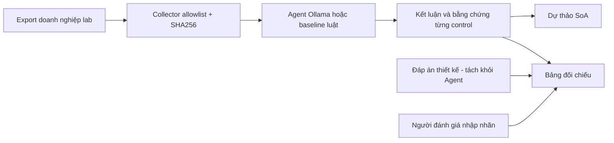

# HIVEFIVE · AI AGENT ĐÁNH GIÁ TUÂN THỦ ISO/IEC 27001:2022

**Đề tài:** Xây dựng hệ thống AI Agent đánh giá tuân thủ an toàn thông tin theo tiêu chuẩn ISO/IEC 27001:2022.

## Phạm vi tổng thể và nhóm ưu tiên

**Phạm vi phải triển khai của đồ án là 56 control:** 8 A.6 con người, 14 A.7 phần cứng/vật lý và 34 A.8 phần mềm/kỹ thuật. Góp ý sau báo cáo tuần 4 yêu cầu ưu tiên làm sâu 18 A.8, thu bằng chứng tự động, đo với người đánh giá và sinh SoA; không thu hẹp toàn bộ đề tài xuống 18 control.

Màn hình mặc định **Phạm vi 56 control** quản lý tiêu chí, bằng chứng, kết luận và SoA đầy đủ phạm vi. **Thực nghiệm 18 A.8** là luồng chuyên sâu riêng. Đã gỡ mã và tài nguyên văn phòng 3D cùng dependency Three.js; tài liệu/ảnh lịch sử vẫn được giữ làm minh chứng phiên bản trước.

Xem [ma trận tiến độ đủ 56 control](docs/MA_TRAN_56_CONTROL.md). Hiện 27 control có kiểm tra lab đại diện, 29 có luồng nhận tài liệu/đánh giá nhưng chưa có collector riêng; chưa coi đã tự động hóa hoặc hoàn thành đủ 56.

## Chức năng

- 18 control: A.8.1, .2, .3, .5, .7, .8, .9, .10, .12, .13, .15, .16, .17, .19, .20, .22, .24, .32.
- 108 hồ sơ raw chủ đích: đạt, một phần, không đạt, thiếu bằng chứng, hết hạn và mâu thuẫn.
- Thu cấu hình/log gốc bằng collector parse text/JSON/CSV/TSV, tính checksum, kiểm tra quyền/CIDR/thời gian; hỗ trợ container Docker cô lập và replay file. Phần dịch vụ chưa triển khai vẫn ghi rõ là cấu hình/log mô phỏng, không phải chứng cứ sản xuất.
- Hai engine tách biệt: Ollama kết luận từ evidence và luật làm baseline; không fallback ngầm.
- Bảng kết quả/đối chiếu từng control, xuất CSV/JSON. Chưa có nhãn người đánh giá thì hiển thị chưa đo.
- Người đánh giá khác tài khoản người khởi chạy chấm mù: API ẩn kết luận Agent/đáp án nhóm/profile đến khi nộp đủ 18 control; nhãn đã nộp được khóa và gắn hash.
- Sinh dự thảo SoA 18 control, xuất JSON/Markdown; có bước người phụ trách duyệt rubric, quyết định tính áp dụng và kế hoạch xử lý trước khi phê duyệt SoA trong phạm vi.

## Kiến trúc



Stack: React/Vite, FastAPI/Pydantic, Ollama Qwen2.5:7b; PostgreSQL cho xác thực và đợt đánh giá hiện hữu. Lượt A.8 và nhãn người đánh giá lưu local theo đợt trong `data/a8-study`, chưa chuyển sang PostgreSQL. Chạy một tiến trình Uvicorn cho worker A.8 hiện tại.

## Khởi động

Xem [hướng dẫn local](CHAY_LOCAL.md). Chuẩn bị `.env`, Python dependency, frontend dependency, PostgreSQL và Ollama. Không đưa mật khẩu/token vào Git.

```powershell
docker compose -f docker-compose.enterprise-lab.yml up -d postgres
docker compose -f docker-compose.a8.yml up -d
.venv\Scripts\python.exe -m uvicorn backend.main:app --host 127.0.0.1 --port 8000
```

Terminal khác:

```powershell
cd frontend-react
npm ci
npm run dev -- --host 127.0.0.1 --port 5173 --strictPort
```

- Ứng dụng: http://127.0.0.1:5173 — mặc định **Phạm vi 56 control**; chọn **Thực nghiệm 18 A.8** để đo chuyên sâu.
- API: http://127.0.0.1:8000/docs.
- Bản React build: http://127.0.0.1:8000, sau `npm run build` trong `frontend-react`.
- Tài khoản admin lần đầu lấy từ `INITIAL_ADMIN_*` trong `.env`; database đã có người dùng không tự đổi mật khẩu khi sửa các biến này.

## Benchmark và kiểm thử

```powershell
.venv\Scripts\python.exe -m agent_core.a8_benchmark --mode rules --output docs/a8-results/baseline-rules.json
.venv\Scripts\python.exe -m agent_core.a8_benchmark --mode llm --output docs/a8-results/ollama-judgments.json
.venv\Scripts\python.exe -m pytest tests -q
cd frontend-react
npm run build
```

Kết quả baseline đúng không phải độ đúng AI. Kết quả đối chiếu đáp án nhóm không phải khảo sát chuyên gia. Bộ ca có rubric hai kiểm tra đại diện/control, gồm raw log/cấu hình và ca hết hạn/mâu thuẫn; vẫn cần người đánh giá độc lập và tập kiểm định tách biệt trước khi suy rộng chất lượng.

## Cấu trúc phần trọng tâm

```text
AI_Agent_ISO27001/
├── lab_a8/
│   ├── catalog.json                   # 18 control, rubric và tính áp dụng đề xuất
│   ├── sources/                       # Bộ export v1 (lịch sử) và raw v2
│   └── reference/designer_labels.json # Đáp án nhóm, không đọc bởi Agent
├── agent_core/
│   ├── a8_assessment.py               # Thu evidence, kết luận, sinh SoA
│   └── a8_benchmark.py                # Đối chiếu và xuất kết quả theo control
├── backend/a8_api.py                  # Job, phân quyền, review theo đợt
├── frontend-react/src/
│   └── A8ComplianceStudy.jsx          # Màn hình đánh giá A.8
├── tests/test_a8_assessment.py         # Kiểm thử luồng mới
├── docs/
│   ├── HUONG_DE_TAI_A8.md             # Phạm vi, thiết kế và phần cần nghiệm thu
│   └── a8-results/                    # Kết quả đo có nguồn engine rõ ràng
└── CHAY_LOCAL.md                      # Hướng dẫn máy phát triển
```

## Kết quả v1 ngày 10/11/2026 — chỉ lưu lịch sử

- 227 test Python và build frontend đạt.
- Baseline luật: 72/72 ca khớp đáp án nhóm.
- Ollama Qwen2.5:7b: **70/72 (97,22%)**, hai lỗi thiếu bằng chứng A.8.15 và A.8.32 được giữ nguyên; không fallback.
- **Chưa có độ đúng so với người đánh giá thực sự.** Bộ ca hiện đơn giản, nhãn thiết kế, một lần lặp; không suy rộng tỷ lệ này sang đánh giá ISO thực tế.

Xem [bảng từng control và kết quả gốc](docs/a8-results/KET_QUA_A8.md), [dự thảo SoA tự sinh](docs/a8-results/SOA_DU_THAO.md) và [ma trận tiêu chí](docs/MA_TRAN_A8.md).

## Phạm vi và giới hạn

Hệ thống hỗ trợ đánh giá trong lab, không chứng nhận ISO. Hai thuộc tính/control là tiêu chí thử nghiệm của nhóm, không phải toàn bộ yêu cầu kiểm soát. SoA tổng thể gồm đủ 56 control, mặc định dự thảo và chưa xác định tính áp dụng; SoA 18 A.8 là báo cáo con. Cần bối cảnh ISMS/đánh giá rủi ro và phê duyệt. Bản raw v2 có giao thức chấm mù trên API/UI; vẫn cần phân công người đánh giá không truy cập đáp án ngoài hệ thống. Chưa có kết quả chuyên gia nếu chưa thu nhãn thật.

Chi tiết: [hướng đề tài A.8, rubric, cách đo và kế hoạch nghiệm thu](docs/HUONG_DE_TAI_A8.md). Tài liệu 3D/benchmark cũ giữ làm lịch sử, không dùng để chứng minh hiệu quả cho phạm vi mới.

## Quy trình hoàn thiện 5 bước — raw v2

Xem [hướng dẫn dựng lab, rubric, collector, chấm mù, đo và phê duyệt SoA](docs/QUY_TRINH_NGHIEM_THU_A8.md). Thao tác chấm/phê duyệt của người thật chưa được thay bằng dữ liệu giả hoặc test tự động.

## Kết quả raw v2 — cấu hình/log gốc và Docker

- 18 control, 108 ca duy nhất, 2 lần lặp = 216 lượt/engine.
- LLM: **206/216 khớp đáp án nhóm (95,37%)**, gồm 4 lỗi engine và 6 lượt sai phân loại đã tính trong mẫu số; baseline luật 216/216.
- 235 test Python và build đạt. Chưa có người thật chấm độc lập/phê duyệt rubric và SoA; không đổi số đo nhóm thành độ đúng so với con người.
- Chấm mù ẩn dự đoán/đáp án/profile và khóa nhãn đã nộp; phê duyệt SoA là thao tác người phụ trách, không tự thực hiện.

Xem [kết quả, giới hạn đo và bảng từng control](docs/a8-results/KET_QUA_RAW_V2.md), [SoA raw v2](docs/a8-results/SOA_RAW_V2.md), [quy trình nghiệm thu 5 bước](docs/QUY_TRINH_NGHIEM_THU_A8.md). Thời gian LLM ghi nhận gồm chờ hàng đợi khi hai tiến trình đo có chồng lấn; không dùng để kết luận tốc độ đơn luồng.

## Hoàn thiện quy trình hồ sơ 56 control

Có connector thu thư mục hồ sơ cho đủ 56 control, checklist nguồn, chế độ Agent chỉ đánh giá tài liệu đã thu, thẩm định có danh tính và phê duyệt SoA toàn phạm vi có kiểm tra phiên bản. Connector tài liệu không được gọi là probe kỹ thuật chuyên biệt cho 29 control còn lại.

Xem [cách chuẩn bị/thu/thẩm định/phê duyệt](docs/THU_HO_SO_VA_THAM_DINH_56.md) và [checklist từng control](docs/CHECKLIST_HO_SO_56.md). Chưa có hồ sơ/người đánh giá thực sự thì vẫn thiếu bằng chứng/chờ phê duyệt; không tạo kết quả người thật để lấp chỗ trống.
