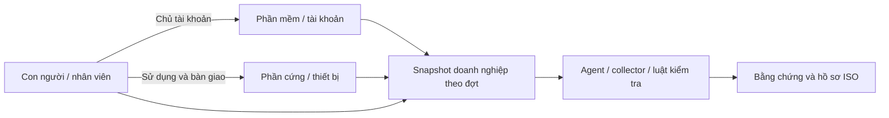
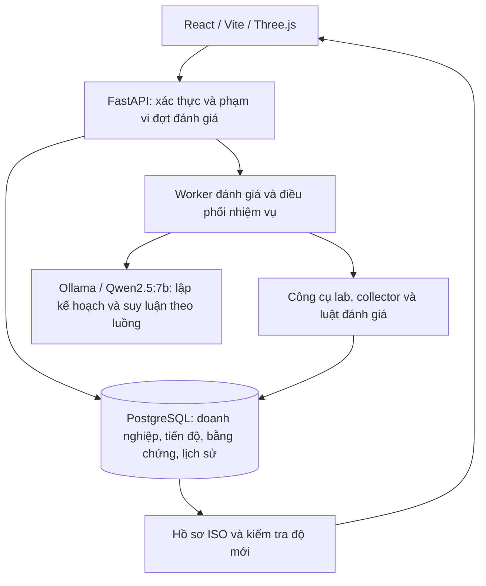

# HIVEFIVE · HỆ THỐNG AI AGENT ĐÁNH GIÁ TUÂN THỦ AN TOÀN THÔNG TIN

## MÔ HÌNH 3 TRỤ CỘT: CON NGƯỜI · PHẦN MỀM · PHẦN CỨNG VÀ VĂN PHÒNG TƯƠNG TÁC 3D


## 📌 Tổng quan đề tài

**Tên đề tài:** Xây dựng hệ thống AI Agent đánh giá tuân thủ an toàn thông tin theo tiêu chuẩn ISO/IEC 27001:2022.

**HiveFive** là tên hệ thống minh họa trong đồ án chuyên ngành, triển khai theo mô hình doanh nghiệp giả lập với ba trụ cột liên kết: con người, phần mềm và phần cứng.

Đồ án xây dựng hệ thống hỗ trợ thu thập bằng chứng, đánh giá một số kiểm soát an toàn thông tin, theo dõi khắc phục và lưu hồ sơ trong **doanh nghiệp giả lập**. Văn phòng tương tác 3D giúp quan sát nhân viên, thiết bị và hoạt động Agent; kết quả hiển thị được liên kết với dữ liệu và quá trình thực thi backend.

Hệ thống hỗ trợ người đánh giá, chưa phải sản phẩm chứng nhận ISO hoặc công cụ kết luận toàn doanh nghiệp tuân thủ.

## 🚀 Các chức năng đã triển khai

| Chức năng | Nội dung hiện có |
|---|---|
| Doanh nghiệp dùng chung | Danh bạ nhân viên, tài khoản và thiết bị trong PostgreSQL theo đợt đánh giá; các màn hình web cùng sử dụng nguồn này |
| Văn phòng 3D | Three.js, chọn nhân viên/máy/phòng, camera xoay và theo nhân viên, di chuyển tránh vật cản; có lựa chọn sơ đồ 2D |
| Bình luận điều khiển | Gửi lệnh cho nhân viên cụ thể; kiểm tra điều kiện hành động, lưu dấu vết và chống trùng yêu cầu |
| Giám sát sự kiện | Phát hiện và xử lý ba hành vi lab: USB chưa đăng ký, cài ứng dụng chưa duyệt, rời máy không khóa |
| Giao việc cho Agent | Chọn vai trò và mục tiêu; lập kế hoạch có ràng buộc, thực thi công cụ, theo dõi công việc con, phản hồi và hồ sơ chờ duyệt |
| Hồ sơ ISO | Tiêu chí, kết luận, bằng chứng, lịch sử, tái đánh giá và xuất JSON; cảnh báo khi dữ liệu nguồn thay đổi |
| Công việc chung | Thành viên cùng đợt xem tiến độ, người phụ trách; theo dõi job có sẵn và dùng lại kết quả còn mới |
| Tiếp tục tự động | Chọn kiểm soát có collector còn cần xử lý, chạy tối đa 12 mục/lượt khi trang Hồ sơ ISO đang mở; dừng khi lỗi hoặc người dùng yêu cầu |

Tại lượt kiểm chứng bản doanh nghiệp dùng chung, dữ liệu lab có **50 nhân viên, 50 máy văn phòng riêng, 202 tài khoản và 70 thiết bị phần cứng**. Các số lượng là dữ liệu mô phỏng tại thời điểm kiểm tra, không phải giới hạn cố định của mọi đợt.

## 🏢 Mô hình doanh nghiệp 3 trụ cột

| Trụ cột | Dữ liệu và vai trò trong hệ thống |
|---|---|
| Con người | Hồ sơ nhân viên, trạng thái đào tạo, cam kết và sự kiện nhân sự; là trọng tâm của nhóm kiểm soát A.6 |
| Phần mềm | Tài khoản, quyền truy cập, MFA và trạng thái dịch vụ lab; liên kết với chủ tài khoản |
| Phần cứng | Máy văn phòng, thiết bị và tài sản lab; liên kết người sử dụng và trạng thái bảo vệ |



Ví dụ: nhân viên nghỉ việc nhưng tài khoản còn hoạt động hoặc thiết bị chưa bàn giao sẽ tạo dấu hiệu cần kiểm tra chéo. Hoàn tất một hành động khắc phục chỉ cập nhật dữ kiện liên quan; kết luận kiểm soát phải được đánh giá lại dựa trên bằng chứng.

Các quan hệ và trạng thái trên web cùng lấy từ PostgreSQL theo đợt đánh giá. CLI/benchmark nghiên cứu dùng fixture riêng để giữ khả năng tái lập, không phải nguồn trạng thái vận hành của văn phòng.

## 🔄 Luồng hoạt động

### Bình luận và xử lý vi phạm

1. Chọn nhân viên và gửi lệnh, ví dụ `cắm USB lạ`.
2. Backend kiểm tra điều kiện; trong văn phòng 3D có thể chuẩn bị vào ca/về bàn nếu hợp lệ, rồi ghi sự kiện cho đúng người/máy.
3. Bộ giám sát phát hiện dấu vết; SOC xử lý bằng công cụ lab và xác minh kết quả.
4. Giao diện hiển thị trạng thái, nguồn thực thi và liên kết hồ sơ sự cố.

Đây là nhận diện từ sự kiện/telemetry mô phỏng, không phải nhận diện người hoặc hành vi qua camera. Sự kiện vừa nhận chưa được coi là đã xác minh.

### Giao việc và đánh giá dùng chung

1. Người dùng giao nhiệm vụ cho vai trò phù hợp hoặc chọn kiểm soát trong Hồ sơ ISO.
2. Tùy luồng, hệ thống dùng kế hoạch LLM có kiểm tra công cụ/phạm vi hoặc workflow/luật xác định; nguồn thực thi được ghi riêng.
3. Công cụ thu thập, kiểm tra và lưu kết quả cùng bằng chứng, định danh và lịch sử.
4. Thành viên khác trong cùng đợt xem được kết quả; nếu đang chạy thì theo dõi job chung, nếu kết quả còn mới thì dùng lại.
5. Bộ chọn việc tiếp theo ưu tiên kết quả cần tái đánh giá rồi đến mục chưa chạy/lỗi. Hồ sơ chờ bằng chứng hoặc chờ duyệt không tự chạy lặp khi nguồn chưa đổi.

**Đã kiểm tra không đồng nghĩa đã đáp ứng kiểm soát.** Một nhân viên vào ca không tự hoàn thành A.6.1; kết luận phải dựa trên bằng chứng thẩm tra. Agent không tự phê duyệt hồ sơ.

## 🧠 Kiến trúc Agent và công nghệ



- **Frontend:** React, Vite, Three.js, Tailwind CSS và Lucide.
- **Backend:** Python, FastAPI, Pydantic; worker nội tiến trình cho các job đánh giá.
- **Agent:** LangGraph ở luồng đánh giá; bộ lập kế hoạch nhiệm vụ kiểm tra JSON, công cụ cho phép, thứ tự và mục tiêu trước khi chạy.
- **Mô hình local:** Ollama, mặc định `qwen2.5:7b`.
- **Lưu trữ:** PostgreSQL theo `assessment_id`. Một số trace/fixture nghiên cứu dùng lưu trữ riêng, không thay nguồn doanh nghiệp web.
- **Bốn vai trò:** Điều phối, Tài sản & nhân sự, SOC, Kiểm soát nội bộ; dùng chung bộ điều phối, chưa phải bốn LLM độc lập.
- **Memory và truy hồi:** có ngữ cảnh từ hồ sơ đã nhận xét; `iso_rag.py` dùng truy hồi từ khóa trên kho kiến thức viết sẵn, chưa phải vector RAG.

## 📋 Phạm vi đánh giá

- Danh mục có **56 kiểm soát**; không đồng nghĩa tự động đánh giá đủ 56 hoặc toàn bộ ISO/IEC 27001.
- Hiện hỗ trợ **12 collector**: A.6.1–A.6.8 trên dữ liệu doanh nghiệp chung và bốn collector lab A.7.1, A.8.5, A.8.13, A.8.20.
- Ba dấu hiệu văn phòng chỉ phản ánh một phần các kiểm soát liên quan. Xử lý một sự cố không tự trở thành kết luận tuân thủ toàn kiểm soát.
- Tiêu chí, ngưỡng và công thức rủi ro lab là chính sách dự án, không phải yêu cầu bắt buộc được suy ra từ ISO.

Xem [ma trận phạm vi, tiêu chí và nguồn bằng chứng](docs/PHAM_VI_DANH_GIA.md).

## 🛠️ Cài đặt lần đầu

Cần Python có hỗ trợ các dependency trong `requirements.txt` (môi trường hiện tại dùng Python 3.12.1), Node.js 20.19+ hoặc 22.12+ và npm tương thích Vite (máy hiện tại dùng Node.js 24.12.0), Docker Desktop chạy Linux containers và Ollama.

Chạy các lệnh từ thư mục gốc repository trong PowerShell:

```powershell
python -m venv .venv
.\.venv\Scripts\python.exe -m pip install -r requirements.txt
.\.venv\Scripts\python.exe -m pip install -r requirements-dev.txt pytest
Copy-Item .env.example .env
```

Nếu đã có `.env`, giữ cấu hình hiện tại. Trước khi khởi động, chỉnh `.env`:

| Biến | Ý nghĩa |
|---|---|
| `POSTGRES_PASSWORD` | Mật khẩu PostgreSQL do bạn chọn |
| `POSTGRES_PORT` | Cổng trên máy host; có thể đặt `5433` nếu `5432` đang được dùng |
| `DATABASE_URL` | URI PostgreSQL với user `iso27001_app`, database `iso27001`, mật khẩu và cổng khớp cấu hình Docker |
| `OLLAMA_HOST` | Mặc định `http://localhost:11434` |
| `OLLAMA_MODEL` | Mặc định `qwen2.5:7b` |
| `INITIAL_ADMIN_USERNAME` | Tên admin được tạo khi database chưa có thành viên |
| `INITIAL_ADMIN_PASSWORD` | Mật khẩu admin ban đầu, tối thiểu 12 ký tự |

`.env.example` mặc định dùng cổng PostgreSQL **5432**; máy phát triển hiện tại dùng **5433**. Khi đổi cổng phải sửa cả `POSTGRES_PORT` và `DATABASE_URL`. Nếu mật khẩu có ký tự đặc biệt, mã hóa phần mật khẩu đúng chuẩn URI trong `DATABASE_URL`.

Không đưa `.env`, mật khẩu hoặc token lên Git. Với database đã có người dùng, đổi biến `INITIAL_ADMIN_PASSWORD` không tự đổi mật khẩu tài khoản hiện hữu. Tương tự, đổi mật khẩu trong `.env` không tự đổi mật khẩu database đã khởi tạo trong volume.

Cài frontend và tải model:

```powershell
cd frontend-react
npm ci
cd ..
ollama pull qwen2.5:7b
```

## ▶️ Khởi chạy hệ thống

Mở Docker Desktop và Ollama. Nếu Ollama chưa chạy dịch vụ, chạy `ollama serve` trong terminal riêng.

Khởi động PostgreSQL và backend từ thư mục gốc:

```powershell
docker compose -f docker-compose.enterprise-lab.yml up -d postgres
.\.venv\Scripts\python.exe -m uvicorn backend.main:app --host 127.0.0.1 --port 8000
```

Chờ PostgreSQL sẵn sàng trước khi chạy backend. Backend khởi tạo schema và dữ liệu nền khi startup. Lệnh trên chỉ khởi động PostgreSQL, không cần chạy toàn bộ container lab để sử dụng giao diện hiện hành.

Mở terminal khác để chạy frontend:

```powershell
cd frontend-react
npm run dev -- --host 127.0.0.1 --port 5173 --strictPort
```

| Địa chỉ | Chức năng |
|---|---|
| http://127.0.0.1:5173 | Giao diện React khi phát triển |
| http://127.0.0.1:8000 | Giao diện React đã build, cần có `frontend-react/dist` |
| http://127.0.0.1:8000/simulation | Mô phỏng Triad |
| http://127.0.0.1:8000/docs | Tài liệu API FastAPI |

Đăng nhập bằng tài khoản đã tạo trong database; lần đầu dùng các biến `INITIAL_ADMIN_*` trong `.env`. Phiên đăng nhập ở cổng 5173 và 8000 tách biệt: dùng Triad tại 8000 thì đăng nhập tại trang gốc 8000 trước.

Chi tiết cho máy phát triển hiện tại: [CHAY_LOCAL.md](CHAY_LOCAL.md).

## 🧪 Build, kiểm thử và kết quả kiểm chứng

```powershell
cd frontend-react
npm run lint
npm run build
cd ..
.\.venv\Scripts\python.exe -m pytest tests -q
node --test tests/*.test.mjs
```

Sau build, backend phục vụ bản React tại cổng 8000. Nếu backend được mở trước lần build đầu tiên, khởi động lại backend để nhận bản build.

Mốc kiểm chứng phần công việc chung ngày **08/11/2026**: **210 test Python đạt**, build frontend thành công; lint còn cảnh báo hiện có và build còn cảnh báo kích thước chunk Three.js. Đây là kết quả đã ghi nhận, không phải cam kết mọi môi trường đều đạt hoặc toàn bộ UI đã được kiểm thử.

Test Python cô lập bước khởi tạo PostgreSQL; cần kiểm tra API/database/Ollama riêng cho luồng thực. Xem [kiểm chứng công việc chung](docs/CONG_VIEC_CHUNG_AGENT.md) và [kiểm chứng văn phòng 3D](docs/VAN_PHONG_AGENT_3D.md).

## 📊 Đánh giá thực nghiệm

Benchmark ngày **06/11/2026** dùng 8 ca tổng hợp tự xây dựng và cùng snapshot/evaluator cho ba chế độ:

| Chế độ | Khớp nhãn kỳ vọng | Thời gian trung bình |
|---|---|---|
| Luật (rules) | 8/8 | 4,69 ms |
| Workflow | 8/8 | 24,07 ms |
| AI | 8/8 | 9.361,26 ms |

Mỗi ca mới chạy một lần lặp; kết quả không chứng minh LLM phân loại tốt hơn luật. Vai trò của LLM trong phạm vi hiện tại là lựa chọn công cụ và diễn giải mục tiêu. Tám ca cố ý gây lỗi model được kiểm tra phục hồi riêng, không tính là tỷ lệ fallback trong vận hành. Xem [thiết kế và kết quả gốc](docs/KIEM_CHUNG_DANH_GIA.md).

**Chưa có khảo sát người dùng thật hoặc điểm SUS được kiểm chứng.** Script khảo sát cũ sinh dữ liệu tổng hợp; không dùng làm kết quả thực nghiệm đồ án. Không công bố tỷ lệ AI vượt luật từ các tập ca không cùng điều kiện đánh giá.

## 🏛️ CẤU TRÚC THƯ MỤC DỰ ÁN

Các thư mục và file tiêu biểu của phiên bản hiện tại:

```text
AI_Agent_ISO27001/
├── agent_core/                          # Luồng Agent và đánh giá nghiên cứu
│   ├── graph_builder.py                 # Graph đánh giá và xác minh bằng chứng
│   ├── autonomous.py                    # Điều phối công cụ trong phạm vi giới hạn
│   ├── triad.py                         # Quan hệ và rủi ro giữa ba trụ cột
│   ├── iso_rag.py                       # Truy hồi từ khóa trên kho kiến thức ISO
│   ├── unstructured_evidence.py         # Phân tích bằng chứng văn bản phi cấu trúc
│   ├── simulation.py                    # Đánh giá tám kiểm soát con người A.6
│   ├── live.py                          # Logic giám sát mô phỏng
│   └── research_benchmark.py            # Benchmark luật, workflow và AI
├── backend/                             # FastAPI và nghiệp vụ doanh nghiệp
│   ├── main.py                          # Khởi tạo ứng dụng và tích hợp API
│   ├── database.py                      # Kết nối và khởi tạo PostgreSQL
│   ├── teamwork.py                      # Thành viên, tiến độ, job và lịch sử
│   ├── company.py                       # Nguồn nhân viên, tài khoản, thiết bị chung
│   ├── company_evidence.py              # Bằng chứng gắn định danh và snapshot
│   ├── employee_commands.py             # Nhận lệnh nhân viên và chống trùng yêu cầu
│   ├── office_logic.py                  # Quy tắc trạng thái và điều kiện hành động
│   ├── mission_planner.py               # Lập và kiểm tra kế hoạch nhiệm vụ LLM
│   ├── enterprise_missions.py           # Thực thi nhiệm vụ theo vai trò
│   ├── shared_work.py                   # Dùng lại kết quả và chọn việc tiếp theo
│   ├── compliance_report.py             # Tổng hợp Hồ sơ ISO và độ mới bằng chứng
│   └── static/                          # Tài nguyên giao diện mô phỏng cũ
│       ├── campus.js                    # Cảnh 3D khuôn viên mô phỏng
│       ├── live.js                      # Hiển thị giám sát Live
│       └── index.html                   # Trang mô phỏng tĩnh
├── frontend-react/                      # Giao diện React/Vite hiện hành
│   ├── src/
│   │   ├── App.jsx                      # Đăng nhập và điều hướng
│   │   ├── EnterpriseIncident3D.jsx      # Tích hợp văn phòng và nhiệm vụ
│   │   ├── OfficeInteractive3D.jsx       # Tương tác chọn người, máy và phòng
│   │   ├── office3dEngine.js             # Cảnh Three.js, camera và hoạt ảnh
│   │   ├── office3dModel.js              # Dữ liệu cảnh và tìm đường
│   │   ├── AgentOfficeConsole.jsx        # Bình luận giao việc cho vai trò Agent
│   │   ├── EnterpriseMissionControl.jsx  # Theo dõi nhiệm vụ và kết quả
│   │   ├── CompanyInventory.jsx          # Danh mục doanh nghiệp dùng chung
│   │   └── ComplianceDossier.jsx         # Hồ sơ ISO và tiếp tục công việc chung
│   ├── package.json                     # Dependency và lệnh frontend
│   └── vite.config.js                   # Build và proxy API
├── frontend/                            # Trang bổ trợ còn được backend tham chiếu
├── evidence_collectors/                 # Thu thập và phân tích tài liệu bằng chứng
├── docs/                                # Thiết kế, phạm vi và minh chứng
│   ├── PHAM_VI_DANH_GIA.md              # Kiểm soát, tiêu chí và nguồn bằng chứng
│   ├── DOANH_NGHIEP_DUNG_CHUNG.md        # Nguồn dữ liệu và định danh thống nhất
│   ├── VAN_PHONG_AGENT_3D.md             # Thiết kế và kiểm chứng văn phòng 3D
│   ├── CONG_VIEC_CHUNG_AGENT.md          # Tiến độ chung và tiếp tục tự động
│   ├── KIEM_CHUNG_DANH_GIA.md            # Benchmark và giới hạn thực nghiệm
│   ├── TRIAD-ARCHITECTURE.md             # Thiết kế mô hình ba trụ cột
│   ├── SLIDE-THUYET-TRINH.md             # Nội dung slide bảo vệ
│   └── KICH-BAN-BAO-VE-HOI-DONG.md       # Kịch bản trình bày và vấn đáp
├── tests/                               # Kiểm thử Python và JavaScript
├── ke_hoach_nhat_ky_tuan/                # Nhật ký tuần 1–4 và kế hoạch tuần 5
├── tasks/                               # Theo dõi công việc phát triển
├── vi_du_kho_bang_chung/                 # Manifest kho bằng chứng ví dụ
├── docker-compose.enterprise-lab.yml     # PostgreSQL và các container lab tùy chọn
├── requirements.txt                     # Dependency Python của ứng dụng
├── requirements-dev.txt                 # Dependency bổ trợ phát triển
├── .env.example                         # Mẫu cấu hình, không chứa bí mật thực tế
├── CHAY_LOCAL.md                        # Hướng dẫn chạy trên máy phát triển
├── run_agent_cli.py                     # Điểm vào CLI nghiên cứu và demo
├── run_user_study.py                    # Sinh dữ liệu khảo sát giả lập, không phải khảo sát thật
├── week1_benchmark.py                   # Benchmark giai đoạn đầu
├── week3_benchmark.py                   # Benchmark tuần 3
└── README.md                            # Tổng quan và hướng dẫn đồ án
```

`data/`, `work/`, `.venv/`, `node_modules/` và `dist/` là dữ liệu local, môi trường, artifact thử hoặc bản build được bỏ qua trong Git; không xóa dữ liệu local nếu chưa xác định vai trò và nhu cầu giữ lịch sử.

## ⚠️ Giới hạn và hướng phát triển

- Chưa tích hợp HR/IAM/EDR thật, bình luận TikTok hoặc tự tạo nhân vật từ tài khoản người bình luận.
- Lượt tiếp tục tự động cần giữ trang Hồ sơ ISO mở; chưa có scheduler nền bền vững. Job đã giao vẫn lưu kết quả trên server khi đóng trang.
- Chống trùng đánh giá ở mức **đợt + kiểm soát**; chưa phải hàng đợi đánh giá tăng dần từng nhân viên.
- Thay đổi hash toàn snapshot có thể khiến nhiều kiểm soát cần tái đánh giá; chưa tối ưu phụ thuộc từng trường dữ liệu.
- Phân biệt kết quả từ luật, LLM và `policy-fallback`; có lượt SOC kiểm chứng dùng fallback. Không nhận toàn bộ xử lý là LLM thành công.
- Chưa kiểm thử bấm toàn bộ UI có đăng nhập hoặc lượt tự động nhiều bước qua trình duyệt.
- Benchmark dùng ca tổng hợp tự xây dựng, chưa có tập kiểm định mù/nhãn chuyên gia. `run_user_study.py` sinh dữ liệu random, không phải khảo sát người thật.
- Kết quả lịch sử trong `docs/charts` và `docs/week3` phải đọc kèm nguồn, tập ca và thời điểm. Test phần mềm đạt không chứng minh chất lượng đánh giá ISO hay lợi ích riêng của LLM.

## 📚 Tài liệu đồ án và bảo vệ

- [Doanh nghiệp dùng chung](docs/DOANH_NGHIEP_DUNG_CHUNG.md)
- [Văn phòng Agent 3D](docs/VAN_PHONG_AGENT_3D.md)
- [Bình luận điều khiển](docs/BINH_LUAN_DIEU_KHIEN.md)
- [Kiến trúc Agent áp dụng từ video](docs/KIEN_TRUC_AGENT_TU_VIDEO.md)
- [Trụ sở điều phối](docs/TRU_SO_DIEU_PHOI.md)
- [Công việc chung và tự động tiếp tục](docs/CONG_VIEC_CHUNG_AGENT.md)
- [Kết quả kiểm chứng đánh giá](docs/KIEM_CHUNG_DANH_GIA.md)
- [Quy trình đánh giá và khảo sát](docs/BAO-VE-VA-KHAO-SAT.md)
- [Kế hoạch và nhật ký tuần](ke_hoach_nhat_ky_tuan/README.md)

- [Thiết kế mô hình ba trụ cột](docs/TRIAD-ARCHITECTURE.md)
- [Nội dung slide thuyết trình](docs/SLIDE-THUYET-TRINH.md)
- [Kịch bản bảo vệ và vấn đáp](docs/KICH-BAN-BAO-VE-HOI-DONG.md)
- [Tình trạng dữ liệu khảo sát RQ3](docs/KET-QUA-KHAO-SAT-RQ3.md)

---

*Đồ án chuyên ngành — 2026. Hệ thống hỗ trợ đánh giá trong môi trường mô phỏng; kết quả cần được người phụ trách xem xét trong phạm vi bằng chứng thực tế.*
