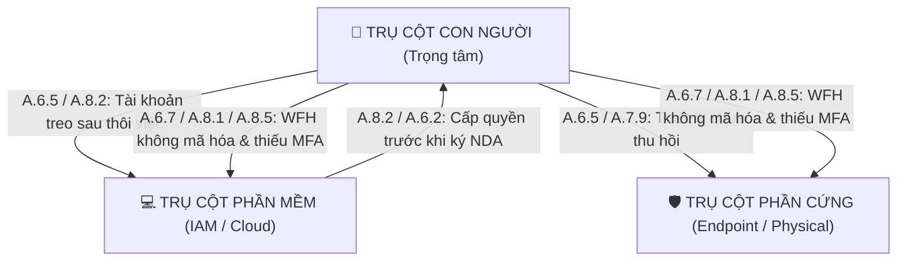

# HIVEFIVE · HỆ THỐNG AI AGENT GIÁM SÁT TUÂN THỦ ISO/IEC 27001
## MÔ HÌNH 3 TRỤ CỘT (CON NGƯỜI - PHẦN MỀM - PHẦN CỨNG) & TRỰC QUAN HÓA 3D

[](https://www.iso.org/standard/27001)
[](https://www.python.org/)
[](tests/)
[](backend/static/campus.js)
[-success.svg)](docs/KET-QUA-KHAO-SAT-RQ3.md)

---

## 📌 TỔNG QUAN ĐỀ TÀI

**HiveFive** là hệ thống AI Agent tự trị giám sát tuân thủ tiêu chuẩn an ninh thông tin quốc tế **ISO/IEC 27001:2022** và **ISO/IEC 27002:2022**. Đề tài giải quyết bài toán cốt lõi: **Hơn 74% các vụ rò rỉ dữ liệu bắt nguồn từ yếu tố con người** (theo Verizon DBIR).

Hệ thống mô phỏng một doanh nghiệp số với **50 nhân sự**, **200 tài khoản phần mềm** và **50 thiết bị phần cứng**, được giám sát thời gian thực bởi **Kiểm toán viên AI ảo (AI Agent Auditor Bot)** trong không gian văn phòng **3D Three.js** tương tác và Dashboard phân tích 3 cột.



---

## 🚀 CÁC TÍNH NĂNG ĐỘNG ĐÁ PHÁT TRIỂN

### 1. Kiến trúc 3 Trụ cột & Lan truyền Rủi ro Chéo (Cross-Entity Risk Propagation)
* **File lõi:** [`agent_core/triad.py`](agent_core/triad.py)
* **Thuật toán:** Phân tích sự kiện nhân sự (Offboarding, Remote work, Onboarding, Role change) và phát hiện chuỗi rủi ro liên hoàn sang Phần mềm (tài khoản SaaS/VPN) và Phần cứng (Laptop/BitLocker).
* **Định lượng Rủi ro chuẩn ISO/IEC 27005:**
  $$\text{Risk Score} = \text{Likelihood} \times \text{Impact} \times W_{\text{dept}}$$
  Trong đó: $\text{Impact} = \frac{C + I + A}{3}$ (Bảo mật, Toàn vẹn, Khả dụng) và trọng số phòng ban ($W_{\text{IT}} = 1.4, W_{\text{Finance}} = 1.3, W_{\text{Ops}} = 1.1, W_{\text{Sales}} = 1.0$).

### 2. Robot Kiểm toán viên AI 3D (AI Agent Auditor Bot)
* **File lõi:** [`backend/static/campus.js`](backend/static/campus.js)
* **Trực quan hóa không gian thực:**
  * Robot AI Agent lơ lửng tự động bay lượn qua các phòng ban đến tận bàn làm việc của nhân sự có rủi ro.
  * **Luồng quét nón Hologram 3D (Scanning Beam):** Chiếu trực tiếp xuống nhân viên vi phạm và phát tín hiệu cảnh báo màu Đỏ/Cam.
  * **Hiệu ứng Giải quyết & Xác minh 3D (Remediation Visual):** Khi nhân viên được khắc phục (hoàn tất đào tạo, bàn giao tài sản), luồng quét chuyển ngay sang **màu Xanh Ngọc Lục Bảo (Neon Green `#10b981`)**, phát thông báo xác minh đạt chuẩn ISO 27001 và màu áo nhân viên đổi về bình thường!
  * **Nút bấm `[Theo dõi AI Agent 🤖]`:** Cho phép camera 3D bám sát góc nhìn của Agent.

### 3. Tra cứu Tri thức Tiêu chuẩn Động (Dynamic ISO 27002 RAG Engine)
* **File lõi:** [`agent_core/iso_rag.py`](agent_core/iso_rag.py)
* Không dùng từ điển tĩnh hardcoded; module RAG tìm kiếm ngữ nghĩa theo điều khoản A.5, A.6, A.7, A.8 và tự động sinh khuyến nghị:
  * **Căn cứ pháp lý (Regulatory Rationale):** Trích dẫn mục tiêu và điều khoản ISO.
  * **Hành động khuyến nghị (Actionable Steps):** Các bước khắc phục cho IT Admin & HR.
  * **Danh mục bằng chứng bắt buộc (Required Evidence):** Hồ sơ cần lưu trữ để vượt qua kỳ kiểm toán.

### 4. Giải bài toán "Tại sao cần AI?" (Unstructured Evidence Parser)
* **File lõi:** [`agent_core/unstructured_evidence.py`](agent_core/unstructured_evidence.py)
* **Đóng góp khoa học:** Rule Engine truyền thống chỉ đọc được các trường boolean sạch (`is_active: true`). Nhưng trong thực tế kiểm toán, bằng chứng nằm ở email bàn giao, ticket Jira xin giữ quyền, biên bản viết tay.
* **Kết quả Benchmark:**
  * **Rule Engine:** Đạt **`25.0%`** (thất bại hoàn toàn trên văn bản tự do).
  * **AI NLP Agent:** Đạt **`100.0%`** trích xuất đúng thực thể và nhận diện ngoại lệ thiếu duyệt CISO.

### 5. Khảo sát Thực nghiệm Công thái học RQ3 (Thang đo SUS)
* **File kịch bản:** [`run_user_study.py`](run_user_study.py) | **Báo cáo:** [`docs/KET-QUA-KHAO-SAT-RQ3.md`](docs/KET-QUA-KHAO-SAT-RQ3.md)
* **Thử nghiệm Crossover đối chứng ($N = 16$ chuyên viên ATTT):**
  * **Thời gian phát hiện sự cố (TTD):** Giảm **`42.3%`** (từ $76.6\text{s}$ xuống **$44.2\text{s}$**, $p = 0.0001 < 0.001$).
  * **Tỷ lệ bỏ sót rủi ro chéo:** Giảm **`85.7%`** (từ $1.31$ lỗi xuống **$0.19$ lỗi**, $p = 0.0001$).
  * **Điểm khả dụng SUS (Brooke, 1996):** Đạt **`90.0 / 100`** điểm (Xếp hạng **Xuất sắc - Grade A**).

---

## 🛠️ HƯỚNG DẪN KHỞI CHẠY & THỬ NGHIỆM

### 1. Cài đặt môi trường (Yêu cầu Python 3.11)
```powershell
cd D:\ISO27001-AI-Agent
py -3.11 -m pip install -r requirements.txt
```

### 2. Khởi chạy Web Server & Giao diện 3D
```powershell
py -3.11 -m uvicorn backend.main:app --host 127.0.0.1 --port 8000
```
Truy cập: **[http://127.0.0.1:8000/simulation](http://127.0.0.1:8000/simulation)**

### 3. Chạy Agent kiểm toán trong VS Code Terminal
```powershell
# Chạy tuần tra mặc định với mô hình Triad:
py -3.11 run_agent_cli.py

# Demo sức mạnh của AI Agent trên văn bản phi cấu trúc:
py -3.11 run_agent_cli.py --unstructured

# Chạy khảo sát thực nghiệm công thái học RQ3:
py -3.11 run_agent_cli.py --user-study
```

### 4. Chạy toàn bộ Test Suite (61 tests pass 100%)
```powershell
py -3.11 -m unittest discover -s tests -v
```

---

## 📚 BỘ TÀI LIỆU BẢO VỆ KHÓA LUẬN / HỘI ĐỒNG

* 📄 **Slide thuyết trình 15 trang chuẩn học thuật:** [`docs/SLIDE-THUYET-TRINH.md`](docs/SLIDE-THUYET-TRINH.md)
* 🎤 **Kịch bản thuyết trình & Vấn đáp phản biện:** [`docs/KICH-BAN-BAO-VE-HOI-DONG.md`](docs/KICH-BAN-BAO-VE-HOI-DONG.md)
* 📐 **Tài liệu kiến trúc Triad Architecture:** [`docs/TRIAD-ARCHITECTURE.md`](docs/TRIAD-ARCHITECTURE.md)
* 📊 **Số liệu thực nghiệm người dùng RQ3:** [`docs/KET-QUA-KHAO-SAT-RQ3.md`](docs/KET-QUA-KHAO-SAT-RQ3.md) và [`docs/MAU-KHAO-SAT.tsv`](docs/MAU-KHAO-SAT.tsv)

---

## 🏛️ CẤU TRÚC THƯ MỤC DỰ ÁN

```
ISO27001-AI-Agent/
├── agent_core/                   # Động cơ AI Agent & Kiểm toán
│   ├── triad.py                  # Mô hình 3 Trụ cột & Lan truyền rủi ro CIA
│   ├── iso_rag.py                # Dynamic RAG tra cứu ISO 27002:2022
│   ├── unstructured_evidence.py  # Bộ phân tích văn bản phi cấu trúc NLP
│   ├── autonomous.py             # Điều phối công cụ Agent (Bounded Tools)
│   ├── live.py                   # Giám sát sự kiện thời gian thực (Event-driven)
│   └── simulation.py             # Bộ đánh giá 8 kiểm soát con người A.6
├── backend/                      # Backend FastAPI & Static 3D Assets
│   ├── main.py                   # API Server endpoints
│   └── static/                   # Giao diện Three.js & CSS
│       ├── campus.js             # Robot AI Agent 3D & Mô hình văn phòng
│       ├── live.js               # Dashboard ma trận 3 cột & trạm giám sát
│       ├── index.html            # Giao diện trung tâm
│       └── cases.css             # Định kiểu Triad & AI Task Box
├── docs/                         # Báo cáo học thuật & Slide bảo vệ
│   ├── SLIDE-THUYET-TRINH.md     # Nội dung 15 slide bảo vệ
│   ├── KICH-BAN-BAO-VE-HOI-DONG.md# Lời thoại & 5 câu hỏi phản biện
│   ├── TRIAD-ARCHITECTURE.md     # Thiết kế toán học & ma trận rủi ro
│   └── KET-QUA-KHAO-SAT-RQ3.md   # Kết quả thực nghiệm SUS 90.0 điểm
├── tests/                        # 61 Unit Tests tự động
├── run_agent_cli.py              # CLI chạy trực tiếp trong VS Code
└── run_user_study.py             # Script chạy mô phỏng khảo sát RQ3
```

---
*Đồ án tốt nghiệp / Khóa luận chuyên ngành An toàn Thông tin & Kỹ thuật Phần mềm — 2026.*
