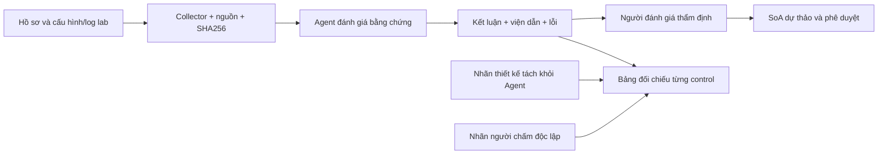

# HIVEFIVE · AI AGENT ĐÁNH GIÁ TUÂN THỦ ISO/IEC 27001:2022

**Đề tài:** Xây dựng hệ thống AI Agent đánh giá tuân thủ an toàn thông tin theo tiêu chuẩn ISO/IEC 27001:2022.

## Phạm vi

Đồ án quản lý **56 control: 8 A.6 con người, 14 A.7 vật lý/phần cứng và 34 A.8 kỹ thuật/phần mềm**. Nhóm **18 A.8** được ưu tiên thực nghiệm sâu theo góp ý giảng viên, không thay thế 38 control còn lại.

Hiện 27 control có kiểm tra lab đại diện; 29 có connector hồ sơ và quy trình thẩm định nhưng chưa có probe chuyên biệt. Trong nguồn live A.8, mới 5 control có probe; 13 control chưa hỗ trợ trả thiếu bằng chứng. Không coi đã tự động hóa hoặc đáp ứng đủ 56 control.

## Chức năng hiện hành

- Quản lý phạm vi, tiêu chí, nhân viên, tài khoản, thiết bị và hồ sơ theo đợt đánh giá.
- Thu tài liệu/cấu hình/log, kiểm tra nguồn/hash/phiên bản và chống nhập trùng; chế độ chỉ đánh giá hồ sơ đã thu không dùng preset thay thế.
- Agent đánh giá bằng chứng qua LangGraph/Ollama; kiểm tra viện dẫn và kết luận, lưu lỗi, không fallback ngầm.
- Thực nghiệm 18 A.8: 108 ca raw thuộc 6 profile; tách LLM, baseline luật và nguồn nhãn.
- Thu live A.8.3/.10/.13/.15/.19 từ container cô lập; replay raw v2 là nguồn riêng.
- Admin điều phối tạo lượt; assessor chấm mù bằng tài khoản khác. Nhãn được khóa và gắn hash; không xuất answer key đầy đủ cho người chấm.
- Theo dõi công việc dùng chung, thẩm định có danh tính và sinh SoA dự thảo đủ 56 dòng, với bước người phụ trách quyết định tính áp dụng và phê duyệt.

Văn phòng, bình luận điều khiển nhân vật, mission/SOC demo, giao diện HTML cũ và các khảo sát tổng hợp không còn nằm trong mã hiện hành. Các đường trang cũ chuyển về ứng dụng React; API demo đã gỡ. Lịch sử phát triển còn trong Git và nhật ký tuần.

## Kiến trúc



Stack: React/Vite, FastAPI/Pydantic, LangGraph, Ollama Qwen2.5:7b và PostgreSQL. Lượt A.8/settings lưu local trong `data/a8-study`; hiện yêu cầu **một tiến trình Uvicorn**. Chưa có worker/hàng đợi phân tán.

## Cấu trúc thư mục

```text
AI_Agent_ISO27001/
├── agent_core/
│   ├── graph_builder.py       # Đánh giá hồ sơ qua LangGraph
│   ├── a8_assessment.py       # Kết luận từ bằng chứng, guard và SoA A.8
│   ├── a8_benchmark.py        # Đo theo control, tách nguồn nhãn/engine
│   ├── people_assessment.py   # Kiểm tra A.6 đại diện trên hồ sơ lab
│   └── business_events.py     # Thay đổi hồ sơ nghiệp vụ lab
├── backend/
│   ├── main.py               # API chính và giao diện React đã build
│   ├── team_api.py           # Đăng nhập, bằng chứng, công việc dùng chung
│   ├── a8_api.py             # Lượt A.8, chấm mù và phê duyệt
│   ├── scope56.py            # Phạm vi và SoA tổng thể 56 control
│   └── company_storage.py    # Kho nhân viên/tài khoản/thiết bị độc lập demo
├── evidence_collectors/      # Parser tài liệu, connector 56, raw/live A.8
├── frontend-react/src/       # App, Scope56, A8, CompanyInventory, ComplianceDossier
├── lab_company/              # Seed danh bạ/tài sản lab dùng chung
├── lab_a8/                   # Rubric, bộ ca raw, script container và nhãn thiết kế
├── docs/                     # Ma trận, quy trình và bằng chứng thực nghiệm A.8
├── tests/                    # Kiểm thử chức năng hiện hành
├── ke_hoach_nhat_ky_tuan/     # Nhật ký tuần 1–5
├── run_agent_cli.py          # CLI đánh giá A.8 hiện hành
└── CHAY_LOCAL.md             # Hướng dẫn khởi động local
```

## Khởi động

Chuẩn bị `.env`, dependency Python/frontend, Docker Desktop và Ollama theo [CHAY_LOCAL.md](CHAY_LOCAL.md). Tài khoản khởi tạo lấy từ `INITIAL_ADMIN_*`; không đưa mật khẩu/token vào Git.

```powershell
docker compose -f docker-compose.enterprise-lab.yml up -d postgres
docker compose -f docker-compose.a8.yml up -d
.venv\Scripts\python.exe -m uvicorn backend.main:app --host 127.0.0.1 --port 8000
```

Terminal khác:

```powershell
cd frontend-react
npm ci
npm run dev -- --host 127.0.0.1 --port 5173 --strictPort
```

- Ứng dụng phát triển: http://127.0.0.1:5173
- Bản build phục vụ bởi FastAPI: http://127.0.0.1:8000
- API: http://127.0.0.1:8000/docs

## Kiểm thử và đo

```powershell
.venv\Scripts\python.exe -m pytest tests -q
node --test tests/*.test.mjs
npm run build --prefix frontend-react
npm run lint --prefix frontend-react
.venv\Scripts\python.exe run_agent_cli.py --help
.venv\Scripts\python.exe run_agent_cli.py --mode rules --transport files --output work/a8-rules-new.json
```

Xuất lượt mới vào `work/` để không ghi đè số đo đã chốt trong `docs/a8-results/`.

Raw v2 trước đây: LLM khớp **206/216 lượt với đáp án nhóm (95,37%)**, gồm lỗi trong mẫu số; không phải độ đúng so với chuyên gia. Bộ hồi quy v3 là ca đã biết, không thay thế kiểm định độc lập. Live chưa có nhãn độc lập; lỗi suy luận A.8.3 được giữ và guard chặn. Xem [kết quả raw v2](docs/a8-results/KET_QUA_RAW_V2.md) và [hiện trạng nghiệm thu](docs/HOAN_THIEN_THEO_GOP_Y_GIANG_VIEN.md).

## Tài liệu sử dụng

- [Hướng dẫn thao tác](HUONG_DAN.md).
- [Ma trận 56 control](docs/MA_TRAN_56_CONTROL.md), [checklist nguồn](docs/CHECKLIST_HO_SO_56.md).
- [Thu hồ sơ, thẩm định và duyệt SoA 56](docs/THU_HO_SO_VA_THAM_DINH_56.md).
- [Quy trình thực nghiệm A.8](docs/QUY_TRINH_NGHIEM_THU_A8.md).
- [Doanh nghiệp dùng chung](docs/DOANH_NGHIEP_DUNG_CHUNG.md).
- [Dọn mã cũ và phạm vi giữ lại](docs/DON_GON_PROJECT.md).

Hệ thống hỗ trợ thử nghiệm trong lab, chưa chứng nhận ISO. Cần hồ sơ phù hợp, người thật xác nhận rubric, chấm độc lập, quyết định tính áp dụng và duyệt SoA. Nguồn nộp/hash không tự chứng minh nội dung được xác thực; hai tiêu chí đại diện không bao phủ toàn bộ một control.
