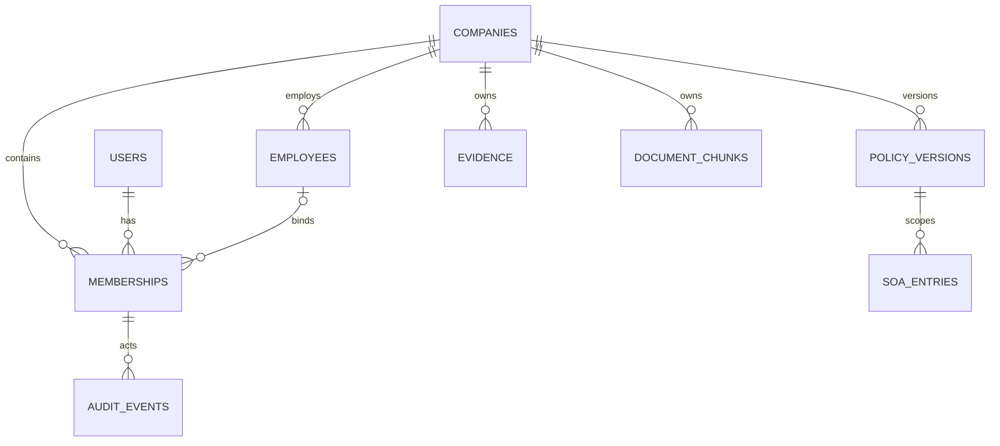

# Dữ liệu và phân quyền Phase 03

- `app_auth` lưu người dùng và quyền theo doanh nghiệp. DB kiểm tra khóa ngoại ghép cho liên kết nhân viên và thành viên. Tên đăng nhập là duy nhất trên hệ thống, mật khẩu lưu bằng Argon2id.
- `app_data` lưu hồ sơ tổng hợp, phiên bản chính sách, SoA, bằng chứng, văn bản vector và sự kiện. Policy RLS kiểm tra danh tính, tenant và vai trò. Auditor xem hồ sơ cùng tenant. Employee xem hồ sơ được liên kết với mình. Admin có thể đổi tên hiển thị của hồ sơ mô phỏng trong tenant với số phiên bản dự kiến. Mỗi thay đổi thành công thêm đúng một bản ghi audit.
- `benchmark_private` lưu nhãn kỳ vọng phục vụ đánh giá. Tài khoản PostgreSQL `compliance_app` thiếu quyền truy cập schema này. Tài khoản `compliance_evaluator` riêng chỉ đọc kết quả. Phase 03 kiểm tra quyền của hai tài khoản bằng PostgreSQL thật.
- Backend đặt định danh và tenant bằng cấu hình cục bộ theo giao dịch. Token HS256 hết hạn sau 15 phút và chứa định danh. Backend lấy quyền hiện hành từ PostgreSQL. Backend kết nối bằng `compliance_app`; migration và lệnh seed dùng tài khoản riêng.
- Vector lưu 384 chiều. Truy vấn hiện dùng lọc chính xác theo tenant và mã kiểm soát, rồi xếp hạng L2. Chọn mô hình embedding tương thích và xác thực nguồn trong Phase 08. Chỉ bổ sung chỉ mục gần đúng sau khi đo truy vấn loại này với dữ liệu đại diện.

Các bảng cho thiết bị, tài khoản, đánh giá, hành động, tác nhân và phỏng vấn sẽ đi cùng lát cắt nghiệp vụ của các phase tiếp theo.
