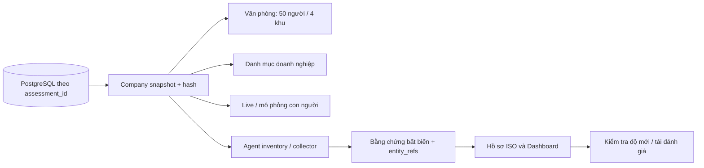

# Doanh nghiệp dùng chung theo đợt đánh giá

## Nguồn dữ liệu hiện hành

PostgreSQL là nguồn dữ liệu nghiệp vụ của các màn hình web hiện hành. Mỗi đợt đánh giá có cùng danh bạ nhân viên, tài khoản, thiết bị và cấu hình lab; không lấy trạng thái vận hành từ snapshot SQLite riêng nữa.

## Định danh và quan hệ

- Nhân viên chính thức dùng `EMP-xxx`; `HF-xxx` là mã nhập tương thích theo cùng số thứ tự, không phải một nhân viên mới.
- Máy văn phòng dùng `OFFICE-EMP-xxx`; 50 người có 50 máy riêng, chia 4 khu tối đa 14 người/khu.
- Tài khoản có ID ổn định, chủ tài khoản, hệ thống và trạng thái. Có 200 tài khoản nền (4 hệ thống/người), cộng tài khoản lab gắn rõ với tài sản phần mềm và có đúng một chủ sở hữu. Dịch vụ dùng chung không bị tự biến thành tài khoản cá nhân.
- Thiết bị bao gồm máy cá nhân và phần cứng lab hiện có; tổng số được đọc từ dữ liệu, không ép thành 50. Quan hệ nhiều người–tài sản được giữ trong snapshot.
- Snapshot chứa assessment_id, hồ sơ, tài khoản, thiết bị, quan hệ và phiên bản cấu hình lab. Hash thay đổi khi dữ liệu nguồn thay đổi.
- Dữ kiện chưa biết giữ null. Không suy rằng đã ký NDA, bật MFA hoặc mã hóa chỉ vì đang có tài khoản hay preset healthy.

## Đồng bộ luồng nghiệp vụ

1. Ghi nhận đào tạo, NDA, nghỉ việc, đổi vai trò, MFA/mã hóa hoặc sự kiện văn phòng vào cùng dữ liệu PostgreSQL.
2. Live Monitor và mô phỏng web đọc lại snapshot này; Agent nhận cùng snapshot và hash. Lịch sử công cụ có thể dùng SQLite theo từng đợt, nhưng không dùng bản sao đó làm nguồn doanh nghiệp.
3. Collector A.6.1–A.6.8 dùng evaluator minh bạch trên snapshot chung; audit trail ghi rõ luật, không nhận là phân loại bởi LLM. Bốn collector lab còn lại vẫn dùng cấu hình lab và đọc số liệu/định danh doanh nghiệp chung. IAM lấy số tài khoản/MFA thực tế, không dùng số đếm cố định của preset.
4. Bằng chứng lưu bất biến: assessment_id, control_id, entity_refs, snapshot_hash, nội dung và SHA-256. Không sửa bằng chứng cũ để khớp hiện trạng.
5. Hồ sơ ISO và Dashboard kiểm tra hash bằng chứng được viện dẫn. Dữ liệu đổi thì yêu cầu tái đánh giá; giữ nguyên kết luận cũ trong lịch sử. Cơ chế hiện tại bảo thủ: thay đổi snapshot có thể làm nhiều kiểm soát cần chạy lại; chưa tối ưu theo phụ thuộc từng trường.
6. SOC và lệnh nhân viên dùng cùng máy. Trạng thái khóa/cô lập, tài khoản vô hiệu hóa, mã hóa và giao khóa học được phản ánh qua projection chung. Giao khóa học chưa đồng nghĩa đã học xong. Thiết bị đã thu hồi không được mở lại bằng lệnh đi làm.

## API và phân quyền

- `GET /api/assessments/{id}/enterprise/company`
- `POST /api/assessments/{id}/enterprise/company/events`
- `/api/live`, `/api/simulation`, `/api/agent/*` yêu cầu đăng nhập và kiểm tra thành viên đợt đánh giá; có thể truyền assessment_id, nếu thiếu chọn đợt đầu tiên mà người dùng được tham gia.
- Giao diện web cũ lấy token/đợt từ phiên đăng nhập trên cùng origin. Nếu mở ở cổng 8000, cần đăng nhập tại trang gốc cổng 8000; sessionStorage ở 5173 là origin khác.
- Thay đổi nghiệp vụ mới lưu người thực hiện. Chỉ admin ghi nhận phê duyệt ngoại lệ giữ tài khoản. Lệnh giả lập không thực thi lệnh máy chủ hoặc tác động tài sản thật.

## Migration và dữ liệu lịch sử

Migration bổ sung 50 nhân viên, tài khoản và máy bằng ON CONFLICT DO NOTHING; không ghi đè hồ sơ/máy đang có, không xóa quan hệ tùy chỉnh hoặc sự cố cũ. Có thể chạy lại migration mà không nhân đôi bản ghi.

Dữ liệu HF trong SQLite và kết quả benchmark cũ vẫn được giữ làm lịch sử/fixture độc lập. Không tự trộn những thay đổi lịch sử đó vào hồ sơ EMP vì trạng thái và ngữ nghĩa từng nhân viên có thể mâu thuẫn. Mã tương thích HF khi gửi lệnh mới được chuẩn hóa sang EMP; báo cáo lịch sử vẫn phải đọc kèm nguồn và hash gốc.

CLI nghiên cứu và benchmark tiếp tục dùng fixture cô lập để giữ khả năng tái lập, không dùng làm nguồn trạng thái cho màn hình doanh nghiệp.

## Cách kiểm tra

Mở Doanh nghiệp → chọn EMP-050 → ghi nhận chưa hoàn tất đào tạo → mở Live/mô phỏng hoặc chạy A.6.3 → xem cùng nhân viên trong bằng chứng. Ghi nhận hoàn tất đào tạo → kết luận cũ cần tái đánh giá → chạy lại → xem lịch sử và hash mới. Chuyển về văn phòng, khu 4 để thao tác trên OFFICE-EMP-050.

Giới hạn: chưa kiểm thử toàn bộ thao tác UI có đăng nhập; chưa tích hợp HR/IAM/EDR thật; cấu hình mạng/vật lý/sao lưu vẫn là chính sách và telemetry lab, không phải chứng cứ dịch vụ thật.

Kiểm chứng lúc 19:40 ngày 06/11/2026 (UTC+7).

## Kiểm chứng bản doanh nghiệp dùng chung

- Dữ liệu hiện tại: 50 nhân viên, 202 tài khoản (200 nền + 2 tài khoản lab gắn tài sản), 70 thiết bị phần cứng gồm 50 máy văn phòng riêng.
- API doanh nghiệp, danh bạ văn phòng và Live có cùng tập EMP và cùng hash snapshot. Mã nhập HF-050 cập nhật đúng EMP-050.
- Ghi nhận thiếu đào tạo → Live phát hiện EMP-050 → đánh giá A.6.3 lưu bằng chứng có entity_refs → ghi nhận hoàn tất → cả hồ sơ và Dashboard yêu cầu tái đánh giá → chạy lại có lịch sử mới.
- Lệnh máy EMP-050 làm thay đổi cùng thiết bị trong danh mục chung. IAM overview lấy số liệu tài khoản/MFA đúng theo snapshot hiện tại.
- USB trên EMP-050 được SOC xác minh và phản ánh trạng thái cách ly trong doanh nghiệp. Mission inventory trả đúng 4 tài khoản của EMP-050. Lượt kiểm chứng này dùng policy-fallback, không nhận là model xử lý thành công.
- Chạy cả 8 kiểm soát A.6 qua API: 8 job SUCCEEDED, bằng chứng chung và trạng thái độ mới hợp lệ. Kết luận có thể vẫn thiếu bằng chứng, không ép thành Compliant.
- API đánh giá cũ nay lưu theo đợt và cập nhật cùng progress/history. Truy cập không đăng nhập trả 401; đợt không được tham gia trả 403.
- Chạy lại migration giữ nguyên snapshot/hash, không nhân đôi người/tài khoản; dữ liệu cũ và quan hệ tùy chỉnh không bị xóa.
- 188 test Python, 18 test JavaScript và build frontend đạt. Lint còn cảnh báo hiện có; chunk 3D vẫn có cảnh báo kích thước.
- Đã xem ảnh render khu 4 từ dữ liệu thực: đủ 8 người, hiển thị đúng EMP-050 đang được chọn. Đây là render tĩnh và API thật, chưa thay thế kiểm thử bấm toàn bộ UI có đăng nhập.
