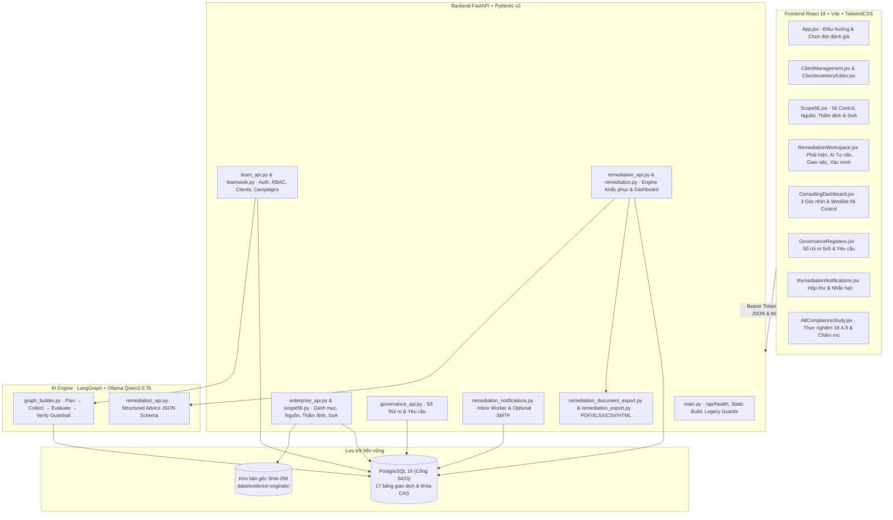

# NGHIỆM THU KỸ THUẬT VÀ NGHIỆP VỤ TOÀN DIỆN — ISO27001-AI-AGENT (2026)

Ngày nghiệm thu: **22/11/2026**  
Repository: `https://github.com/ToanTranVan03/ISO27001-AI-Agent`  
Phạm vi hệ thống: **56 Control ISO/IEC 27001:2022** (8 A.6 Con người, 14 A.7 Vật lý/Phần cứng, 34 A.8 Kỹ thuật/Phần mềm), thực nghiệm chuyên sâu **18 Control A.8**, quản lý đa khách hàng/đợt đánh giá và vòng đời tư vấn – khắc phục – xác minh độc lập – báo cáo trước/sau.

---

## 1. Tổng quan hệ thống & Bảng nghiệm thu toàn bộ Repository (Phần 1)

Hệ thống được thiết kế theo mô hình nền tảng quản lý đánh giá và tư vấn khắc phục ISO/IEC 27001:2022 dựa trên bằng chứng có kiểm chứng mã băm (SHA-256), phân tách rõ vai trò giữa bên tư vấn/đánh giá (`admin`, `consultant`, `verifier`) và bên doanh nghiệp thực hiện (`business_admin`, `operator`), đồng thời giữ nguyên tắc **không tự động tuyên bố chứng nhận ISO và không tự phê duyệt thay con người**.

### Bảng đối chiếu trạng thái toàn bộ chức năng

| Chức năng | Code | API | UI | Database | Test | Kết luận |
|---|---|---|---|---|---|---|
| **1. Xác thực, hồ sơ tài khoản & chống brute-force** | `backend/teamwork.py`, `backend/team_api.py` | `POST /api/auth/login`, `/logout`, `GET/PUT /api/auth/profile` | `App.jsx`, `AccountProfile.jsx` | `team_users`, `team_sessions`, `login_attempts` (PBKDF2-SHA256 310k vòng, khóa 15 phút sau 5 lần sai) | `test_teamwork_logic.py`, `test_account_profile.py`, `api.test.mjs` | **Đạt (Hoạt động thực tế)** |
| **2. Quản lý nhiều khách hàng & nhiều đợt đánh giá** | `backend/team_api.py`, `backend/teamwork.py` | `GET/POST /api/clients`, `PUT /api/clients/{id}`, `POST /api/clients/{id}/campaigns`, `/members` | `ClientManagement.jsx`, dropdown chọn đợt trên `App.jsx` | `consulting_clients`, `consulting_campaigns`, `assessment_campaigns` (`inventory_mode`), `assessment_members` | `client-management.spec.js`, `live-zz-clients.spec.js` | **Đạt (Hoạt động thực tế, tách biệt `client` và `lab`)** |
| **3. Quản lý danh mục doanh nghiệp (Nhân sự, Tài khoản, Tài sản)** | `backend/company.py`, `backend/company_storage.py`, `backend/enterprise_api.py` | `GET /enterprise/company`, `PUT /enterprise/company/inventory/{kind}/{id}`, `POST /events/preview`, `/events` | `CompanyInventory.jsx`, `ClientInventoryEditor.jsx`, `CompanyChanges.jsx` | `enterprise_company`, `enterprise_sim_people`, `enterprise_company_accounts`, `enterprise_sim_assets`, `assessment_events` | `test_company_changes.py`, `live-zz-clients.spec.js` | **Đạt (Có kiểm tra snapshot hash & lịch sử trước/sau)** |
| **4. Tiếp nhận, kiểm tra trước (preflight) & lưu bản gốc bằng chứng 56 Control** | `evidence_collectors/source_intake.py`, `source_quality.py`, `source_verification.py`, `document_parser.py` | `POST /scope56/controls/{id}/sources/validate`, `/upload`, `GET .../original`, `POST /packages/collect` | `SourceIntake.jsx`, `Scope56.jsx` | `evidence` + kho bản gốc `data/evidence-originals/{aid}/{sha256}.bin` | `test_source_intake.py`, `test_source_quality.py`, `test_source_verification.py`, `test_source_preflight.py` | **Đạt (Chống trùng, kiểm chất lượng, kiểm toàn vẹn SHA-256)** |
| **5. AI Agent đánh giá 56 Control & chạy lô trên server** | `agent_core/graph_builder.py`, `model_input.py`, `backend/batch_work.py` | `POST /assessments/{id}/controls/{cid}/run`, `POST /shared-work/batches`, `GET /jobs/{id}` | `Scope56.jsx`, `ResultExplorer.jsx`, `ComplianceDossier.jsx` | `evaluations`, `control_progress`, `agent_jobs`, `source_evaluation_batches` | `test_graph_builder.py`, `test_batch_work.py`, `test_model_input_budget.py` | **Đạt (LangGraph + Ollama `qwen2.5:7b`, phục hồi khi ngắt API)** |
| **6. Thực nghiệm chuyên sâu 18 Control A.8 & chấm mù** | `agent_core/a8_assessment.py`, `a8_benchmark.py`, `backend/a8_api.py` | `GET/POST /a8/runs`, `POST /a8/runs/{id}/reviews`, `/disagreements`, `/preflight` | `A8ComplianceStudy.jsx`, `DevelopmentLabPanel.jsx` | Lưu trữ run/review có khóa hash trong `data/a8-study/{aid}/` | `test_a8_benchmark.py`, `test_a8_live_v2.py`, `test_disagreement_ledger.py` | **Đạt (108 ca raw + 18 probe live v2 + 38 hồ sơ phát triển)** |
| **7. Thẩm định từng tiêu chí, quyết định tính áp dụng & phê duyệt SoA 56** | `backend/scope56.py`, `review_criteria.py`, `decision_batch.py`, `soa_readiness.py` | `POST /scope56/reviews`, `/decisions`, `/decisions/batch`, `/approval`, `/rubric/approval` | `ControlCriteriaReview.jsx`, `DecisionBatchPanel.jsx`, `SoAReadiness.jsx` | Lưu lịch sử kèm fingerprint/token trong `settings/scope56-*.json` | `test_review_criteria.py`, `test_decision_batch.py`, `test_soa_readiness.py` | **Đạt (Siết gate đủ 56 quyết định & thẩm định hiện hành)** |
| **8. Phát hiện GAP & Sổ rủi ro (5×5) / Sổ yêu cầu có nguồn** | `backend/remediation.py`, `remediation_api.py`, `governance_api.py` | `POST /remediation/findings`, `/discover`, `PUT /findings/{id}`, `GET/PUT /governance/records/{id}`, `/review` | `RemediationWorkspace.jsx`, `GovernanceRegisters.jsx` | `remediation_records` (`context`, `finding`), `governance_records` (`risk`, `requirement`) | `test_remediation.py`, `test_governance_registers.py` | **Đạt (Khóa baseline, chống tự rà sổ của chính mình)** |
| **9. AI Tư vấn phương án khắc phục có cấu trúc** | `backend/remediation_api.py` (`Advice` schema + Ollama `/api/chat`) | `POST /remediation/findings/{id}/ai-proposal`, `POST /findings/{id}/actions` | `RemediationWorkspace.jsx` (`ProposalForm`, `ActionCard`) | Lưu nháp `PENDING_APPROVAL` + `raw_proposal` hoặc log lỗi `ai_proposal_failed` trong `remediation_records` | `test_remediation_ai_api.py`, `test_consulting_dashboard.py`, `live-zz-clients.spec.js` | **Đạt (Đủ 15 trường tư vấn + câu hỏi bổ sung, không fallback giả)** |
| **10. Duyệt kế hoạch, giao việc, phối hợp & phân công bước con** | `backend/remediation.py`, `remediation_api.py` | `POST /remediation/findings/{fid}/actions/{aid}/events` (`edit`, `approve`, `assign_task`, `start`, `task`, `attach`, `submit`) | `RemediationWorkspace.jsx` | `remediation_records` (versioned CAS + `FOR UPDATE`), `remediation_roles` | `test_remediation.py`, `test_final_acceptance_2026.py` | **Đạt (Thứ tự bước phụ thuộc, phân quyền người chính/phối hợp)** |
| **11. Xác minh độc lập, trả bổ sung/làm lại & đóng hành động** | `backend/remediation.py`, `remediation_api.py` | `POST .../events` (`verify` với `accepted`/`partial`/`rework`/`more_information`, `return`, `close`) | `RemediationWorkspace.jsx` | `remediation_records` (lưu chữ ký thẩm định, token, lịch sử xác minh) | `test_remediation.py`, `test_final_acceptance_2026.py`, `live-zz-clients.spec.js` | **Đạt (Chặn tự xác minh, bắt buộc thẩm định viện dẫn nguồn mới)** |
| **12. Dashboard 3 góc nhìn & Danh sách việc 56 Control** | `backend/remediation.py`, `remediation_api.py` | `GET /remediation/dashboard` | `ConsultingDashboard.jsx` | Tổng hợp trực tiếp từ `remediation_records`, `consulting_clients`, `control_progress`, `evidence` | `test_consulting_dashboard.py`, `consulting-dashboard.spec.js` | **Đạt (Chuyên viên / Doanh nghiệp / Lãnh đạo + `required_tasks`)** |
| **13. Hệ thống thông báo & nhắc hạn (kèm tùy chọn SMTP an toàn)** | `backend/remediation_notifications.py` | `GET /remediation/notifications`, `POST .../{nid}/read` | `RemediationNotifications.jsx` | `remediation_notifications` (`UNIQUE(assessment_id, user_id, dedupe_key)`) | `test_remediation_notifications.py` | **Đạt (Thông báo giao việc/bước con/xác minh/quản lý/nhắc hạn 3 ngày)** |
| **14. Xuất báo cáo PDF, Excel XLSX, CSV, HTML, JSON** | `backend/remediation_document_export.py`, `remediation_export.py`, `remediation_api.py` | `GET /remediation/report`, `/report.pdf`, `/report.xlsx`, `/report.csv`, `/report.html` | `RemediationWorkspace.jsx` | Đọc dữ liệu thực theo quyền từ PostgreSQL | `test_remediation_document_export.py`, `test_remediation_export.py`, `test_final_acceptance_2026.py` | **Đạt (PDF tiếng Việt Unicode, Excel 8 sheet, chống XSS/Formula Injection)** |
| **15. Health Check & Bảo mật vận hành** | `backend/main.py` | `GET /api/health` | — | Kiểm tra kết nối PostgreSQL (`SELECT 1`) và trạng thái build React | `test_final_acceptance_2026.py` | **Đạt (Không lộ chuỗi kết nối hoặc secrets)** |

---

## 2. Kiến trúc hệ thống



---

## 3. Nghiệm thu luồng nghiệp vụ End-to-End 21 bước (Phần 2)

Toàn bộ 21 bước nghiệp vụ đã được kiểm chứng cả ở tầng Engine/API ([tests/test_final_acceptance_2026.py](../tests/test_final_acceptance_2026.py)) lẫn kiểm thử tích hợp ghi thật trên PostgreSQL + trình duyệt Edge + Ollama `qwen2.5:7b` qua khởi động lại ([frontend-react/tests/live-zz-clients.spec.js](../frontend-react/tests/live-zz-clients.spec.js) và [s-prompt-isolated-seed-guard-2026-11-22.json](a8-results/s-prompt-isolated-seed-guard-2026-11-22.json)):

1. **Đăng nhập:** Xác thực qua `POST /api/auth/login`, cấp token phiên 8 giờ lưu hash SHA-256 trong `team_sessions`.
2. **Tạo khách hàng:** Admin tạo hồ sơ khách hàng qua `POST /api/clients` (`version = 1`), lưu vào `consulting_clients`.
3. **Tạo assessment:** Tự động khởi tạo đợt đầu tiên hoặc thêm đợt mới qua `POST /api/clients/{id}/campaigns` với `inventory_mode = 'client'`, bắt đầu rỗng (0 nhân sự, 0 tài khoản, 0 thiết bị, không nạp dữ liệu lab).
4. **Khai báo phạm vi:** Lưu hồ sơ bối cảnh & phạm vi ISMS (`PUT /api/assessments/{id}/remediation/context`) có kiểm tra `expected_version` và lưu lịch sử trước/sau.
5. **Khai báo tài sản, nhân viên và thông tin doanh nghiệp:** Tư vấn hoặc `business_admin` khai báo qua `PUT /enterprise/company/inventory/{kind}/{id}` (`person`, `account`, `asset`) với `expected_snapshot_hash`; ghi audit event `client_inventory_saved`.
6. **Nộp bằng chứng:** Tải tệp gốc lên qua `POST /enterprise/scope56/controls/{cid}/sources/upload`, lưu file nhị phân theo SHA-256 và bản ghi trong bảng `evidence`.
7. **Kiểm tra nguồn và chất lượng dữ liệu:** `POST .../sources/validate` và `source_quality.py` chặn tệp rỗng, quá ít ký tự, lặp ký tự, chứa NUL byte, JSON lỗi hoặc sai hash bản gốc.
8. **AI đánh giá:** `POST /assessments/{id}/controls/{cid}/run` chạy LangGraph + `qwen2.5:7b` ở chế độ `user_evidence_only` cho đợt khách hàng; kiểm tra ngân sách token đầu vào (`validate_budget`) và guardrail viện dẫn `evidence_id` có thật.
9. **Người đánh giá kiểm tra kết luận:** Xem kết luận máy, lý do, viện dẫn và lịch sử trong `Scope56.jsx` / `ComplianceDossier.jsx`.
10. **Xác định GAP:** Tạo phát hiện thủ công (`POST /remediation/findings`) hoặc quét ứng viên từ nguồn đã đánh giá (`POST /remediation/discover`), khóa bất biến `baseline` (`review_token`, `conclusion`, `evidence`, `criteria`).
11. **Tạo phương án khắc phục:** Gọi AI tư vấn (`POST /remediation/findings/{fid}/ai-proposal`) hoặc tạo nháp thủ công (`POST .../actions`) ở trạng thái `PENDING_APPROVAL`.
12. **Chuyên gia chỉnh sửa và duyệt:** Chuyên viên (`consultant`) sửa phương án (`command='edit'`) và phê duyệt (`command='approve'`), kiểm tra `baseline.review_token` và `context_snapshot.version` còn khớp.
13. **Giao việc & phân công bước con:** Giao người thực hiện chính (`assignee`), danh sách người phối hợp (`collaborator_ids`), hạn hoàn thành (`due_date`) và phân công từng bước công việc con (`command='assign_task'`).
14. **Người thực hiện cập nhật:** Người chính hoặc người phối hợp bắt đầu (`start`) và đánh dấu hoàn thành từng bước theo đúng thứ tự phụ thuộc tuần tự (`task`).
15. **Nộp bằng chứng sau khắc phục:** Tải nguồn mới lên control, sau đó đính kèm vào hành động (`command='attach'`); hệ thống chặn đính kèm lại nguồn đã nằm trong `baseline` hoặc nguồn không đủ chất lượng.
16. **Gửi xác minh:** Chỉ người chịu trách nhiệm chính (`assignee`) được gửi xác minh (`command='submit'`) sau khi toàn bộ bước con đã hoàn tất và đã đính kèm ít nhất một bằng chứng mới.
17. **Người xác minh độc lập đánh giá:** Hệ thống chặn người thực hiện chính và người phối hợp tự xác minh (`PermissionError` / `403`).
18. **Yêu cầu bổ sung nếu chưa đạt:** Người xác minh trả kết quả `more_information`, `rework` hoặc `partial`; hành động chuyển về `NEEDS_INFORMATION` hoặc `REWORK`, lưu lịch sử xác minh và gửi thông báo cho bên thực hiện + quản lý doanh nghiệp.
19. **Xác minh lại:** Người thực hiện bổ sung bằng chứng mới, gửi xác minh lại (`submit` cập nhật `submitted_token` mới); người xác minh thực hiện thẩm định tiêu chí hiện hành viện dẫn nguồn mới và xác minh đạt (`outcome='accepted'` → `VERIFIED`), sau đó đóng hành động (`close` → `CLOSED`).
20. **Đánh giá lại control:** Chạy lại AI Agent trên nguồn mới và chuyên viên ký thẩm định từng tiêu chí (`POST /scope56/reviews`); hoàn thành công việc khắc phục không tự động biến control thành `Compliant` nếu chưa qua bước thẩm định.
21. **Xuất báo cáo:** Tải báo cáo trước/sau ở cả 5 định dạng JSON, CSV, HTML, Excel XLSX (8 sheet) và PDF tiếng Việt Unicode.

---

## 4. Các lỗi phát hiện và đã sửa trong quá trình nghiệm thu (Phần 3, 7, 8, 10)

| Mã | Hạng mục | Mô tả lỗi / điểm chưa hoàn thiện phát hiện khi rà soát | Cách đã sửa trong repository | File thay đổi & Test kiểm chứng |
|---|---|---|---|---|
| **BUG-01** | Khởi tạo đợt khách hàng | Mã cũ tự seed nhân sự/tài khoản/thiết bị mẫu lab vào mọi đợt đánh giá mới và tự thêm tài khoản khách hàng vào đợt lab khi khởi động lại API. | Thêm cột `inventory_mode` (`'lab'` vs `'client'`); tách đợt khách hàng khỏi seed/collector lab; sửa câu truy vấn `init_teamwork()` để không thêm thành viên khách hàng vào đợt lab. | `backend/teamwork.py`, `backend/company_storage.py`, `backend/ company.py`, `live-zz-clients.spec.js` |
| **BUG-02** | Đầu vào AI tư vấn khắc phục | Trích đoạn nội dung bằng chứng đưa vào prompt AI bị rỗng do API `scope56` chỉ trả metadata của nguồn mà không kèm cột `extracted_text`. | Truy vấn trực tiếp `extracted_text` từ bảng `evidence` đúng theo `(assessment_id, control_id, evidence_id)` với giới hạn 1.500 ký tự/nguồn và tối đa 6 nguồn khả dụng. | `backend/remediation_api.py`, `tests/test_remediation_ai_api.py` |
| **BUG-03** | Form sửa phương án khắc phục | Form sửa kế hoạch trên UI gửi kèm các trường metadata của action (`action_id`, `state`, `verifications`...) làm Pydantic `extra='forbid'` từ chối `422`. | Lọc chỉ giữ các trường thuộc schema `Proposal` trong `ProposalForm` trước khi gửi sự kiện `edit`. | `frontend-react/src/RemediationWorkspace.jsx`, `s-prompt-ui-forms-release-2026-11-22.json` |
| **BUG-04** | Dropdown cấp thành viên khi có nhiều khách hàng | Trong `ClientManagement.jsx`, state `target` (đợt cấp quyền) dùng chung một biến chuỗi giữa các thẻ khách hàng, dễ giữ ID đợt của khách hàng A khi thao tác trên thẻ khách hàng B. | Đổi sang map `targets[c.client_id]` tách biệt trạng thái chọn đợt cho từng khách hàng. | `frontend-react/src/ClientManagement.jsx`, `client-management.spec.js` |
| **BUG-05** | Dashboard 3 góc nhìn & danh sách việc từng Control | Giao diện `ConsultingDashboard.jsx` ban đầu chưa hiển thị riêng khung tiêu chí chưa đáp ứng cho góc nhìn Doanh nghiệp, chưa hiện mức độ đáp ứng/nguồn lực kế hoạch cho Lãnh đạo và chưa tách danh sách việc cụ thể (`required_tasks`) cho từng Control. | Bổ sung `required_tasks`, `planned_resources`, `remaining_issues` trong `remediation.dashboard()` và hiển thị chi tiết theo cả 3 góc nhìn trên `ConsultingDashboard.jsx`. | `backend/remediation.py`, `frontend-react/src/ConsultingDashboard.jsx`, `tests/test_consulting_dashboard.py`, `consulting-dashboard.spec.js` |
| **BUG-06** | Thông báo phân công bước con & báo cáo HTML/CSV | Sự kiện `assign_task` chưa phát thông báo hộp thư; báo cáo bản in HTML (`/report.html`) và CSV (`/report.csv`) chưa có phần Tổng quan lãnh đạo, Sổ rủi ro/yêu cầu và các trường tư vấn AI mới. | Thêm thông báo cho `assign_task` + hỗ trợ tùy chọn SMTP qua biến môi trường; đồng bộ đầy đủ nội dung báo cáo HTML và CSV với PDF/XLSX. | `backend/remediation_notifications.py`, `backend/remediation_export.py`, `tests/test_remediation_notifications.py`, `tests/test_remediation_export.py` |
| **BUG-07** | Health check & tài liệu hướng dẫn | Thiếu endpoint `/api/health` để kiểm tra sức khỏe dịch vụ; `HUONG_DAN.md` còn ghi số lượng probe live v1 cũ (5 probe thay vì 18 probe live v2). | Thêm `GET /api/health` kiểm tra kết nối DB không lộ secret; cập nhật `README.md` và `HUONG_DAN.md`. | `backend/main.py`, `README.md`, `HUONG_DAN.md`, `tests/test_final_acceptance_2026.py` |

*Bug chưa sửa:* **Không còn bug kỹ thuật nào được phát hiện trong phạm vi repository hiện tại.**

---

## 5. Kiểm tra AI Tư vấn ISO (Phần 4)

- **Kiến trúc & Schema (`Advice` trong `backend/remediation_api.py`):**
  - Sử dụng một AI engine duy nhất qua Ollama HTTP API (`/api/chat`, model `qwen2.5:7b`, `temperature=0`, `format=Advice.model_json_schema()`).
  - Bắt buộc trả đủ cấu trúc: `title`, `problem` (hiện trạng/GAP), `possible_causes` (nguyên nhân có thể cần xác minh), `objective` (mục tiêu), `rationale` (tại sao phải làm/rủi ro), `target_location` (vị trí xử lý), `department` (bộ phận phụ trách), `resources` (nguồn lực dự kiến), `estimated_effort` (thời gian dự kiến để chuyên viên xem xét), `priority`, `steps` (hướng dẫn từng bước), `tasks` (danh sách công việc con), `acceptance` (điều kiện nghiệm thu), `required_evidence` (bằng chứng cần nộp), `recheck_method` (cách kiểm tra lại) và `clarification_questions` (câu hỏi bổ sung).
- **Ngữ cảnh đầu vào thực tế:**
  - Truyền `company_context_unverified` (bối cảnh doanh nghiệp & phạm vi ISMS), `criteria` (tiêu chí rubric của control), `source_excerpts_untrusted` (trích đoạn bằng chứng thực tế đã nộp trong đợt), `reviewed_registers_untrusted` (các mục sổ rủi ro & yêu cầu đã rà liên quan tới control) và `prior_actions` (các hành động khắc phục trước đó).
- **Guardrails an toàn:**
  - Nếu control chưa có nội dung bằng chứng mà model không sinh `clarification_questions`, backend từ chối và báo lỗi.
  - Nếu phản hồi model sai JSON/schema, backend ghi log sự kiện `ai_proposal_failed` kèm phản hồi thô vào lịch sử và trả `502`, tuyệt đối không sinh kế hoạch giả để thay thế.
  - Mọi đề xuất AI đều mang nhãn `OLLAMA_DRAFT_REQUIRES_REVIEW` và trạng thái `PENDING_APPROVAL`, không có `assignee` hay `due_date` cho đến khi chuyên viên duyệt.

---

## 6. Kiểm tra Phân quyền, Tách dữ liệu, Database & Bảo mật (Phần 5, 6, 8)

### Phân quyền (RBAC) & Tách dữ liệu đa khách hàng
- **Tách biệt khách hàng & đợt đánh giá:** Mọi endpoint dưới `/api/assessments/{assessment_id}/...` đều gọi `require_campaign(assessment_id, user)` kiểm tra bảng `assessment_members`. Tài khoản thuộc Khách hàng A gọi sang `assessment_id` của Khách hàng B hoặc gọi `PUT /api/clients/{client_b}` đều bị chặn `403 Forbidden`.
- **Phân quyền 4 vai trò trong đợt (`consultant`, `verifier`, `business_admin`, `operator`):**
  - `operator` chỉ nhìn thấy các phát hiện và hành động mà mình là `assignee` hoặc nằm trong `collaborator_ids`; chỉ đọc danh mục doanh nghiệp (`403` khi gọi `PUT /company/inventory/...`).
  - Người phối hợp (`collaborator_ids`) được đánh dấu bước công việc được giao nhưng bị chặn `403` nếu gọi `submit` thay người chịu trách nhiệm chính (`assignee`).
  - Cả người thực hiện chính lẫn người phối hợp đều bị chặn `403` nếu gọi `verify`, `return`, `close` hoặc ký thẩm định tiêu chí (`POST /scope56/reviews`).
  - Chỉ `consultant` được tạo/sửa phát hiện, gọi AI đề xuất, sửa kế hoạch nháp, phê duyệt (`approve`) và phân công bước con (`assign_task`).

### Database, Giao dịch & Chống Race Condition
- **Khóa đồng thời (Concurrency Control):**
  - Sử dụng `SELECT ... FOR UPDATE` kết hợp kiểm tra phiên bản (`expected_version`, `expected_snapshot_hash`, `expected_review_token`, `expected_fingerprint`) trên `remediation_records`, `governance_records`, `consulting_clients`, `enterprise_company` và `control_progress`. Cập nhật cũ trả `409 Conflict` và rollback an toàn.
  - Khởi tạo bản ghi đơn (`context`, `discover`, `governance_records`) dùng `pg_advisory_xact_lock` chống race condition khi hai request đầu tiên chạy song song.
- **Restart Persistence:** Khi Uvicorn khởi động lại, `init_teamwork()` và `recover_interrupted()` tự động chuyển các job luồng bị gián đoạn sang `INTERRUPTED`/`FAILED` và mở khóa control, bảo toàn toàn bộ bằng chứng, kết quả đánh giá, hồ sơ khách hàng và tiến độ khắc phục.

### Bảo mật & Production Readiness
- **Secrets & `.env`:** Mật khẩu hash bằng `PBKDF2-HMAC-SHA256` (310.000 vòng, salt 16 byte ngẫu nhiên, so sánh hằng thời gian `hmac.compare_digest`). Không có mật khẩu hay SMTP credentials hardcode trong mã nguồn.
- **SQL Injection & XSS & CSV/Excel Formula Injection:** 100% truy vấn SQL dùng tham số hóa `%s` của `psycopg`. Xuất HTML/PDF dùng `html.escape()`; xuất CSV/XLSX trung hòa các ô bắt đầu bằng `=`, `+`, `-`, `@` bằng dấu nháy đơn `'`.
- **File Upload & Path Traversal:** Giới hạn 15MB, kiểm tra phần mở rộng hợp lệ, loại bỏ đường dẫn tương đối (`..`, `/`, `\`, NUL), lưu file dưới tên `{sha256}.bin` trong thư mục cô lập theo `UUID(assessment_id)` và kiểm tra `path.resolve()` trước khi đọc/ghi.
- **Health Check:** `GET /api/health` kiểm tra kết nối PostgreSQL thực tế và trạng thái bản build frontend mà không tiết lộ chuỗi kết nối.

---

## 7. Kết quả kiểm thử thực tế (Phần 7 & Phần 9)

Toàn bộ các bộ kiểm thử đã được chạy thực tế và xác nhận đạt:

| Loại kiểm thử | Công cụ / Lệnh chạy | Phân loại dữ liệu | Số lượng & Kết quả | Minh chứng |
|---|---|---|---|---|
| **1. Python Unit, API, RBAC, DB & Report Tests** | `.venv\Scripts\python.exe -m pytest tests -q` | Unit / API / Mocked DB & Isolated File Fixtures | **442 / 442 PASS** (0 failed) | `tests/test_*.py` (bao gồm `test_final_acceptance_2026.py`) |
| **2. JavaScript Contract & Navigation Tests** | `node --test tests/*.test.mjs` | Unit / Contract | **14 / 14 PASS** (0 failed) | `tests/api.test.mjs`, `tests/completion_guide.test.mjs`, `tests/navigation.test.mjs` |
| **3. Frontend Static Analysis (Linter)** | `npm run lint --prefix frontend-react` | Static Analysis (`oxlint`) | **0 warnings, 0 errors** (58 files) | `frontend-react/src/*` |
| **4. Frontend Production Build** | `npm run build --prefix frontend-react` | Production Bundle (`vite build`) | **PASS** (`dist/index.html` + `assets/`) | `frontend-react/dist/` |
| **5. UI Regression & Form Tests (Playwright Edge)** | `npx --prefix frontend-react playwright test` | UI Test (API mô phỏng cho form, không làm bẩn DB chính) | **17 / 17 kịch bản PASS** | [s-prompt-ui-first-2026-11-22.json](a8-results/s-prompt-ui-first-2026-11-22.json), [s-prompt-ui-forms-release-2026-11-22.json](a8-results/s-prompt-ui-forms-release-2026-11-22.json) |
| **6. End-to-End Real-Write, Real-AI & Restart Persistence** | `.venv\Scripts\python.exe run_isolated_acceptance.py --execute --remediation --governance --clients` | **Database PostgreSQL thật (tạm) + API thật + Qwen2.5:7b thật + Edge UI thật + Restart** | **PASS** (`remediation_restart_persistence: true`, `main_table_counts_unchanged: true`) | [s-prompt-isolated-release-2026-11-22.json](a8-results/s-prompt-isolated-release-2026-11-22.json), [s-prompt-isolated-seed-guard-2026-11-22.json](a8-results/s-prompt-isolated-seed-guard-2026-11-22.json) |

---

## 8. Chức năng chưa nghiệm thu chuyên môn & Những phần cần Người dùng / Giảng viên thực hiện (Phần 11 & 12)

Hệ thống phần mềm đã hoàn thiện đầy đủ luồng kỹ thuật, tuy nhiên theo đúng nguyên tắc trung thực học thuật và nghiệp vụ ISO/IEC 27001, các hạng mục dữ liệu và quyết định con người dưới đây **không được phần mềm tự động giả mạo** và cần nhóm người dùng/giảng viên thực hiện:

1. **Bổ sung nguồn bằng chứng thực tế cho 37 Control còn thiếu và thay thế nguồn `A.6.2` (1 ký tự)** trong đợt đánh giá chính.
2. **Xác nhận Rubric và nguồn tiêu chuẩn/pháp lý:** Giảng viên hoặc người phụ trách xác nhận phiên bản rubric 56 control (`POST /scope56/rubric/approval`) và cung cấp tài liệu tiêu chuẩn/nghĩa vụ hợp pháp vào Sổ yêu cầu.
3. **Chấm độc lập và đối chiếu bất đồng:** Người đánh giá đủ điều kiện thực hiện chấm độc lập trên bộ kiểm định mới chưa dùng để phát triển, rà soát 15 ca lệch kết luận tổng / 19 tiêu chí lệch trong bộ phát triển 38 hồ sơ.
4. **Thẩm định tiêu chí, quyết định tính áp dụng (56 dòng) và phê duyệt SoA:** Người đánh giá tự đọc bằng chứng hiện hành, ghi nhận thẩm định (`POST /scope56/reviews`), người phụ trách ghi 56 quyết định tính áp dụng (`POST /scope56/decisions` hoặc nhập theo lô) và ký phê duyệt SoA (`POST /scope56/approval`).

---

## 9. Hướng dẫn chạy hệ thống & Kịch bản Demo (Phần 13 & 14)

### Hướng dẫn khởi động hệ thống

```powershell
# 1. Khởi động PostgreSQL (cổng 5433) và container lab A.8
cd D:\AI_Agent_ISO27001
docker compose -f docker-compose.enterprise-lab.yml up -d postgres
docker compose -f docker-compose.a8.yml up -d

# 2. Build frontend (nếu vừa cập nhật giao diện) và chạy Backend FastAPI tại cổng 8000
npm run build --prefix frontend-react
.\.venv\Scripts\python.exe -m uvicorn backend.main:app --host 127.0.0.1 --port 8000

# 3. (Tuỳ chọn khi phát triển UI) Chạy Vite dev server tại cổng 5173
cd frontend-react
npm run dev -- --host 127.0.0.1 --port 5173 --strictPort
```

- Kiểm tra sức khỏe hệ thống: `http://127.0.0.1:8000/api/health`
- Giao diện người dùng: `http://127.0.0.1:8000` (hoặc `http://127.0.0.1:5173`)
- Tài liệu OpenAPI: `http://127.0.0.1:8000/docs`

### Kịch bản Demo chuẩn (10–15 phút)

1. **Bước 1 – Đăng nhập & Tạo khách hàng mới (2 phút):**
   - Đăng nhập bằng tài khoản `admin`. Mở tab **Doanh nghiệp → Khách hàng tư vấn**.
   - Tạo khách hàng mới (ví dụ: *Công ty Cổ phần Dịch vụ Số Demo*) cùng đợt đánh giá đầu tiên và phạm vi ISMS.
   - Chuyển sang đợt đánh giá vừa tạo trên thanh điều hướng: chỉ rõ danh mục bắt đầu rỗng (0 nhân sự, 0 tài khoản, 0 thiết bị) và không bị trộn dữ liệu mẫu lab.
   - Cấp quyền thành viên cho đợt: 1 tài khoản `business_admin` (Quản trị doanh nghiệp) và 1 tài khoản `operator` (Người thực hiện).
2. **Bước 2 – Khai báo danh mục & Nộp bằng chứng ban đầu (3 phút):**
   - Mở **Khai báo / sửa danh mục doanh nghiệp**, tạo nhân viên `EMP-001`, tài khoản và thiết bị liên kết; xem mã snapshot và lịch sử thay đổi.
   - Chuyển sang tab **Tổng quan 56 control**, chọn `A.8.13` (Sao lưu thông tin), dùng khung **Nộp hồ sơ, log hoặc cấu hình gốc** để kiểm tra trước (preflight) rồi lưu tệp log sao lưu ban đầu (chưa có diễn tập khôi phục).
   - Bấm **Agent đánh giá hồ sơ đã thu** để `qwen2.5:7b` đánh giá và trả kết luận `Partially Compliant` / `Non-Compliant` kèm viện dẫn mã bằng chứng.
3. **Bước 3 – Phát hiện GAP, AI Tư vấn khắc phục & Giao việc (4 phút):**
   - Mở mục **Tư vấn & khắc phục**, tạo phát hiện từ snapshot hiện tại của `A.8.13`.
   - Bấm **AI đề xuất có cấu trúc — chờ tư vấn duyệt**: trình bày các trường AI sinh ra (vấn đề, nguyên nhân cần xác minh, mục tiêu, lý do, vị trí, bộ phận, thời gian dự kiến, nguồn lực, các bước làm, bằng chứng cần cung cấp, cách kiểm tra lại và câu hỏi làm rõ).
   - Chuyên viên chỉnh sửa kế hoạch nếu cần, chọn người thực hiện chính, người phối hợp, đặt hạn hoàn thành và bấm **Duyệt và giao thực hiện**; phân công bước 1 cho người phối hợp.
4. **Bước 4 – Doanh nghiệp thực hiện, Nộp bằng chứng sau & Xác minh độc lập (4 phút):**
   - Đăng nhập bằng tài khoản `operator` / `business_admin`: mở hộp thư **Thông báo khắc phục**, đánh dấu hoàn thành các bước theo thứ tự.
   - Tải lên biên bản diễn tập khôi phục mới vào control `A.8.13`, gắn nguồn mới vào hành động khắc phục và bấm **Gửi xác minh**.
   - Quay lại tài khoản `admin`/chuyên viên xác minh: chạy đánh giá lại control, thực hiện thẩm định từng tiêu chí viện dẫn nguồn mới, sau đó bấm **Xác minh đạt** và **Đóng hành động đã xác minh**.
5. **Bước 5 – Dashboard 3 góc nhìn & Xuất báo cáo trước/sau (2 phút):**
   - Mở **Dashboard tư vấn và khắc phục**, chuyển đổi giữa 3 góc nhìn: **Chuyên viên**, **Doanh nghiệp** và **Lãnh đạo**; lọc danh sách công việc 56 Control.
   - Bấm **Tải PDF**, **Tải Excel XLSX** và **Tải bản in HTML** để trình chiếu báo cáo đối chiếu trước và sau khắc phục.

---

## 10. Đánh giá mức độ sẵn sàng của sản phẩm (Phần 15)

- **Về mặt kỹ thuật & luồng nghiệp vụ phần mềm:** **Sẵn sàng (Production-grade Prototype / MVP hoàn chỉnh cho môi trường nội bộ & bảo vệ đồ án)**. Toàn bộ quy trình từ quản lý đa khách hàng, thu thập/kiểm định nguồn bằng chứng, AI đánh giá, phát hiện GAP, AI tư vấn khắc phục, giao việc/phối hợp, xác minh độc lập, dashboard 3 góc nhìn, thông báo đến xuất báo cáo đa định dạng (PDF/XLSX/CSV/HTML/JSON) đều hoạt động ổn định trên PostgreSQL thật và LLM thật, đạt 442 test Python, 14 test JS và 17 kịch bản UI.
- **Về mặt vận hành Internet công cộng & nghiệm thu hồ sơ thực tế:** Để triển khai ra môi trường Internet công cộng cho nhiều doanh nghiệp thật, cần bổ sung hạ tầng reverse proxy TLS (Nginx/Caddy), tách worker đánh giá/nhắc hạn sang hàng đợi riêng (Celery/RQ/Redis), thiết lập lịch sao lưu PostgreSQL tự động và hoàn tất việc thu thập 37 nguồn bằng chứng thực tế cùng chữ ký phê duyệt chuyên môn của người có thẩm quyền.
