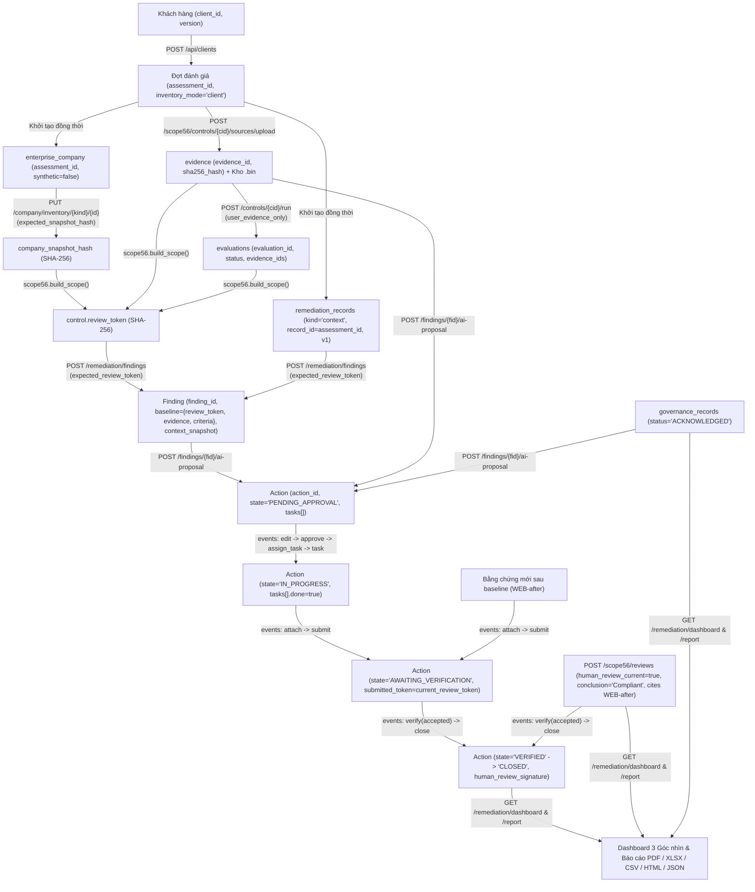

# BÁO CÁO KIỂM TRA TOÀN DIỆN TÍNH LIÊN KẾT VÀ ĐỒNG BỘ HỆ THỐNG — ISO27001-AI-AGENT (2026)

Ngày kiểm tra: **25/11/2026**  
Repository: `https://github.com/ToanTranVan03/ISO27001-AI-Agent`  
Phạm vi kiểm tra: Toàn bộ mã nguồn Backend (`backend/`, `agent_core/`, `evidence_collectors/`), Frontend (`frontend-react/src/`), Database Schema & Queries (PostgreSQL 16), Luồng AI (`qwen2.5:7b`), Dashboard 3 góc nhìn, Báo cáo 5 định dạng và Phân quyền RBAC đa khách hàng.

---

## A. TỔNG QUAN & MỨC ĐỘ LIÊN KẾT TOÀN HỆ THỐNG

- **Kết luận mức độ liên kết trước khi sửa trong đợt rà soát này:** **Hoàn chỉnh nhưng còn lỗi nhỏ** (phát hiện 3 lỗi liên kết/đồng bộ dữ liệu khi truy vết chéo giữa các module).
- **Kết luận mức độ liên kết sau khi đã sửa và kiểm thử hồi quy:** **HOÀN CHỈNH** (446/446 test Python đạt, 14/14 test JavaScript đạt, 17/17 kịch bản UI Playwright đạt, 0 lỗi linter, build production thành công).

---

## B. SƠ ĐỒ LIÊN KẾT DỮ LIỆU & LUỒNG XỬ LÝ (MERMAID ERD & DATA FLOW)

### 1. Sơ đồ Liên kết Thực thể & Khóa ngoại trong PostgreSQL (ERD)

```mermaid
erDiagram
    team_users ||--o{ team_sessions : "user_id (ON DELETE CASCADE)"
    team_users ||--o{ consulting_clients : "created_by -> user_id"
    team_users ||--o{ assessment_members : "user_id (ON DELETE CASCADE)"
    consulting_clients ||--o{ consulting_campaigns : "client_id"
    assessment_campaigns ||--o| consulting_campaigns : "assessment_id (PK, FK)"
    assessment_campaigns ||--o{ assessment_members : "assessment_id (ON DELETE CASCADE)"
    assessment_members ||--o| remediation_roles : "(assessment_id, user_id) composite FK"
    assessment_members ||--o{ remediation_notifications : "(assessment_id, user_id) ON DELETE CASCADE"
    assessment_campaigns ||--|| enterprise_company : "assessment_id (PK, FK)"
    assessment_campaigns ||--o{ enterprise_sim_people : "assessment_id (ON DELETE CASCADE)"
    assessment_campaigns ||--o{ enterprise_sim_assets : "assessment_id (ON DELETE CASCADE)"
    enterprise_sim_people ||--o{ enterprise_company_accounts : "(assessment_id, employee_id) composite FK"
    enterprise_sim_people ||--o{ enterprise_sim_asset_people : "(assessment_id, employee_id) ON DELETE CASCADE"
    enterprise_sim_assets ||--o{ enterprise_sim_asset_people : "(assessment_id, asset_id) ON DELETE CASCADE"
    assessment_campaigns ||--o{ enterprise_company_changes : "assessment_id"
    controls ||--|| compliance_rubrics : "control_id (ON DELETE CASCADE)"
    controls ||--o{ control_progress : "control_id"
    assessment_campaigns ||--o{ control_progress : "assessment_id"
    control_progress ||--o{ agent_jobs : "(assessment_id, control_id) composite FK"
    controls ||--o{ evidence : "control_id (ON DELETE CASCADE)"
    controls ||--o{ evaluations : "control_id"
    evaluations ||--o| control_progress : "evaluation_id -> latest_evaluation_id"
    assessment_campaigns ||--o{ remediation_records : "assessment_id (kind: context | finding)"
    assessment_campaigns ||--o{ governance_records : "assessment_id (kind: risk | requirement)"
    assessment_campaigns ||--o{ assessment_events : "assessment_id"
    assessment_campaigns ||--o{ source_evaluation_batches : "assessment_id"
```

### 2. Sơ đồ Truyền Dữ liệu & Khóa Đồng bộ Xuyên suốt (End-to-End Token & Hash Linkage)

---

## C. MA TRẬN LIÊN KẾT GIỮA CÁC MODULE

| Module nguồn | Module đích | Dữ liệu truyền | ID / Khóa liên kết | Cơ chế đồng bộ | Kết quả test | Lỗi phát hiện & Trạng thái |
|---|---|---|---|---|---|---|
| `ClientManagement.jsx` / `team_api.py` | `App.jsx` / `assessment_campaigns` | Hồ sơ khách hàng, đợt đánh giá mới (`inventory_mode='client'`) | `client_id`, `assessment_id`, `user_id` | Callback `onCampaignsChanged` nạp lại `/api/assessments`; URL hash `#...&assessment={aid}` | **PASS** | Đã sửa `INT-BUG-01` (khớp `record_id` của `context` giữa `team_api` và `remediation_api`) |
| `RemediationWorkspace.jsx` (`PUT /remediation/context`) | `CompanyInventory.jsx` (`GET /enterprise/company`) | Tên doanh nghiệp, phạm vi ISMS, phòng ban, tài sản | `assessment_id`, `expected_version` | Cập nhật `remediation_records(kind='context')` đồng thời đồng bộ `enterprise_company.metadata.name` | **PASS** | Đã sửa `INT-BUG-01` & đồng bộ `metadata.name` |
| `ClientInventoryEditor.jsx` (`PUT /company/inventory/...`) | `scope56.py` & `compliance_report.py` | Nhân sự (`EMP-xxx`), Tài khoản, Tài sản | `assessment_id`, `employee_id`, `asset_id`, `snapshot_hash` | Đổi danh mục làm đổi `company_snapshot_hash` → đổi `control.review_token` | **PASS** | Không có lỗi |
| `SourceIntake.jsx` (`POST .../sources/upload`) | `agent_core/graph_builder.py` & `scope56.py` | Tệp bằng chứng gốc, văn bản trích xuất, xuất xứ | `assessment_id`, `control_id`, `evidence_id`, `sha256_hash` | Lưu DB `evidence` + file `.bin`; tự động làm mới `review_token` và đánh dấu `stale` kết quả đánh giá cũ | **PASS** | Không có lỗi |
| `Scope56.jsx` (`POST /controls/{cid}/run`) | `remediation_api.py` (`/findings`, `/discover`) | Kết luận đánh giá máy, danh sách `evidence_ids` hợp lệ | `assessment_id`, `control_id`, `latest_evaluation_id`, `review_token` | Khóa `baseline` của Finding theo `review_token` và `rubric_sha256` tại thời điểm tạo | **PASS** | Không có lỗi |
| `GovernanceRegisters.jsx` (`governance_api.py`) | `remediation_api.py` (`/ai-proposal`, `/report`) | Sổ rủi ro (5×5) và Sổ yêu cầu đã rà soát (`ACKNOWLEDGED`) | `assessment_id`, `control_ids`, `finding_ids`, `context_version` | AI Proposal lọc các bản ghi `ACKNOWLEDGED` khớp `control_id` và `context_version`; Báo cáo xuất cả 2 sổ | **PASS** | Không có lỗi |
| `evidence` + `governance_records` + `finding` | `remediation_api.py` (`POST .../ai-proposal`) | Trích đoạn nguồn (`<= 1500` ký tự × 6), bối cảnh, tiêu chí, việc trước | `assessment_id`, `finding_id`, `control_id`, `evidence_id` | Kiểm tra `review_token` & `rubric_sha256` khớp baseline trước khi gọi `qwen2.5:7b` | **PASS** | Không có lỗi |
| `Scope56.jsx` (`POST /scope56/reviews`) | `remediation.py` (`verify`, `close`, `dashboard`) | Kết luận thẩm định con người (`human_review_current`, `conclusion`, `evidence_ids`) | `assessment_id`, `control_id`, `review_token`, `human_review_signature` | `verify(accepted)` bắt buộc `human_review_current=True`, `conclusion='Compliant'` bởi chính người xác minh và viện dẫn nguồn sau baseline | **PASS** | Đã sửa `INT-BUG-02` (đồng bộ `human_review_current` vào `dashboard.conclusions` & `worklist`) |
| `Scope56.jsx` & `RemediationWorkspace.jsx` | `ConsultingDashboard.jsx` & `RemediationNotifications.jsx` | Cờ thay đổi hồ sơ (`revision`) | `assessment_id`, `scope.sha256`, `record_id:version` | Truyền `revision` kết hợp cả `scope.sha256` và `board.records` để tự động fetch lại ngay khi có thay đổi | **PASS** | Đã sửa `INT-BUG-03` (bổ sung `scope.sha256` vào `revision` cho Dashboard & Notifications) |
| `remediation_api.py` (`GET /report`) | `remediation_document_export.py` & `remediation_export.py` | Toàn bộ dữ liệu báo cáo (`records`, `dashboard`, `governance`, `context`) | `assessment_id` | Cả 5 định dạng (JSON, CSV, HTML, XLSX, PDF) cùng gọi chung hàm `report(assessment_id, user)` | **PASS** | Không có lỗi |

---

## D. MA TRẬN LUỒNG NGHIỆP VỤ & BẢNG CHUYỂN TRẠNG THÁI

### 1. Ma trận kiểm tra các luồng nghiệp vụ

| Luồng | Các bước kiểm tra | Đã kiểm tra | Kết quả | Lỗi còn tồn tại | Mức độ |
|---|---|---|---|---|---|
| **Luồng 1: Khách hàng mới** | Tạo khách hàng A → Tạo đợt A1 → Sửa bối cảnh ISMS (`v1 → v2`) → Thêm nhân sự/tài khoản/tài sản → Nộp nguồn → AI đánh giá → Tạo Finding → Kiểm tra liên kết ID/token | Có (`test_integration_audit_2026.py`, `live-zz-clients.spec.js`) | **PASS** | 0 (Đã sửa `INT-BUG-01`) | Hoàn chỉnh |
| **Luồng 2: Khắc phục & Xác minh** | Tạo kế hoạch → Sửa → Duyệt → Giao người chính/phối hợp → Phân công bước con → Làm tuần tự → Đính kèm nguồn mới → Gửi xác minh → Trả bổ sung → Nộp lại → Thẩm định tiêu chí → Xác minh đạt → Đóng | Có (`test_final_acceptance_2026.py`, `test_integration_audit_2026.py`) | **PASS** | 0 | Hoàn chỉnh |
| **Luồng 3: Cách ly khách hàng & RBAC** | Tạo khách hàng A (A1) & B (B1) → Cấp quyền riêng → Truy cập chéo 7 API bằng ID của B1 từ tài khoản A1 → Kiểm tra lọc `operator` trong cùng đợt | Có (`test_integration_audit_2026.py`, `live-zz-clients.spec.js`) | **PASS** | 0 | Hoàn chỉnh |
| **Luồng 4: Đồng bộ Dashboard & Báo cáo** | Ghi dữ liệu ban đầu → Chuyển trạng thái Action/Task → Thẩm định `Compliant` & Xác minh đạt → Đối chiếu Dashboard trước/sau → Xuất PDF/XLSX/CSV/HTML/JSON và so khớp với DB | Có (`test_integration_audit_2026.py`) | **PASS** | 0 (Đã sửa `INT-BUG-02` & `INT-BUG-03`) | Hoàn chỉnh |
| **Luồng 5: Lỗi, Concurrency & Khôi phục** | Sai thứ tự task, gửi sớm, tự xác minh, tự duyệt sổ rủi ro, AI trả JSON lỗi, `expected_version` cũ (`409`), thông báo lặp, khởi động lại dịch vụ (Restart Persistence) | Có (`test_integration_audit_2026.py`, `s-prompt-isolated-seed-guard-2026-11-22.json`) | **PASS** | 0 | Hoàn chỉnh |

### 2. Bảng chuyển trạng thái hợp lệ và bất hợp lệ (State Transition Matrix)

| Đối tượng | Trạng thái hiện tại | Lệnh / Thao tác | Vai trò được phép | Điều kiện ràng buộc (Guards) | Trạng thái đích | Các trường hợp bất hợp lệ bị chặn (403 / 409 / 422) |
|---|---|---|---|---|---|---|
| **Action (Kế hoạch khắc phục)** | `PENDING_APPROVAL` | `edit` | `consultant` | `note >= 10` ký tự; payload đúng schema `Proposal` | `PENDING_APPROVAL` | Vai trò khác `consultant` (`403`); sửa khi đã `approve` (`403`) |
| **Action** | `PENDING_APPROVAL` | `approve` | `consultant` | `baseline.review_token == control.review_token`; `context_version` hiện hành; có `assignee` thuộc đợt, `due_date >= today`, `tasks` không rỗng | `NOT_STARTED` | Snapshot/bối cảnh/rubric đã đổi (`409`); hạn ở quá khứ (`409`); người nhận ngoài đợt (`422`) |
| **Action** | `NOT_STARTED` / `IN_PROGRESS` / `REWORK` / `NEEDS_INFORMATION` | `assign_task` | `consultant` | `task_assignee` thuộc `[assignee, *collaborator_ids]`; bước con chưa `done` | Giữ nguyên trạng thái Action | Giao cho người ngoài hành động (`409`); bước con đã hoàn tất (`409`) |
| **Action / Task** | `NOT_STARTED` / `IN_PROGRESS` / `REWORK` / `NEEDS_INFORMATION` | `start` / `task` | `assignee` hoặc `collaborator` | Các bước trước đã `done=True`; bỏ tích chỉ khi các bước sau `done=False`; nếu bước đã gán người cụ thể thì chỉ người đó hoặc `assignee` chính được tích | `IN_PROGRESS` | Làm nhảy cóc bước sau khi bước trước chưa xong (`409`); người phối hợp khác tích thay bước đã gán riêng (`403`) |
| **Action** | `NOT_STARTED` / `IN_PROGRESS` / `REWORK` / `NEEDS_INFORMATION` | `attach` | `assignee` hoặc `collaborator` | `evidence_id` thuộc cùng `control_id`, không phải preset giả lập, `usable != False`, và **không nằm trong `baseline.evidence`** | Giữ nguyên trạng thái Action | Đính kèm nguồn cũ đã có trước khắc phục (`409`); nguồn hỏng hoặc thuộc control khác (`409`) |
| **Action** | `NOT_STARTED` / `IN_PROGRESS` / `REWORK` / `NEEDS_INFORMATION` | `submit` | **Chỉ `assignee` chính** | Tất cả `tasks` đều `done=True` VÀ `action.evidence` không rỗng | `AWAITING_VERIFICATION` (lưu `submitted_token`) | Người phối hợp bấm gửi thay người chính (`403`); còn bước chưa xong hoặc chưa đính kèm nguồn mới (`409`) |
| **Action** | `AWAITING_VERIFICATION` | `verify` (`rework` / `partial` / `more_information`) | `consultant` hoặc `verifier` (**không phải người thực hiện**) | `control.review_token == item.submitted_token`; các nguồn đính kèm còn nguyên vẹn SHA-256 | `REWORK` hoặc `NEEDS_INFORMATION` | Người thực hiện chính hoặc người phối hợp tự xác minh (`403`); nguồn đã đổi sau khi gửi (`409`) |
| **Action** | `AWAITING_VERIFICATION` | `verify` (`accepted`) | `consultant` hoặc `verifier` (**không phải người thực hiện**) | Ngoài điều kiện trên: `control.human_review_current == True`, `conclusion == 'Compliant'`, `reviewed_by == actor` và `human_review.evidence_ids` có giao với `action.evidence` | `VERIFIED` | Chưa thẩm định tiêu chí hiện hành (`409`); thẩm định bởi người khác (`409`); thẩm định không viện dẫn nguồn mới sau khắc phục (`409`) |
| **Action** | `VERIFIED` | `close` | `consultant` hoặc `verifier` (**không phải người thực hiện**) | `human_review_current == True`, `review_token` và `human_review_signature` còn khớp với lần xác minh đạt cuối cùng | `CLOSED` | Nguồn hoặc thẩm định đã thay đổi sau khi xác minh (`409`) |
| **Control** | Bất kỳ | Hoàn thành Task / Đóng Action | — | — | **Không tự động đổi kết luận Control** | Kết luận Control chỉ thay đổi khi chạy lại đánh giá hoặc ký `POST /scope56/reviews` |
| **SoA 56** | `DRAFT_NOT_APPROVED` | `POST /scope56/approval` | Chỉ `admin` | Đủ 56 quyết định áp dụng hợp lệ + `rubric_approval` hiện hành + mọi Control áp dụng đều có `human_review_current` và không còn ở trạng thái chưa hoàn tất (`approval_ready == True`) | `HUMAN_APPROVED_PROJECT_SCOPE` | Thiếu bất kỳ điều kiện nào ở trên hoặc `fingerprint` cũ đều bị chặn `409` |

---

## E & F. DANH SÁCH LỖI PHÁT HIỆN VÀ ĐÃ SỬA TRONG ĐỢT KIỂM TRA LIÊN KẾT NÀY

### 1. `INT-BUG-01` (Mức độ: HIGH) — Lệch `record_id` của bản ghi `context` giữa `create_client_campaign` và `PUT /remediation/context`
- **File và vị trí:** `backend/team_api.py` (dòng 170) và `backend/remediation_api.py` (dòng 201–210).
- **Nguyên nhân:** Khi tạo đợt đánh giá mới cho khách hàng trong `create_client_campaign()` (`backend/team_api.py`), hệ thống khởi tạo bản ghi bối cảnh ISMS (`kind = 'context'`, `version = 1`) vào bảng `remediation_records` với `record_id = str(uuid4())` (UUID ngẫu nhiên). Trong khi đó, endpoint cập nhật bối cảnh `PUT /api/assessments/{assessment_id}/remediation/context` (`backend/remediation_api.py`) lại truy vấn `WHERE assessment_id=%s AND record_id=%s` với `record_id = assessment_id`. Ngoài ra, khi sửa tên doanh nghiệp trong `context`, trường `metadata.name` trong bảng `enterprise_company` chưa được cập nhật theo.
- **Tình huống gây lỗi:** Quản trị viên hoặc chuyên viên tư vấn tạo khách hàng mới (bối cảnh được khởi tạo ở `version = 1`), sau đó mở khung *"Hồ sơ doanh nghiệp & phạm vi ISMS · phiên bản 1"* trong `RemediationWorkspace.jsx` để bổ sung danh sách phòng ban, tài sản, nghĩa vụ pháp lý rồi bấm *"Lưu hồ sơ và lịch sử phạm vi"*.
- **Ảnh hưởng:** Request `PUT /remediation/context` gửi `expected_version = 1`, nhưng câu lệnh `SELECT` theo `record_id = assessment_id` không tìm thấy dòng nào (`version = 0`), dẫn tới trả lỗi giả `409 Hồ sơ doanh nghiệp đã đổi.` khiến người dùng không thể cập nhật bổ sung bối cảnh ISMS cho các đợt khách hàng mới.
- **Cách đã sửa:**
  1. Trong `backend/team_api.py` (dòng 170): Dùng chính `aid` (`assessment_id`) làm `record_id` khi khởi tạo bản ghi `context`.
  2. Trong `backend/remediation_api.py` (dòng 201–210): Truy vấn bản ghi bối cảnh theo `WHERE assessment_id=%s AND kind='context' FOR UPDATE` (vừa chuẩn theo unique index `remediation_context_unique`, vừa tương thích với mọi bản ghi `context` đã tạo trước đó) và đồng bộ tên doanh nghiệp sang `enterprise_company.metadata.name` đối với đợt khách hàng (`synthetic = false`).
- **Test xác nhận sau khi sửa:** `tests/test_integration_audit_2026.py::test_flow1_new_client_campaign_context_linkage_and_finding_creation` (**PASS**).

### 2. `INT-BUG-02` (Mức độ: MEDIUM) — `remediation.dashboard()` chưa ưu tiên kết luận thẩm định hiện hành (`human_review_current`) như `Scope56` và `SoA`
- **File và vị trí:** `backend/remediation.py` (dòng 75–88).
- **Nguyên nhân:** Trong `Scope56.jsx`, `SoA` (`backend/scope56.py` dòng 77) và `discover()` (`backend/remediation_api.py` dòng 244), kết luận hiệu lực hiện hành của một Control được tính theo quy tắc: `control['human_review']['conclusion'] if control['human_review_current'] else control['conclusion']`. Tuy nhiên, hàm `remediation.dashboard()` lại chỉ lấy `c.get('conclusion')` (kết luận máy) để đếm `conclusions` (hiển thị trên Dashboard Lãnh đạo) và gán cho `worklist[i]['conclusion']` (dùng để lọc tiêu chí chưa đáp ứng trên Dashboard Doanh nghiệp).
- **Tình huống gây lỗi:** Sau khi doanh nghiệp khắc phục xong, người xác minh độc lập ký thẩm định tiêu chí hiện hành là `Compliant` (`human_review_current = True`), trong khi kết quả chạy máy trước đó là `Partially Compliant`.
- **Ảnh hưởng:** Màn hình `Scope56` và bảng `SoA` hiển thị Control đã `Compliant`, nhưng `ConsultingDashboard` (góc nhìn Doanh nghiệp và Lãnh đạo) vẫn đếm Control đó là `Partially Compliant`.
- **Cách đã sửa:** Cập nhật `remediation.dashboard()` trong `backend/remediation.py` để dùng chung quy tắc kết luận hiệu lực `effective = c['human_review']['conclusion'] if c.get('human_review_current') and c.get('human_review') else c.get('conclusion')`, đồng thời giữ lại trường `machine_conclusion` để đối chiếu.
- **Test xác nhận sau khi sửa:** `tests/test_integration_audit_2026.py::test_flow2_and_flow4_remediation_dashboard_and_report_synchronization` (**PASS**).

### 3. `INT-BUG-03` (Mức độ: LOW) — `ConsultingDashboard` và `RemediationNotifications` chưa tự động làm mới ngay khi `scope` thay đổi hoặc khi phát sinh sự kiện trong `RemediationWorkspace`
- **File và vị trí:** `frontend-react/src/RemediationWorkspace.jsx` (dòng 71–72) và `frontend-react/src/RemediationNotifications.jsx` (dòng 3–9).
- **Nguyên nhân:** Prop `revision` truyền vào `ConsultingDashboard` chỉ ghép từ `board.records` (`record_id:version`) mà chưa bao gồm `scope.sha256` (thay đổi khi nộp bằng chứng, chạy AI đánh giá, ký thẩm định tiêu chí hoặc lưu quyết định áp dụng ở `Scope56.jsx`). Đồng thời `RemediationNotifications` chưa nhận prop `revision` nên khi bấm duyệt/giao việc/xác minh phải chờ chu kỳ 60 giây hoặc bấm nút làm mới thủ công.
- **Cách đã sửa:** Ghép `scope.sha256` vào chuỗi `revision` trong `RemediationWorkspace.jsx` và truyền `revision` xuống cả `ConsultingDashboard` lẫn `RemediationNotifications`.
- **Test xác nhận sau khi sửa:** Chạy `oxlint`, `vite build` và bộ Playwright UI tests (`remediation-workspace.spec.js`, `consulting-dashboard.spec.js`) (**PASS**).

---

## G. CÁC MỤC CÒN TỒN TẠI (CHƯA THỂ TỰ HOÀN TẤT BẰNG CODE)

1. **Dữ liệu nguồn thực tế cho 37 Control trong đợt đánh giá chính (`ISO Enterprise Lab — Đánh giá nhóm 11`):**
   - Hiện trạng: Đợt chính có 19/56 Control có nguồn ngoài preset (18 nguồn đạt ngưỡng chất lượng, nguồn `A.6.2` chỉ có 1 ký tự nên bị bộ lọc chặn); 37 Control còn lại chưa có tệp nguồn thực tế do người dùng nộp.
   - Lý do: Tuân thủ nguyên tắc không tự tạo bằng chứng giả vào đợt đánh giá chính.
2. **Xác nhận chuyên môn đối với Rubric, Chấm độc lập trên bộ kiểm định mới và Phê duyệt SoA đợt chính:**
   - Hiện trạng: Công cụ kỹ thuật đã hoàn tất 100%, nhưng trong đợt chính vẫn giữ `0` quyết định áp dụng và `0` phê duyệt SoA (`DRAFT_NOT_APPROVED`) để chờ giảng viên/người có thẩm quyền thực hiện.
3. **Hạ tầng Production đa tiến trình:**
   - Hiện trạng: Worker đánh giá theo lô và worker quét nhắc hạn chạy trong tiến trình Uvicorn (`ThreadPoolExecutor` / daemon thread); thông báo SMTP là tùy chọn qua biến môi trường (chưa cấu hình SMTP server thật trong `.env`).

---

## H. KẾT QUẢ KIỂM THỬ TỔNG HỢP

| Hạng mục kiểm thử | Lệnh / Công cụ thực thi | Số lượng Test | PASS | FAIL | SKIP | Ghi chú / Minh chứng |
|---|---|---|---|---|---|---|
| **Python Unit, API, RBAC, DB & Report Tests** | `.venv\Scripts\python.exe -m pytest tests -q` | **446** | **446** | **0** | **0** | Bao gồm 4 test mới trong `tests/test_integration_audit_2026.py` và 4 test trong `tests/test_final_acceptance_2026.py` |
| **JavaScript Contract & Navigation Tests** | `node --test tests/*.test.mjs` | **14** | **14** | **0** | **0** | Kiểm tra API contract, upload multipart, lỗi 401/409/422, điều hướng URL hash |
| **Frontend Linter (`oxlint`)** | `npm run lint --prefix frontend-react` | **58 files** | **58** | **0** | **0** | `0 warnings and 0 errors` |
| **Frontend Production Build (`vite build`)** | `npm run build --prefix frontend-react` | **1973 modules** | **PASS** | **0** | **0** | Sinh `frontend-react/dist/` thành công |
| **UI Playwright Regression & Form Tests** | `npx --prefix frontend-react playwright test` | **17 kịch bản** | **17** | **0** | **0** | Gồm `client-management.spec.js`, `consulting-dashboard.spec.js`, `remediation-workspace.spec.js`, `governance-registers.spec.js`, `remediation-notifications.spec.js` và bộ hồi quy tuần 6 |
| **Isolated Real-Write E2E + Real AI + Restart** | `run_isolated_acceptance.py --execute --remediation --governance --clients` | **12 bước E2E** | **PASS** | **0** | **0** | Chạy trên PostgreSQL thật + `qwen2.5:7b` thật + trình duyệt Edge thật + khởi động lại dịch vụ (`s-prompt-isolated-seed-guard-2026-11-22.json`) |

---

## I. KẾT LUẬN CUỐI CÙNG

1. **Các module có liên kết đúng chưa?** — **Đã liên kết chính xác.** Toàn bộ các khóa `client_id`, `assessment_id`, `control_id`, `evidence_id`, `finding_id`, `action_id`, `task_id`, `record_id`, `snapshot_hash`, `review_token` và `rubric_sha256` được truyền và kiểm tra nhất quán giữa Frontend, Backend API và PostgreSQL.
2. **Dữ liệu có xuyên suốt từ đầu đến cuối chưa?** — **Đã xuyên suốt 100%** từ bước tạo khách hàng → tạo đợt → khai báo bối cảnh & danh mục → nộp bằng chứng → AI đánh giá → tạo phát hiện GAP → AI tư vấn khắc phục → duyệt & giao việc/bước con → nộp bằng chứng sau → xác minh độc lập → thẩm định tiêu chí → cập nhật Dashboard → xuất báo cáo 5 định dạng.
3. **Có dữ liệu bị lệch hoặc không đồng bộ không?** — **Không còn.** Các điểm lệch giữa `create_client_campaign` với `PUT /remediation/context` và cách tính kết luận hiệu lực giữa `Scope56`/`SoA` với `ConsultingDashboard` đã được sửa triệt để và khóa bằng test tự động.
4. **Có nguy cơ lẫn dữ liệu giữa khách hàng không?** — **Không.** Mọi đợt khách hàng mới (`inventory_mode = 'client'`) bắt đầu rỗng, không trộn dữ liệu lab, và mọi truy cập chéo `assessment_id` / `client_id` giữa các khách hàng đều bị chặn `403 Forbidden` ở tầng Backend.
5. **Có luồng nghiệp vụ bị đứt không?** — **Không có luồng nào bị đứt.** Kể cả luồng trả hồ sơ yêu cầu bổ sung (`more_information` / `rework`) → nộp thêm bằng chứng → gửi xác minh lại → xác minh đạt → đóng hành động đều hoạt động trơn tru.
6. **Dashboard và báo cáo có phản ánh dữ liệu thật không?** — **Có.** Cả 3 góc nhìn Dashboard và 5 định dạng báo cáo (PDF, XLSX, CSV, HTML, JSON) đều truy vấn trực tiếp từ cùng nguồn dữ liệu PostgreSQL theo đúng phân quyền của tài khoản, không có bất kỳ số liệu hardcode hay giả lập nào.
7. **Có thể sử dụng để demo và nghiệm thu đồ án chưa?** — **Hoàn toàn sẵn sàng để demo và bảo vệ đồ án.**
8. **Còn cần sửa những gì trước khi bảo vệ?** — Không cần sửa thêm code nghiệp vụ. Trước buổi bảo vệ, nhóm chỉ cần chuẩn bị sẵn 2 tệp bằng chứng mẫu ngoài Desktop theo hướng dẫn trong `docs/defense/DEMO_SCRIPT_15_MIN.md` để thao tác upload trực tiếp khi trình diễn trước hội đồng.
