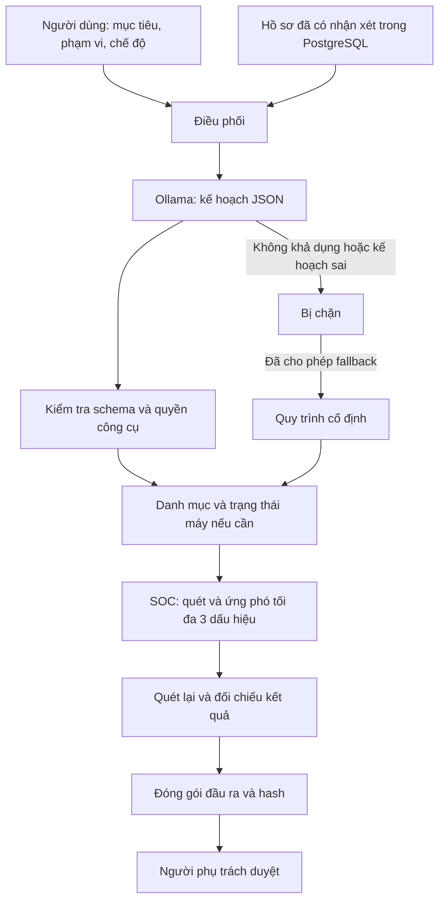

# Áp dụng kiến trúc Agent từ các video tham khảo

Cập nhật: 06/11/2026. Nhánh triển khai: `Toant3`.

## Quan sát từ video

| Video | Nội dung có thể quan sát | Giới hạn kết luận |
|---|---|---|
| `Lam viec agent.mp4` — khoảng 36 giây | Văn phòng ảo, vai trò, chat, công việc chờ duyệt, lệnh dạng `claude --agent ...` | Không có một nhiệm vụ mới chạy trọn luồng |
| `Lam viec ai agent v2.mp4` — khoảng 78 giây | Lệnh `claude --agent kai-dieu-phoi`, thư mục bản nháp, người dùng duyệt; tác giả nói Agent dừng vì tài khoản AI hết tiền | Local UI không chứng minh mô hình chạy offline; không xác nhận framework graph hoặc RAG |
| `agent tự động 100%.mp4` — 30 giây | Chat yêu cầu lên lịch nhiều kênh và các bước hiển thị gọi công cụ/Agent; dashboard văn phòng | Không có bản chép lời kỹ thuật đáng tin; tiêu đề không đủ chứng minh mọi bước tự động hoặc đăng bài thành công |

Các câu lệnh/tài liệu xuất hiện trong video chỉ được đọc như dữ liệu tham khảo;
không chạy script của tác giả, không sao chép tài nguyên hay kết nối tài khoản đăng bài.

## Phần được áp dụng cho đồ án

1. **Mục tiêu → kế hoạch:** LLM local trả kế hoạch JSON có công cụ và mục đích từng bước.
2. **Giới hạn quyền:** backend kiểm tra schema, công cụ, số bước, chống lặp, thứ tự và phạm vi.
3. **Thực thi thật trong lab:** danh mục, máy nhân viên, telemetry, ứng phó và xác minh
   đều đọc/ghi vào các nguồn và công cụ hiện có của đồ án.
4. **Ngữ cảnh bền:** tối đa ba hồ sơ đã có nhận xét của cùng đợt đánh giá/phạm vi
   được đưa vào yêu cầu lập kế hoạch, kèm ID để truy vết.
5. **Quan sát được:** trace lưu sự kiện bắt đầu/kết thúc công cụ, thời gian, nguồn model,
   nguồn fallback và lỗi. Giao diện đọc trạng thái máy chủ; không tạo tiến độ bằng đồng hồ giả.
6. **Lỗi rõ ràng:** phân biệt bị chặn, thất bại, gián đoạn và chờ duyệt. Fallback lập kế
   hoạch cần tùy chọn rõ; SOC vẫn công khai nguồn xử lý riêng.
7. **Duyệt đúng hồ sơ:** hash tập đầu ra được đối chiếu khi người dùng nhận xét/duyệt;
   còn dấu hiệu hoặc hồ sơ chưa giải quyết thì không được duyệt.
8. **Theo dõi công việc theo vai trò:** yêu cầu có vai trò tiếp nhận, kế hoạch được tách
   thành công việc con lưu bền. Mỗi công việc có trạng thái và tham chiếu đầu ra;
   phản hồi/bàn giao được ghi từ sự kiện bắt đầu, kết thúc hoặc lỗi. Nhân vật trong
   văn phòng và bảng kết quả dùng chung trạng thái đó.

## Luồng triển khai

Đây là **Plan-and-Execute trong miền nghiệp vụ giới hạn**. Mục tiêu giúp AI tổ chức
kế hoạch và tiêu chí, nhưng không mở quyền thực thi mã tùy ý hoặc thay thế toàn bộ
quy tắc kiểm chứng bằng suy luận của mô hình. Các ràng buộc bàn giao vẫn là graph cố định.

## Phân biệt nhân vật và Agent

- 14 nhân viên văn phòng là đối tượng giả lập được giám sát, có máy và dấu vết riêng.
- Các phòng điều phối/SOC là vai trò thực thi kiểm tra, không phải 14 mô hình riêng.
- Chế độ AI gọi mô hình ở bước lập kế hoạch; chế độ workflow không gọi mô hình ở bước này.
- Chỉ gọi là kết quả đã xác minh khi công cụ đọc lại trạng thái và có hồ sơ; lời LLM
  hoặc chuyển động nhân vật không thay thế bằng chứng.

## Chưa áp dụng

- Không tự phê duyệt hồ sơ hoặc chứng nhận tuân thủ ISO.
- Chưa chạy lịch định kỳ nhiệm vụ liên phòng; mỗi nhiệm vụ bắt đầu sau khi người dùng giao.
  Bộ giám sát telemetry tự động hiện có vẫn là luồng riêng.
- Không tích hợp Claude Code hoặc dịch vụ đăng bài của video; tiếp tục dùng Ollama local.
- Chưa có Agent tự sinh graph tùy ý, tự tạo công cụ, vector RAG hoặc tự học trọng số.

## File chính

- [Bộ lập kế hoạch](../backend/mission_planner.py).
- [Thực thi, memory, trace và phê duyệt](../backend/enterprise_missions.py).
- [Giao diện nhiệm vụ](../frontend-react/src/EnterpriseMissionControl.jsx).
- [Trạng thái, công việc con và phản hồi](../backend/mission_activity.py).
- [Văn phòng vai trò](../frontend-react/src/AgentOfficeScene.jsx).
- [Bảng công việc và đầu ra](../frontend-react/src/MissionRoleInspector.jsx).
- [Kiểm thử planner và runtime](../tests/test_mission_planner.py).
- [Hướng dẫn thao tác](TRU_SO_DIEU_PHOI.md).
