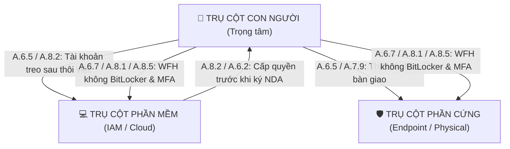

# KHUNG NỘI DUNG SLIDE THUYẾT TRÌNH BẢO VỆ KHÓA LUẬN / ĐỒ ÁN TỐT NGHIỆP

**Đề tài:** HỆ THỐNG AI AGENT GIÁM SÁT TUÂN THỦ ISO/IEC 27001 THEO MÔ HÌNH 3 TRỤ CỘT (CON NGƯỜI - PHẦN MỀM - PHẦN CỨNG)  
**Chuyên ngành:** Kỹ thuật Phần mềm / An toàn Thông tin / Hệ thống Thông tin  
**Học viên thực hiện:** [Họ và tên sinh viên]  
**Giảng viên hướng dẫn:** [Học vị và tên GVHD]  

---

## SLIDE 1: TRANG TIÊU ĐỀ (TITLE SLIDE)
* **Tiêu đề lớn:** HỆ THỐNG AI AGENT GIÁM SÁT TUÂN THỦ ISO/IEC 27001 THEO MÔ HÌNH 3 TRỤ CỘT
* **Tiêu đề phụ:** Tập trung vào kiểm soát Con người (People Controls), lan truyền rủi ro liên thực thể và trực quan hóa không gian 3D
* **Thông tin:** Sinh viên thực hiện, Khóa học, Trường/Khoa, Năm 2026

---

## SLIDE 2: TÍNH CẤP THIẾT & ĐẶT VẤN ĐỀ (PROBLEM STATEMENT)
* **Bối cảnh An toàn thông tin:**
  * Báo cáo Verizon DBIR: Hơn **74% sự cố rò rỉ dữ liệu** bắt nguồn từ yếu tố con người (nhân viên nghỉ việc không thu hồi quyền, chia sẻ tài khoản, làm từ xa thiếu bảo vệ).
  * Tiêu chuẩn quốc tế **ISO/IEC 27001:2022** & **ISO/IEC 27002:2022** tái cấu trúc 93 biện pháp kiểm soát thành 4 chủ đề.
* **Hạn chế của các hệ thống GRC & SIEM truyền thống:**
  * *Kiểm tra độc lập (Siloed Checks):* Chỉ kiểm tra rời rạc (tài khoản khóa chưa, thiết bị trả chưa) mà bỏ qua mối liên kết chéo.
  * *Tĩnh và định kỳ (Periodic Audits):* Chỉ kiểm toán 6 tháng/1 lần; không bắt kịp các sự kiện nhân sự phát sinh hàng ngày.
  * *Tải nhận thức lớn (Cognitive Overload):* Cán bộ Compliance phải đọc hàng ngàn dòng bảng tính Excel/log dạng văn bản.

---

## SLIDE 3: MỤC TIÊU & CÂU HỎI NGHIÊN CỨU (RESEARCH QUESTIONS)
* **Mục tiêu đề tài:** Xây dựng hệ thống giám sát tuân thủ hướng sự kiện, tự động phân tích rủi ro lan truyền giữa Con người - Phần mềm - Phần cứng, hỗ trợ đề xuất khắc phục theo ISO 27002.
* **3 Câu hỏi nghiên cứu then chốt:**
  * **RQ1 (Tính đúng đắn & Điều phối):** Mô hình AI Agent có khả năng điều phối công cụ tự trị để phát hiện toàn diện các vi phạm và bằng chứng thiếu sót không?
  * **RQ2 (Hiệu năng so sánh):** Chi phí tài nguyên và thời gian thực thi của AI Agent khác biệt ra sao so với quy trình quy tắc cố định (Workflow)?
  * **RQ3 (Công thái học & Khả dụng):** Trực quan hóa không gian 3D kết hợp cảnh báo rủi ro chéo có giúp giảm thời gian nhận thức và lỗi của chuyên viên an ninh so với giao diện 2D không?

---

## SLIDE 4: TIÊU CHUẨN ISO/IEC 27002:2022 & TRỌNG TÂM CON NGƯỜI
* **Tập trung vào Nhóm kiểm soát Con người (A.6 People Controls):**
  * `A.6.1`: Sàng lọc lý lịch trước tuyển dụng (Screening).
  * `A.6.2`: Cam kết bảo mật NDA & điều khoản lao động (Terms of employment).
  * `A.6.3`: Đào tạo & đánh giá nhận thức ATTT định kỳ (Awareness & training).
  * `A.6.4`: Quy trình chế tài và kỷ luật vi phạm (Disciplinary process).
  * `A.6.5`: Trách nhiệm thu hồi tài sản sau khi thôi việc (Offboarding responsibilities).
  * `A.6.7`: Làm việc từ xa và di động an toàn (Remote working).
  * `A.6.8`: Báo cáo sự cố an toàn thông tin kịp thời (Security event reporting).
* **Mở rộng sang Phần cứng (`A.7.7`, `A.7.9`, `A.8.1`) và Phần mềm (`A.8.2`, `A.8.5`).**

---

## SLIDE 5: KIẾN TRÚC MÔ HÌNH 3 TRỤ CỘT (SECURITY TRIAD ARCHITECTURE)

---

## SLIDE 6: ĐỊNH LƯỢNG RỦI RO LAN TRUYỀN CHÉO (CIA RISK SCORING)
* **Mô hình toán học lượng hóa rủi ro (Theo chuẩn ISO/IEC 27005):**
  $$\text{Risk Score} = \text{Likelihood} \times \text{Impact} \times W_{\text{dept}}$$
* **Trong đó:**
  * $\text{Impact} = \frac{C + I + A}{3}$ (Dựa trên điểm tác động Bảo mật $C$, Toàn vẹn $I$, Khả dụng $A$).
  * $\text{Likelihood}$: Dựa trên trạng thái hợp đồng và mức độ phơi nhiễm (Remote/Nghỉ việc: $4.5/5.0$).
  * $W_{\text{dept}}$: Trọng số nhạy cảm phòng ban ($W_{\text{IT}} = 1.4$, $W_{\text{Finance}} = 1.3$, $W_{\text{Ops}} = 1.1$, $W_{\text{Sales}} = 1.0$).
* **Thang phân loại rủi ro:**
  * $\ge 18.0$: **Rất cao (Critical)** | $12.0 - 17.9$: **Cao (High)** | $6.0 - 11.9$: **Trung bình (Medium)** | $< 6.0$: **Thấp (Low)**.

---

## SLIDE 7: THIẾT KẾ AI AGENT & ĐIỀU PHỐI CÔNG CỤ TỰ TRỊ
* **Kiến trúc Bounded Tool-Using Agent:**
  * Không để LLM tự do can thiệp hệ thống; Agent chỉ được lựa chọn trong tập 10 công cụ an toàn có kiểm soát (`read_people`, `read_assets`, `assess_people`, `inspect_offboarding`, `create_tasks`,...).
  * Mô hình máy trạng thái (State Machine) đảm bảo agent đi đủ các bước kiểm toán mà không bị rơi vào vòng lặp (No infinite loop).
  * Bộ lưu trữ bất biến (Immutable State) với SQLite và mã băm SHA-256 đối soát phiên bản.

---

## SLIDE 8: GIẢI BÀI TOÁN "TẠI SAO CẦN AI?" (UNSTRUCTURED EVIDENCE PARSING)
* **Lỗ hổng của Rule Engine:** Chỉ chạy được trên bảng dữ liệu sạch với trường boolean (`is_active = false`). Trong thực tế, bằng chứng kiểm toán nằm trong email, ticket Jira, biên bản viết tay.
* **Đóng góp của AI / NLP Parser:**
  * Đọc hiểu văn bản tự nhiên: Phát hiện ngoại lệ xin giữ quyền nhưng thiếu chữ ký CISO.
  * Nhận diện thiết bị bàn giao thiếu (trả laptop nhưng giữ thẻ từ).
* **Kết quả thực nghiệm so sánh:**
  * **Rule Engine:** Đạt **25.0%** độ chính xác (thất bại hoàn toàn trên văn bản tự do).
  * **AI NLP Agent:** Đạt **100.0%** trích xuất đúng thực thể và vi phạm ISO.

---

## SLIDE 9: HỆ THỐNG TRA CỨU TRI THỨC ĐỘNG ISO 27002 (DYNAMIC RAG ENGINE)
* **Khắc phục hạn chế của việc hardcode:**
  * Module `IsoRagEngine` lập chỉ mục toàn bộ điều khoản ISO 27002:2022.
  * Tìm kiếm ngữ nghĩa theo từ khóa rủi ro và mã điều khoản.
* **Tự động sinh Khuyến nghị khắc phục chuẩn quốc tế:**
  * Căn cứ pháp lý (Regulatory Rationale).
  * Các bước hành động cụ thể cho IT Admin & HR (Actionable Steps).
  * Danh mục bằng chứng bắt buộc phải lưu trữ (Required Evidence).

---

## SLIDE 10: TRỰC QUAN HÓA KHÔNG GIAN 3D & PHẢN HỒI THỜI GIAN THỰC
* **Mặt bằng văn phòng ảo hóa Three.js:**
  * Chia khu vực theo 4 phòng ban (IT, Finance, Operations, Sales).
  * **Cơ chế cảnh báo tức thì:** Nhân viên có vi phạm hoặc sự cố lập tức đổi màu áo sang **Đỏ**, gắn thẻ trạng thái vi phạm trực quan trên đỉnh đầu.
  * Hỗ trợ tương tác đa điểm: Bấm chọn nhân viên để xem toàn bộ hồ sơ Tam giác bảo mật 3 cột.

---

## SLIDE 11: KẾT QUẢ THỰC NGHIỆM RQ1 & RQ2 (PAIRED BENCHMARK)
* **Thực nghiệm ghép cặp (Paired Benchmark 72 ca thử nghiệm):**
  * Cả 3 chế độ (**Rules**, **Workflow**, **AI**) đều đạt **100% độ chính xác** (Exact Matches: 72/72) khi đối chiếu các kiểm soát A.6.
* **So sánh hiệu năng & thời gian phản hồi:**
  * **Rules:** $0.94\text{ ms}$ (Cực nhanh).
  * **Workflow:** $2.4\text{ ms}$ (Tối ưu cho hệ thống tự động).
  * **AI Agent (Ollama Qwen2.5:7b):** $2571\text{ ms}$ (Thích hợp cho phân tích sâu, xử lý ngoại lệ và văn bản phi cấu trúc).

---

## SLIDE 12: KẾT QUẢ KHẢO SÁT THỰC NGHIỆM RQ3 (USER STUDY & SUS)
* **Thử nghiệm Crossover đối chứng ($N = 16$ chuyên viên/sinh viên ATTT):**
  * **Thời gian phát hiện sự cố (TTD):** Giảm từ $76.6\text{s}$ (2D) xuống **$44.2\text{s}$ (3D)** $\rightarrow$ **Nhanh hơn 42.3%** ($p = 0.0001 < 0.001$).
  * **Tỷ lệ bỏ sót rủi ro chéo:** Giảm từ $1.31$ lỗi xuống **$0.19$ lỗi** $\rightarrow$ **Giảm 85.7%** lỗi ($p = 0.0001$).
  * **Điểm khả dụng SUS (System Usability Scale):** Tăng từ $60.3$ (Mức TB) lên **$90.0/100$ (Xuất sắc - Grade A)**.
* **Kết luận khoa học:** Trực quan hóa 3D giúp giảm đáng kể tải nhận thức thị giác và loại bỏ điểm mù bảo mật.

---

## SLIDE 13: GIỚI HẠN CỦA ĐỒ ÁN (ACADEMIC LIMITATIONS)
* **Trung thực học thuật:**
  * Dữ liệu thử nghiệm là môi trường giả lập (Synthetic enterprise data), chưa kết nối trực tiếp Active Directory doanh nghiệp thật.
  * 8/56 kiểm soát có evaluator chi tiết; 48 kiểm soát còn lại được theo dõi phạm vi (Scope tracking) và ánh xạ sang các nhóm trách nhiệm.
  * Đồ án là công cụ hỗ trợ cán bộ tuân thủ (Copilot/Assistant), không thay thế chuyên gia đánh giá độc lập để cấp chứng chỉ ISO 27001.

---

## SLIDE 14: KẾT LUẬN & HƯỚNG PHÁT TRIỂN (CONCLUSION & FUTURE WORKS)
* **Đóng góp chính của đề tài:**
  1. Xây dựng thành công hệ thống giám sát tuân thủ ISO 27001 bám sát 3 trụ cột lấy Con người làm trọng tâm.
  2. Hiện thực hóa thuật toán phát hiện chuỗi lan truyền rủi ro chéo và công thức định lượng CIA.
  3. Tích hợp Dynamic RAG và NLP Parser xử lý văn bản phi cấu trúc.
  4. Chứng minh thực nghiệm tính vượt trội của giao diện trực quan 3D qua thang đo SUS ($90.0$).
* **Hướng phát triển:** Kết nối API trực tiếp với Microsoft Entra ID (Azure AD), Google Workspace và hệ thống vé Jira/ServiceNow trong doanh nghiệp thực tế.

---

## SLIDE 15: LỜI CẢM ƠN & Q&A
* *Em xin chân thành cảm ơn Quý Thầy/Cô trong Hội đồng đã lắng nghe!*
* *Em rất mong nhận được những câu hỏi và đóng góp quý báu từ Quý Thầy/Cô.*
