# BÁO CÁO NGHIỆM THU CUỐI CÙNG THEO MỤC TIÊU ĐỀ TÀI — ISO27001-AI-AGENT

**Tên đề tài:**  
**"XÂY DỰNG HỆ THỐNG AI AGENT ĐÁNH GIÁ TUÂN THỦ AN TOÀN THÔNG TIN THEO TIÊU CHUẨN ISO/IEC 27001:2022"**

Ngày nghiệm thu: **25/11/2026**  
Repository: `https://github.com/ToanTranVan03/ISO27001-AI-Agent`

---

## 1. Mục tiêu đề tài & Đối chiếu 10 câu hỏi nghiệm thu cốt lõi (Mục I)

| STT | Câu hỏi nghiệm thu theo mục tiêu đề tài | Trả lời trung thực dựa trên thực tế hệ thống | Minh chứng trong Repository |
|---|---|---|---|
| **1** | Hệ thống có thực sự đánh giá tuân thủ ATTT dựa trên ISO/IEC 27001:2022 không? | **Có.** Hệ thống quản lý và đánh giá dựa trên danh mục 56 Control thuộc Phụ lục A của ISO/IEC 27001:2022 (8 A.6, 14 A.7, 34 A.8) cùng 113 tiêu chí đạt (`pass_criteria`) và 56 Rubric chấm điểm (`compliance_rubrics.json`). | `docs/56_controls_scope.json`, `docs/compliance_rubrics.json`, `backend/scope56.py` |
| **2** | AI Agent có thực sự thu thập, xử lý, phân tích bằng chứng và đưa ra kết luận không? | **Có.** AI Agent được xây dựng bằng đồ thị trạng thái **LangGraph (`StateGraph`)** 5 nút (`PLAN → COLLECT → EVALUATE → VERIFY → REPORT`) kết nối với model cục bộ `qwen2.5:7b` qua Ollama, không phải là một khung chat tự do. | `agent_core/graph_builder.py`, `evidence_collectors/` |
| **3** | AI có đánh giá dựa trên tiêu chí Control và dữ liệu doanh nghiệp thực tế được cung cấp không? | **Có.** Với đợt khách hàng (`inventory_mode='client'`), Agent chạy ở chế độ `user_evidence_only`, chỉ đưa vào prompt các bằng chứng đã nộp của đúng đợt/Control đó và Rubric của Control đó; khi tư vấn khắc phục còn truyền thêm bối cảnh doanh nghiệp, phạm vi ISMS và sổ rủi ro/yêu cầu đã rà. | `agent_core/graph_builder.py` (dòng 74–164), `backend/remediation_api.py` (dòng 320–346) |
| **4** | AI có đưa ra kết luận có cơ sở và truy xuất được nguồn không? | **Có.** Mọi kết luận (`Compliant`, `Partially Compliant`, `Non-Compliant`, `Insufficient Evidence`) đều bắt buộc đi kèm `rationale` tiếng Việt, `confidence` và danh sách `evidence_ids` được nút `node_verify` kiểm chứng tồn tại thật và gắn mã băm `SHA-256` tới tệp bản gốc `.bin`. | `agent_core/graph_builder.py` (dòng 186–208), `evidence_collectors/source_intake.py` |
| **5** | AI có phát hiện thiếu bằng chứng, bằng chứng không liên quan, lỗi dữ liệu và mâu thuẫn không? | **Có.** Đã kiểm chứng thực tế qua bộ 10 tình huống độc lập (`IND-01` → `IND-10B`): cổng chất lượng chặn tệp lỗi/1 ký tự; `node_evaluate` ngắt sớm khi thiếu nguồn; `qwen2.5:7b` bác bỏ bằng chứng căng tin/sổ trực cổng, phát hiện biên bản bảo trì hết hạn năm 2018 và phát hiện mâu thuẫn giữa báo cáo tự khai với file config IAM. | `docs/thesis-validation/AI_EVALUATION.md`, `docs/a8-results/thesis-final-validation-10-scenarios-2026-11-25.json` |
| **6** | Hệ thống có nhận diện GAP và đề xuất khắc phục dựa trên kết quả đánh giá không? | **Có.** Hệ thống tự động quét ứng viên GAP từ kết quả đánh giá (`POST /remediation/discover`) hoặc tạo phát hiện thủ công (`POST /remediation/findings`), khóa `baseline` ban đầu và gọi `qwen2.5:7b` sinh phương án khắc phục có cấu trúc 15 trường + câu hỏi làm rõ (`Advice`). | `backend/remediation.py`, `backend/remediation_api.py` |
| **7** | Có thể theo dõi vòng đời khắc phục và đánh giá lại không? | **Có.** Hỗ trợ đầy đủ: Chuyên viên sửa/duyệt kế hoạch → Giao người chính, người phối hợp và phân công từng bước con → Thực hiện tuần tự → Đính kèm bằng chứng mới sau baseline → Gửi xác minh → Người xác minh độc lập trả bổ sung/làm lại hoặc xác minh đạt sau khi đánh giá lại & thẩm định tiêu chí → Đóng hành động. | `backend/remediation.py`, `frontend-react/src/RemediationWorkspace.jsx` |
| **8** | Kết quả đánh giá có được lưu, truy xuất và xuất báo cáo không? | **Có.** Toàn bộ dữ liệu lưu bền vững trong PostgreSQL 16 (qua khởi động lại không mất dữ liệu), hiển thị trên Dashboard 3 góc nhìn và xuất báo cáo Trước–Sau nhất quán ra 5 định dạng: **PDF tiếng Việt Unicode, Excel XLSX (8 sheet), CSV, HTML bản in, JSON**. | `backend/remediation_document_export.py`, `backend/remediation_export.py` |
| **9** | Hệ thống có kiểm soát được lỗi AI, dữ liệu không đáng tin cậy và quyền truy cập không? | **Có.** Chống Prompt Injection bằng regex guardrail + system prompt; chặn tệp rác bằng `source_quality`; bắt lỗi JSON của AI trả `502` và ghi log `ai_proposal_failed` (không fallback giả); kiểm soát RBAC 4 vai trò theo đợt, cách ly đa khách hàng (`403`) và khóa giao dịch `FOR UPDATE` / CAS (`409`). | `tests/test_final_acceptance_2026.py`, `tests/test_integration_audit_2026.py` |
| **10** | Phạm vi tuyên bố của sản phẩm có phù hợp với năng lực thực tế không? | **Hoàn toàn phù hợp.** Mọi giao diện, API, SoA dự thảo và báo cáo đều ghi rõ phạm vi 56 Control của đồ án (không phải toàn bộ 93 Control Annex A hay điều khoản 4–10) và gắn cứng `certification_claim = False` (hỗ trợ đánh giá/khắc phục, không phải chứng nhận ISO). | `backend/scope56.py`, `backend/remediation_document_export.py` |

---

## 2. Phạm vi hệ thống & Ma trận xác minh 56 Control ISO/IEC 27001:2022 (Mục II & Mục XII.2, XII.5)

### Kết quả kiểm tra tự động danh mục 56 Control (`TV-SCOPE-01` → `TV-SCOPE-03`):
- **Tổng số Control:** **56 Control** (Không trùng lặp, không thiếu, khớp 1-1 giữa `docs/56_controls_scope.json`, `docs/compliance_rubrics.json` và bảng `controls` trong PostgreSQL).
- **Phân bổ đúng phiên bản ISO/IEC 27001:2022:**
  - **Nhóm A.6 (Con người / People):** 8 Control (`A.6.1` đến `A.6.8`) — 16 tiêu chí đạt.
  - **Nhóm A.7 (Vật lý & Phần cứng / Physical):** 14 Control (`A.7.1` đến `A.7.14`) — 28 tiêu chí đạt.
  - **Nhóm A.8 (Kỹ thuật & Phần mềm / Technological):** 34 Control (`A.8.1` đến `A.8.34`) — 69 tiêu chí đạt (trong đó 18 Control A.8 ưu tiên có thêm bộ thực nghiệm Raw Replay 108 ca và Live Probe v2 trên container cô lập).
- **Tổng số tiêu chí đạt (`pass_criteria`):** **113 tiêu chí**.

### Ma trận xác minh toàn bộ 56 Control trong hệ thống

| Mã Control | Tên Control (ISO/IEC 27001:2022) | Nhóm | Số tiêu chí (`pass_criteria`) | Loại bằng chứng kỳ vọng (`expected_evidence_types`) | Có Rubric 3 mức | Chế độ hỗ trợ kỹ thuật |
|---|---|---|---|---|---|---|
| `A.6.1` | Screening | A.6 Con người | 2 | `EVID_PPL_HR_RECORD` | Có | Luật hồ sơ nhân sự Lab + Connector nộp nguồn Web |
| `A.6.2` | Terms and conditions of employment | A.6 Con người | 2 | `EVID_PPL_CONTRACT_NDA` | Có | Luật hồ sơ nhân sự Lab + Connector nộp nguồn Web |
| `A.6.3` | Information security awareness, education and training | A.6 Con người | 2 | `EVID_PPL_TRAINING`, `EVID_DOC_POLICY` | Có | Luật hồ sơ nhân sự Lab + Connector nộp nguồn Web |
| `A.6.4` | Disciplinary process | A.6 Con người | 2 | `EVID_DOC_POLICY` | Có | Luật hồ sơ nhân sự Lab + Connector nộp nguồn Web |
| `A.6.5` | Responsibilities after termination or change of employment | A.6 Con người | 2 | `EVID_PPL_HR_RECORD` | Có | Luật hồ sơ nhân sự Lab + Connector nộp nguồn Web |
| `A.6.6` | Confidentiality or non-disclosure agreements | A.6 Con người | 2 | `EVID_PPL_CONTRACT_NDA` | Có | Luật hồ sơ nhân sự Lab + Connector nộp nguồn Web |
| `A.6.7` | Remote working | A.6 Con người | 2 | `EVID_DOC_POLICY`, `EVID_TECH_ENDPOINT_AV` | Có | Luật hồ sơ nhân sự Lab + Connector nộp nguồn Web |
| `A.6.8` | Information security event reporting | A.6 Con người | 2 | `EVID_PPL_HR_RECORD`, `EVID_DOC_POLICY` | Có | Luật hồ sơ nhân sự Lab + Connector nộp nguồn Web |
| `A.7.1` | Physical security perimeters | A.7 Vật lý | 2 | `EVID_PHY_CHECKLIST` | Có | Connector nộp nguồn Web + AI Agent Đánh giá |
| `A.7.2` | Physical entry | A.7 Vật lý | 2 | `EVID_PHY_ACCESS_LOG` | Có | Connector nộp nguồn Web + AI Agent Đánh giá |
| `A.7.3` | Securing offices, rooms and facilities | A.7 Vật lý | 2 | `EVID_PHY_CHECKLIST`, `EVID_DOC_POLICY` | Có | Connector nộp nguồn Web + AI Agent Đánh giá |
| `A.7.4` | Physical security monitoring | A.7 Vật lý | 2 | `EVID_PHY_ASSET_INV` | Có | Connector nộp nguồn Web + AI Agent Đánh giá |
| `A.7.5` | Protecting against physical and environmental threats | A.7 Vật lý | 2 | `EVID_PHY_CHECKLIST` | Có | Connector nộp nguồn Web + AI Agent Đánh giá |
| `A.7.6` | Working in secure areas | A.7 Vật lý | 2 | `EVID_PHY_ACCESS_LOG`, `EVID_DOC_POLICY` | Có | Connector nộp nguồn Web + AI Agent Đánh giá |
| `A.7.7` | Clear desk and clear screen | A.7 Vật lý | 2 | `EVID_PHY_CHECKLIST`, `EVID_TECH_ENDPOINT_AV` | Có | Connector nộp nguồn Web + AI Agent Đánh giá |
| `A.7.8` | Equipment siting and protection | A.7 Vật lý | 2 | `EVID_PHY_ASSET_INV` | Có | Connector nộp nguồn Web + AI Agent Đánh giá |
| `A.7.9` | Security of assets off-premises | A.7 Vật lý | 2 | `EVID_PHY_ASSET_INV`, `EVID_TECH_ENDPOINT_AV` | Có | Connector nộp nguồn Web + AI Agent Đánh giá |
| `A.7.10` | Storage media | A.7 Vật lý | 2 | `EVID_PHY_ASSET_INV`, `EVID_DOC_POLICY` | Có | Connector nộp nguồn Web + AI Agent Đánh giá |
| `A.7.11` | Supporting utilities | A.7 Vật lý | 2 | `EVID_PHY_CHECKLIST` | Có | Connector nộp nguồn Web + AI Agent Đánh giá |
| `A.7.12` | Cabling security | A.7 Vật lý | 2 | `EVID_PHY_CHECKLIST` | Có | Connector nộp nguồn Web + AI Agent Đánh giá |
| `A.7.13` | Equipment maintenance | A.7 Vật lý | 2 | `EVID_PHY_MAINT_DISP` | Có | Connector nộp nguồn Web + AI Agent Đánh giá |
| `A.7.14` | Secure disposal or re-use of equipment | A.7 Vật lý | 2 | `EVID_PHY_MAINT_DISP` | Có | Connector nộp nguồn Web + AI Agent Đánh giá |
| `A.8.1` | User endpoint devices | A.8 Kỹ thuật | 3 | `EVID_TECH_ENDPOINT_AV` | Có | **Ưu tiên 18 A.8** (Live Probe v2 + Raw 108 + Nguồn Web) |
| `A.8.2` | Privileged access rights | A.8 Kỹ thuật | 2 | `EVID_TECH_IAM_AUTH` | Có | **Ưu tiên 18 A.8** (Live Probe v2 + Raw 108 + Nguồn Web) |
| `A.8.3` | Information access restriction | A.8 Kỹ thuật | 2 | `EVID_TECH_IAM_AUTH`, `EVID_DOC_POLICY` | Có | **Ưu tiên 18 A.8** (Live Probe v2 + Raw 108 + Nguồn Web) |
| `A.8.4` | Access to source code | A.8 Kỹ thuật | 2 | `EVID_TECH_SDLC_REPORT` | Có | **Ưu tiên 18 A.8** (Live Probe v2 + Raw 108 + Nguồn Web) |
| `A.8.5` | Secure authentication | A.8 Kỹ thuật | 3 | `EVID_TECH_IAM_AUTH` | Có | **Ưu tiên 18 A.8** (Live Probe v2 + Raw 108 + Nguồn Web) |
| `A.8.6` | Capacity management | A.8 Kỹ thuật | 2 | `EVID_TECH_NET_FIREWALL` | Có | Connector nộp nguồn Web + AI Agent Đánh giá |
| `A.8.7` | Protection against malware | A.8 Kỹ thuật | 2 | `EVID_TECH_ENDPOINT_AV` | Có | **Ưu tiên 18 A.8** (Live Probe v2 + Raw 108 + Nguồn Web) |
| `A.8.8` | Management of technical vulnerabilities | A.8 Kỹ thuật | 2 | `EVID_TECH_VULN_CONFIG` | Có | **Ưu tiên 18 A.8** (Live Probe v2 + Raw 108 + Nguồn Web) |
| `A.8.9` | Configuration management | A.8 Kỹ thuật | 2 | `EVID_TECH_VULN_CONFIG` | Có | **Ưu tiên 18 A.8** (Live Probe v2 + Raw 108 + Nguồn Web) |
| `A.8.10` | Information deletion | A.8 Kỹ thuật | 2 | `EVID_TECH_VULN_CONFIG`, `EVID_DOC_POLICY` | Có | Connector nộp nguồn Web + AI Agent Đánh giá |
| `A.8.11` | Data masking | A.8 Kỹ thuật | 2 | `EVID_TECH_VULN_CONFIG`, `EVID_DOC_POLICY` | Có | Connector nộp nguồn Web + AI Agent Đánh giá |
| `A.8.12` | Data leakage prevention | A.8 Kỹ thuật | 2 | `EVID_TECH_ENDPOINT_AV`, `EVID_DOC_POLICY` | Có | **Ưu tiên 18 A.8** (Live Probe v2 + Raw 108 + Nguồn Web) |
| `A.8.13` | Information backup | A.8 Kỹ thuật | 2 | `EVID_TECH_BACKUP_LOG` | Có | **Ưu tiên 18 A.8** (Live Probe v2 + Raw 108 + Nguồn Web) |
| `A.8.14` | Redundancy of information processing facilities | A.8 Kỹ thuật | 2 | `EVID_TECH_NET_FIREWALL`, `EVID_DOC_POLICY` | Có | Connector nộp nguồn Web + AI Agent Đánh giá |
| `A.8.15` | Logging | A.8 Kỹ thuật | 2 | `EVID_TECH_BACKUP_LOG` | Có | **Ưu tiên 18 A.8** (Live Probe v2 + Raw 108 + Nguồn Web) |
| `A.8.16` | Monitoring activities | A.8 Kỹ thuật | 2 | `EVID_TECH_BACKUP_LOG`, `EVID_DOC_POLICY` | Có | **Ưu tiên 18 A.8** (Live Probe v2 + Raw 108 + Nguồn Web) |
| `A.8.17` | Clock synchronization | A.8 Kỹ thuật | 2 | `EVID_TECH_BACKUP_LOG` | Có | Connector nộp nguồn Web + AI Agent Đánh giá |
| `A.8.18` | Use of privileged utility programs | A.8 Kỹ thuật | 2 | `EVID_TECH_IAM_AUTH` | Có | Connector nộp nguồn Web + AI Agent Đánh giá |
| `A.8.19` | Installation of software on operational systems | A.8 Kỹ thuật | 2 | `EVID_TECH_ENDPOINT_AV`, `EVID_DOC_POLICY` | Có | **Ưu tiên 18 A.8** (Live Probe v2 + Raw 108 + Nguồn Web) |
| `A.8.20` | Networks security | A.8 Kỹ thuật | 2 | `EVID_TECH_NET_FIREWALL` | Có | **Ưu tiên 18 A.8** (Live Probe v2 + Raw 108 + Nguồn Web) |
| `A.8.21` | Security of network services | A.8 Kỹ thuật | 2 | `EVID_TECH_NET_FIREWALL`, `EVID_DOC_POLICY` | Có | **Ưu tiên 18 A.8** (Live Probe v2 + Raw 108 + Nguồn Web) |
| `A.8.22` | Segregation of networks | A.8 Kỹ thuật | 2 | `EVID_TECH_NET_FIREWALL` | Có | **Ưu tiên 18 A.8** (Live Probe v2 + Raw 108 + Nguồn Web) |
| `A.8.23` | Web filtering | A.8 Kỹ thuật | 2 | `EVID_TECH_NET_FIREWALL` | Có | Connector nộp nguồn Web + AI Agent Đánh giá |
| `A.8.24` | Use of cryptography | A.8 Kỹ thuật | 2 | `EVID_TECH_VULN_CONFIG`, `EVID_DOC_POLICY` | Có | **Ưu tiên 18 A.8** (Live Probe v2 + Raw 108 + Nguồn Web) |
| `A.8.25` | Secure development life cycle | A.8 Kỹ thuật | 2 | `EVID_TECH_SDLC_REPORT`, `EVID_DOC_POLICY` | Có | Connector nộp nguồn Web + AI Agent Đánh giá |
| `A.8.26` | Application security requirements | A.8 Kỹ thuật | 1 | `EVID_DOC_POLICY` | Có | Connector nộp nguồn Web + AI Agent Đánh giá |
| `A.8.27` | Secure system architecture and engineering principles | A.8 Kỹ thuật | 2 | `EVID_DOC_POLICY` | Có | Connector nộp nguồn Web + AI Agent Đánh giá |
| `A.8.28` | Secure coding | A.8 Kỹ thuật | 2 | `EVID_TECH_SDLC_REPORT`, `EVID_DOC_POLICY` | Có | **Ưu tiên 18 A.8** (Live Probe v2 + Raw 108 + Nguồn Web) |
| `A.8.29` | Security testing in development and acceptance | A.8 Kỹ thuật | 2 | `EVID_TECH_SDLC_REPORT` | Có | Connector nộp nguồn Web + AI Agent Đánh giá |
| `A.8.30` | Outsourced development | A.8 Kỹ thuật | 2 | `EVID_DOC_POLICY`, `EVID_TECH_SDLC_REPORT` | Có | Connector nộp nguồn Web + AI Agent Đánh giá |
| `A.8.31` | Separation of development, test and production environments | A.8 Kỹ thuật | 2 | `EVID_TECH_NET_FIREWALL`, `EVID_TECH_IAM_AUTH` | Có | Connector nộp nguồn Web + AI Agent Đánh giá |
| `A.8.32` | Change management | A.8 Kỹ thuật | 2 | `EVID_TECH_SDLC_REPORT`, `EVID_DOC_POLICY` | Có | Connector nộp nguồn Web + AI Agent Đánh giá |
| `A.8.33` | Test information | A.8 Kỹ thuật | 2 | `EVID_TECH_VULN_CONFIG`, `EVID_DOC_POLICY` | Có | Connector nộp nguồn Web + AI Agent Đánh giá |
| `A.8.34` | Protection of information systems during audit testing | A.8 Kỹ thuật | 2 | `EVID_TECH_IAM_AUTH`, `EVID_DOC_POLICY` | Có | Connector nộp nguồn Web + AI Agent Đánh giá |

---

## 3. Kiến trúc thực tế & Sơ đồ quy trình AI Agent (Mục XII.3 & XII.4)

```mermaid
flowchart TB
    subgraph Intake["1. Tiếp nhận & Kiểm định Nguồn (evidence_collectors/)"]
        U["Người dùng nộp File / Probe thu thập"] --> PF["Preflight & Quality Gate (source_quality.py)\nChặn tệp < ngưỡng ký tự, lặp ký tự, NUL, sai loại Control"]
        PF --> SHA["Lưu Bản gốc Bất biến (source_intake.py)\ndata/evidence-originals/{aid}/{sha256}.bin + Bảng evidence"]
    end

    subgraph AgentGraph["2. Đồ thị Trạng thái AI Agent Đánh giá (agent_core/graph_builder.py)"]
        N1["PLAN (node_plan)\nChọn source_mode: user_evidence_only (Client) / shared_lab (Lab)"]
        N2["COLLECT (node_collect)\nĐọc nguồn đã qua cổng kiểm tra toàn vẹn SHA-256"]
        N3["EVALUATE (node_evaluate)\n- Ngắt sớm nếu 0 nguồn (Insufficient Evidence)\n- Lọc Prompt Injection ([BLOCKED_BY_GUARDRAIL])\n- Kiểm tra ngân sách 16.384 token (validate_budget)\n- Gọi Ollama Qwen2.5:7b theo Rubric Control"]
        N4["VERIFY (node_verify — Guardrail)\n- Đối chiếu proposed_evidence_ids với nguồn thực tế\n- Hạ về Insufficient Evidence nếu bịa ID hoặc chỉ có probe đại diện"]
        N5["REPORT (node_report)\nGhi evaluations & cập nhật control_progress + review_token"]
        N1 --> N2 --> N3 --> N4 --> N5
    end

    subgraph Remediation["3. Vòng đời Tư vấn & Khắc phục (backend/remediation*.py)"]
        GAP["Phát hiện GAP (Finding)\nKhóa cứng Baseline (review_token, conclusion, evidence, criteria)"]
        ADV["AI Tư vấn Khắc phục (POST .../ai-proposal)\nĐọc Bối cảnh + Trích đoạn nguồn + Sổ rủi ro/yêu cầu + Việc trước\nSinh Advice 15 trường + clarification_questions (PENDING_APPROVAL)"]
        APP["Chuyên viên Sửa & Duyệt (edit / approve)\nGiao Người chính + Người phối hợp + Hạn + Phân công bước con (assign_task)"]
        EXE["Doanh nghiệp Thực hiện (start / task / attach / submit)\nLàm tuần tự từng bước + Đính kèm bằng chứng mới sau baseline"]
        VER["Xác minh Độc lập & Đánh giá lại (verify / close)\nChặn tự xác minh; bắt buộc thẩm định tiêu chí hiện hành viện dẫn nguồn mới"]
        OUT["Dashboard 3 Góc nhìn & Báo cáo Trước–Sau (PDF / XLSX / CSV / HTML / JSON)"]
        GAP --> ADV --> APP --> EXE --> VER --> OUT
    end

    SHA --> N1
    N5 --> GAP
    EXE -.->|"Nộp nguồn mới & Đánh giá lại"| SHA
```

---

## 4. Ma trận Đánh giá 16 Chức năng theo Tiêu chí Đề tài & Chấm Mức độ Nghiệm thu (Mục IX, X, XII.6)

> **Quy ước mức chấm (Mục X):**
> - **PASS:** Đã triển khai đầy đủ trong code và có bằng chứng kiểm thử thực tế xác nhận đạt.
> - **PARTIAL:** Đã triển khai hoàn chỉnh về phần mềm và kiểm thử kỹ thuật, nhưng còn chờ dữ liệu hồ sơ thực tế hoặc chữ ký xác nhận của chuyên gia/con người trong đợt chính.
> - **FAIL:** Có lỗi hoặc không đáp ứng tiêu chí (Hiện có **0** mục FAIL).
> - **OUT OF SCOPE:** Ngoài phạm vi đồ án (ví dụ: 37 Control A.5, điều khoản 4–10, cấp chứng chỉ ISO).

| STT | Tiêu chí đề tài | Chức năng thực tế trong hệ thống | Bằng chứng Code & API | Kiểm thử thực tế | Mức nghiệm thu | Giới hạn còn tồn tại |
|---|---|---|---|---|---|---|
| **1** | **Quản lý dữ liệu doanh nghiệp** | Quản lý nhiều khách hàng có phiên bản (`v1`, `v2`...), nhiều đợt đánh giá (`inventory_mode='client'`), hồ sơ bối cảnh ISMS, danh mục nhân sự (`EMP-xxx`), tài khoản, tài sản kèm `snapshot_hash` và lịch sử trước/sau. | `team_api.py`, `company.py`, `enterprise_api.py`, `ClientManagement.jsx`, `ClientInventoryEditor.jsx` | `client-management.spec.js`, `live-zz-clients.spec.js`, `test_integration_audit_2026.py` | **PASS** | Danh mục khai báo là dữ liệu đầu vào chưa xác thực; không tự sinh cờ tuân thủ từ tên nhân sự/tài sản. |
| **2** | **Phạm vi ISO/IEC 27001:2022** | Quản lý chuẩn xác 56 Control (8 A.6, 14 A.7, 34 A.8), 113 tiêu chí đạt, 56 Rubric 3 mức và dự thảo SoA 56 dòng. | `docs/56_controls_scope.json`, `docs/compliance_rubrics.json`, `scope56.py` | `test_thesis_final_validation.py`, `test_soa_readiness.py` | **PASS** *(Kỹ thuật)* / **PARTIAL** *(Chờ giảng viên ký duyệt Rubric đợt chính)* | Chưa bao gồm 37 Control nhóm A.5 và điều khoản 4–10 (**OUT OF SCOPE**). |
| **3** | **Tiếp nhận bằng chứng** | Hỗ trợ 9 định dạng (`.pdf`, `.docx`, `.txt`, `.md`, `.json`, `.csv`, `.tsv`, `.conf`, `.log` <= 15MB), kiểm tra trước (Preflight) không ghi DB, lọc chất lượng văn bản, lưu bản gốc `.bin` theo SHA-256 và tải lại bản gốc. | `source_intake.py`, `source_quality.py`, `source_verification.py`, `SourceIntake.jsx` | `test_source_intake.py`, `test_source_preflight.py`, `test_source_verification.py` | **PASS** *(Chức năng)* / **PARTIAL** *(Đợt chính còn thiếu nguồn của 37 Control)* | Chưa tích hợp OCR tự động cho ảnh scan hoặc phân tích video. |
| **4** | **AI Agent** | Đồ thị trạng thái LangGraph 5 nút (`PLAN → COLLECT → EVALUATE → VERIFY → REPORT`) gọi Ollama `qwen2.5:7b` cục bộ, kiểm soát ngân sách 16.384 token, lọc Prompt Injection và hậu kiểm viện dẫn `node_verify`. | `agent_core/graph_builder.py`, `agent_core/model_input.py` | `test_graph_builder.py`, `test_thesis_final_validation.py`, 10 tình huống độc lập `IND-01..10B` | **PASS** | Model 7B đôi khi còn sai lệch nhỏ khi đếm số lượng chi tiết trong JSON phức tạp (như ca `IND-05`), cần bước thẩm định của con người. |
| **5** | **Đánh giá Control** | Đánh giá đơn lẻ hoặc chạy theo lô trên server (`batch_work.py`), tự động đánh dấu `stale` khi có nguồn mới hoặc khi bản gốc lệch hash, tự mở khóa khi API khởi động lại. | `team_api.py`, `batch_work.py`, `compliance_report.py`, `Scope56.jsx` | `test_batch_work.py`, `isolated-llm-restart-2026-11-21-retry.json` | **PASS** | Worker chạy lô hiện nằm trong tiến trình Uvicorn, chưa tách hàng đợi phân tán HA. |
| **6** | **Phân tích GAP (Findings)** | Tạo phát hiện thủ công hoặc quét ứng viên tự động từ kết quả đánh giá hiện hành (`/discover`), khóa cứng `baseline` bất biến (`review_token`, `conclusion`, `evidence`, `criteria`, `context_snapshot`), chống tạo trùng. | `remediation.py`, `remediation_api.py`, `RemediationWorkspace.jsx` | `test_remediation.py`, `live-zz-clients.spec.js` | **PASS** | Giả thuyết nguyên nhân và mức rủi ro ban đầu cần chuyên viên xác nhận. |
| **7** | **Quản lý Rủi ro & Yêu cầu** | Sổ rủi ro 5×5 (tài sản, kịch bản, điểm trước/còn lại, phương án, người chịu trách nhiệm, hạn, liên kết Control/Finding) và Sổ yêu cầu có nguồn/phiên bản/căn cứ bản quyền; chặn người tạo tự duyệt sổ của mình. | `governance_api.py`, `GovernanceRegisters.jsx` | `test_governance_registers.py`, `governance-registers.spec.js` | **PASS** | Thang điểm 5×5 là phương pháp đề xuất của dự án, không thay thế quyết định chấp nhận rủi ro của lãnh đạo. |
| **8** | **AI Tư vấn khắc phục** | Gọi `qwen2.5:7b` với bối cảnh doanh nghiệp, tiêu chí, sổ rủi ro/yêu cầu đã rà, trích đoạn bằng chứng thực tế và việc trước để sinh phương án `Advice` 15 trường + `clarification_questions`. | `remediation_api.py` (`/ai-proposal`), `RemediationWorkspace.jsx` | `test_remediation_ai_api.py`, `IND-10B`, `live-zz-clients.spec.js` | **PASS** | Luôn tạo ở trạng thái nháp `PENDING_APPROVAL`, không tự giao việc hay cam kết thời gian thay chuyên viên. |
| **9** | **Quản lý nhiệm vụ & Giao việc** | Chuyên viên sửa nháp (`edit`), duyệt (`approve`), giao người chính (`assignee`) + nhiều người phối hợp (`collaborator_ids`) + hạn (`due_date`), phân công từng bước con (`assign_task`), ràng buộc hoàn thành tuần tự. | `remediation.py`, `remediation_api.py`, `RemediationWorkspace.jsx` | `test_remediation.py`, `test_final_acceptance_2026.py` | **PASS** | Các bước con phụ thuộc tuần tự theo danh sách, chưa hỗ trợ đồ thị DAG tùy ý. |
| **10** | **Xác minh độc lập** | Bắt buộc đính kèm bằng chứng mới sau baseline; chỉ người chính được gửi xác minh (`submit`); chặn người thực hiện/người phối hợp tự xác minh (`403`); hỗ trợ 4 kết quả (`accepted`, `partial`, `rework`, `more_information`) và đóng (`close`). | `remediation.py`, `remediation_api.py`, `RemediationWorkspace.jsx` | `test_remediation.py`, `test_final_acceptance_2026.py`, `live-zz-clients.spec.js` | **PASS** | Xác minh đạt bắt buộc người xác minh độc lập phải ký thẩm định tiêu chí hiện hành viện dẫn nguồn mới. |
| **11** | **Đánh giá lại (Reassessment)** | Nộp nguồn mới làm đổi `review_token` → chạy lại AI Agent → người xác minh ký thẩm định từng tiêu chí hiện hành (`POST /scope56/reviews`) → đối chiếu song song cột *Trước khắc phục* và *Hiện tại*. | `enterprise_api.py`, `review_criteria.py`, `Scope56.jsx`, `RemediationWorkspace.jsx` | `test_review_criteria.py`, `test_integration_audit_2026.py`, `live-zz-clients.spec.js` | **PASS** | Nguồn hoặc rubric thay đổi sau khi xác minh sẽ đánh dấu `verification_stale = True` yêu cầu rà lại. |
| **12** | **Dashboard** | Dashboard 3 góc nhìn (*Chuyên viên*, *Doanh nghiệp*, *Lãnh đạo*) + bộ lọc 9 trạng thái của 56 Control kèm danh sách việc cụ thể (`required_tasks`), lấy dữ liệu trực tiếp từ PostgreSQL. | `remediation.py`, `remediation_api.py`, `ConsultingDashboard.jsx` | `test_consulting_dashboard.py`, `consulting-dashboard.spec.js`, `test_integration_audit_2026.py` | **PASS** | Chi phí tiền tệ để `None` (*Chưa có dữ liệu số tiền*) để không bịa số liệu tài chính. |
| **13** | **Báo cáo** | Xuất báo cáo Trước–Sau nhất quán ở 5 định dạng: **PDF tiếng Việt Unicode, Excel XLSX (8 sheet), CSV, HTML bản in, JSON**, chống XSS và CSV/Excel Formula Injection. | `remediation_document_export.py`, `remediation_export.py` | `test_remediation_document_export.py`, `test_remediation_export.py`, `test_final_acceptance_2026.py` | **PASS** | Mọi báo cáo đều gắn `certification_claim = False`. |
| **14** | **Phân quyền (RBAC) & Cách ly dữ liệu** | Quyền hệ thống (`admin`, `assessor`) + 4 vai trò theo đợt (`consultant`, `verifier`, `business_admin`, `operator`); cách ly tuyệt đối giữa các khách hàng và đợt đánh giá ở Backend (`403`). | `teamwork.py`, `team_api.py`, `remediation_api.py`, `governance_api.py` | `test_integration_audit_2026.py`, `live-zz-clients.spec.js`, `api-acceptance-2026-11-20.json` | **PASS** | Phân vai thực tế trong tổ chức phải do quản trị viên hệ thống cấp. |
| **15** | **Audit Trail & Lịch sử** | Lưu lịch sử bất biến cho mọi thay đổi danh mục, bối cảnh, phát hiện, chuyển trạng thái hành động, xác minh, sổ rủi ro/yêu cầu và thẩm định kèm `actor`, `at`, `before`, `after`, `note`. | `teamwork.py` (`assessment_events`), `company.py`, `remediation.py`, `governance_api.py` | `test_company_changes.py`, `test_remediation.py`, `test_integration_audit_2026.py` | **PASS** | Lịch sử chỉ ghi thêm (append-only), không cho phép xóa qua API. |
| **16** | **Thực nghiệm & Đo lường AI** | Thực nghiệm 108 ca Raw v2 (206/216 khớp khóa nhóm — 95,37%), 18 Probe Live v2, 38 hồ sơ mô phỏng phát triển (23/38 khớp khóa — 60,53%) và 10 tình huống độc lập mới (`IND-01..10B` — 100% guardrail & cấu trúc đạt). | `a8_benchmark.py`, `a8_api.py`, `docs/a8-results/` | `test_a8_benchmark.py`, `thesis-final-validation-10-scenarios-2026-11-25.json` | **PARTIAL** *(Đã hoàn tất thực nghiệm kỹ thuật; còn chờ người chấm độc lập trên tập kiểm định mới chưa qua phát triển)* | Chưa có nhãn của kiểm toán viên độc lập bên ngoài nhóm nên chưa tuyên bố accuracy so với chuyên gia. |

---

## 5. Tổng hợp Kết quả Kiểm thử & Thực nghiệm (Mục XII.7, XII.8, XII.9, XII.10)

1. **Bộ kiểm thử tự động Python (`pytest`):** **449 / 449 PASS** (0 failed), bao gồm:
   - `tests/test_thesis_final_validation.py` (3 test mới xác minh 56 Control/Rubric, guardrail chống bịa viện dẫn/zero-evidence và chặn tệp lỗi/sai Control).
   - `tests/test_integration_audit_2026.py` (4 test liên kết 5 luồng End-to-End).
   - `tests/test_final_acceptance_2026.py` (4 test nghiệm thu E2E có nhánh trả bổ sung/làm lại, đồng nhất 5 định dạng báo cáo, chống Path Traversal và `/api/health`).
   - Toàn bộ 438 test đơn vị và tích hợp trước đó.
2. **Bộ kiểm thử hợp đồng & điều hướng JavaScript (`node --test`):** **14 / 14 PASS**.
3. **Phân tích tĩnh & Build giao diện (`oxlint` & `vite build`):** **0 warnings, 0 errors** trên 58 files; build production `dist/` thành công.
4. **Kiểm thử giao diện trình duyệt thật (Playwright MS Edge):** **17 / 17 kịch bản PASS** + **Kiểm thử xuyên suốt ghi thật (Real-Write PostgreSQL + Qwen2.5:7b + Restart Persistence) PASS**.
5. **Thực nghiệm 10 tình huống AI độc lập (`IND-01` → `IND-10B`):** Chạy trực tiếp trên `qwen2.5:7b` ngày 25/11/2026, lưu đầy đủ đầu vào/đầu ra tại [thesis-final-validation-10-scenarios-2026-11-25.json](a8-results/thesis-final-validation-10-scenarios-2026-11-25.json) và phân tích chi tiết theo 12 tiêu chí chất lượng tại [docs/thesis-validation/AI_EVALUATION.md](thesis-validation/AI_EVALUATION.md).

---

## 6. Lỗi phát hiện, Lỗi đã sửa, Giới hạn hệ thống & Nội dung chờ chuyên gia (Mục XII.11 → XII.15)

- **Lỗi phát hiện & đã sửa trong quá trình nghiệm thu (10/10 lỗi kỹ thuật đã được sửa triệt để):**
  1. Tách `inventory_mode` (`client` vs `lab`) để đợt khách hàng mới bắt đầu rỗng và không bị tự nạp tài khoản khách hàng vào đợt lab khi khởi động lại (`backend/teamwork.py`, `backend/company_storage.py`, `backend/company.py`).
  2. Sửa lỗi trích đoạn nội dung bằng chứng đưa vào AI Tư vấn khắc phục bị rỗng (`backend/remediation_api.py`).
  3. Lọc đúng các trường schema `Proposal` khi gửi form sửa kế hoạch trên UI (`frontend-react/src/RemediationWorkspace.jsx`).
  4. Tách state chọn đợt cấp thành viên `targets[c.client_id]` theo từng khách hàng (`frontend-react/src/ClientManagement.jsx`).
  5. Bổ sung đầy đủ thông tin cho 3 góc nhìn Dashboard (*Chuyên viên*, *Doanh nghiệp*, *Lãnh đạo*) và danh sách việc cụ thể `required_tasks` cho 56 Control (`backend/remediation.py`, `frontend-react/src/ConsultingDashboard.jsx`).
  6. Bổ sung thông báo hộp thư khi phân công bước con (`assign_task`) và tùy chọn gửi email SMTP an toàn qua biến môi trường (`backend/remediation_notifications.py`).
  7. Đồng bộ nội dung báo cáo bản in HTML và CSV với PDF/Excel (`backend/remediation_export.py`).
  8. Bổ sung endpoint `GET /api/health` kiểm tra kết nối PostgreSQL không lộ secret (`backend/main.py`).
  9. Đồng bộ `record_id` của bản ghi `context` giữa `create_client_campaign` và `PUT /remediation/context` kèm đồng bộ tên doanh nghiệp sang `enterprise_company.metadata.name` (`backend/team_api.py`, `backend/remediation_api.py`).
  10. Đồng bộ quy tắc ưu tiên kết luận thẩm định con người hiện hành (`human_review_current`) vào `remediation.dashboard()` và nối `scope.sha256` vào `revision` để làm mới Dashboard/Notifications tức thì (`backend/remediation.py`, `frontend-react/src/RemediationWorkspace.jsx`).
- **Lỗi kỹ thuật chưa sửa:** **0** (Không còn lỗi kỹ thuật nào trong phạm vi repository).
- **Giới hạn của hệ thống:**
  1. Phạm vi tiêu chuẩn tập trung vào 56 Control (A.6, A.7, A.8), chưa bao gồm 37 Control nhóm A.5 và các điều khoản 4–10.
  2. Mới xử lý bằng chứng dạng văn bản/tài liệu/cấu hình/log, chưa có OCR tự động cho ảnh hoặc phân tích video.
  3. Worker chạy lô và nhắc hạn chạy trong tiến trình Uvicorn (phù hợp triển khai đơn tiến trình/nội bộ, cần tách Celery/Redis khi triển khai cụm phân tán HA).
  4. Model cục bộ `qwen2.5:7b` (7 tỷ tham số) có thể diễn đạt chưa thật chi tiết khi tổng hợp mảng JSON nhiều phần tử (như ca `IND-05`) và lệch 15/38 ca so với khóa thiết kế trên bộ 38 hồ sơ mô phỏng phát triển — do đó luôn cần bước thẩm định của con người.
- **Các nội dung chưa được chuyên gia xác nhận:**
  1. Rubric 56 Control / 113 tiêu chí trong đợt chính đang chờ giảng viên/người phụ trách ký xác nhận chuyên môn.
  2. Đợt đánh giá chính còn 37 Control chờ nộp nguồn bằng chứng thực tế và nguồn `A.6.2` (1 ký tự) chờ thay thế.
  3. Chưa có đợt chấm độc lập bởi kiểm toán viên ISO bên ngoài trên bộ kiểm định mới chưa qua phát triển.
  4. 56 quyết định tính áp dụng và bước phê duyệt SoA của đợt chính đang để mở chờ người có thẩm quyền thực hiện.

---

## 7. Trả lời Trung thực 11 Câu hỏi Kết luận Bắt buộc (Mục XIII, XII.16, XII.17, XII.18)

1. **Sản phẩm có đúng với tên đề tài *"Xây dựng hệ thống AI Agent đánh giá tuân thủ an toàn thông tin theo tiêu chuẩn ISO/IEC 27001:2022"* không?**
   - **Hoàn toàn đúng và vượt mức yêu cầu cơ bản:** Hệ thống không chỉ đánh giá tuân thủ 56 Control ISO/IEC 27001:2022 bằng AI Agent (`LangGraph + Qwen2.5:7b`) mà còn mở rộng thành nền tảng quản lý trọn vẹn quy trình phát hiện GAP, AI tư vấn khắc phục, giao việc phối hợp, xác minh độc lập và xuất báo cáo Trước–Sau cho nhiều doanh nghiệp khách hàng.
2. **AI Agent có thực sự hoạt động không?**
   - **Có, hoạt động thực tế 100%.** Đã được chứng minh qua hàng trăm lượt gọi thật tới Ollama `qwen2.5:7b` (108 ca Raw v2, 18 Probe Live v2, 38 hồ sơ mô phỏng, các lượt E2E ghi thật trên DB cô lập và bộ 10 tình huống độc lập `IND-01..10B` vừa thực thi ngày 25/11/2026).
3. **AI có đánh giá dựa trên bằng chứng không?**
   - **Có.** AI chỉ đọc các bằng chứng đã qua cổng kiểm định chất lượng và khớp mã băm SHA-256 của đúng Control và đúng đợt đánh giá đó; nếu không có bằng chứng thì ngắt sớm trả về `Insufficient Evidence`, và nếu AI trích dẫn mã bằng chứng không có thật thì nút hậu kiểm `node_verify` sẽ tự động bác bỏ kết luận.
4. **Các kết quả có thể truy xuất không?**
   - **Truy xuất được 100% từ cả hai chiều (xuôi và ngược):** Từ bất kỳ dòng nào trên Dashboard hoặc trong Báo cáo PDF/Excel đều truy xuất được về Mã phát hiện → Mã Control → Mã lượt đánh giá (`evaluation_id`) → Mã bằng chứng (`evidence_id`) → Mã băm `SHA-256` → Tệp bản gốc `.bin` trên đĩa và người đã ký thẩm định/xác minh.
5. **Hệ thống có đáp ứng được luồng đánh giá và khắc phục không?**
   - **Đáp ứng trọn vẹn 100%** luồng khép kín: *Khách hàng → Đợt đánh giá → Phạm vi & Danh mục → Nộp bằng chứng → AI Đánh giá → Phát hiện GAP (khóa Baseline) → Sổ rủi ro/yêu cầu → AI Tư vấn khắc phục → Chuyên viên sửa/duyệt → Giao người chính/phối hợp/bước con → Thực hiện & Nộp bằng chứng mới → Xác minh độc lập (gồm cả nhánh trả bổ sung/làm lại và xác minh lại) → Đánh giá lại & Thẩm định tiêu chí → Dashboard 3 góc nhìn → Báo cáo 5 định dạng*.
6. **Phần nào là chức năng đã triển khai?**
   - **Toàn bộ 16 nhóm chức năng phần mềm** (Backend FastAPI, Frontend React, LangGraph AI Agent, Evidence Collectors, PostgreSQL Schema & Concurrency Locks, Multi-tenant Client Management, Remediation Engine, Risk/Requirement Registers, In-app Notifications + Optional SMTP, 3-Perspective Dashboard, 5-Format Report Exporter, Health Check) đều đã được lập trình hoàn chỉnh.
7. **Phần nào đã kiểm thử?**
   - Toàn bộ các chức năng trên đã được kiểm thử qua **449 bài test Python**, **14 bài test JavaScript**, **17 kịch bản giao diện Playwright MS Edge**, **bộ kiểm thử E2E ghi thật trên PostgreSQL + Qwen2.5:7b qua khởi động lại** và **bộ 10 tình huống AI độc lập `IND-01..10B`**.
8. **Phần nào mới chỉ được mô tả (chưa triển khai hoặc ngoài phạm vi)?**
   - 37 Control thuộc nhóm A.5 và các điều khoản quản trị 4–10 của ISO/IEC 27001:2022 (ngoài phạm vi 56 Control của đồ án).
   - Xử lý OCR tự động cho hình ảnh/video và hàng đợi tác vụ phân tán đa máy chủ (Celery/Redis) cùng chữ ký số PKI.
9. **Phần nào còn cần chuyên gia / người dùng đánh giá và thực hiện?**
   - Cung cấp nguồn bằng chứng thật cho 37 Control còn thiếu và thay nguồn `A.6.2` trong đợt đánh giá chính.
   - Giảng viên/chuyên gia xác nhận Rubric 56 Control, thực hiện chấm độc lập trên tập kiểm định mới, ghi 56 quyết định tính áp dụng và ký phê duyệt SoA trong đợt chính.
10. **Có thể sử dụng để demo bảo vệ chưa?**
    - **Đã hoàn toàn sẵn sàng để demo và bảo vệ đồ án ngay lập tức.** Cả dịch vụ Backend (`http://127.0.0.1:8000`), Frontend (`http://127.0.0.1:5173`), PostgreSQL (`5433`), Container Lab A.8 và Ollama `qwen2.5:7b` (`11434`) đều đang chạy ổn định kèm checklist và dữ liệu demo mẫu tại [docs/thesis-validation/DEMO_CHECKLIST.md](thesis-validation/DEMO_CHECKLIST.md) và [docs/defense/DEMO_SCRIPT_15_MIN.md](defense/DEMO_SCRIPT_15_MIN.md).
11. **Còn những lỗi nào phải sửa trước khi bảo vệ?**
    - **Không còn bất kỳ lỗi kỹ thuật nào phải sửa.** Toàn bộ 449 test Python, 14 test JS, linter và production build đều đã đạt 100%.
