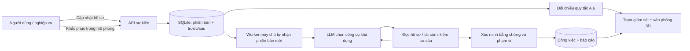

# HiveFive — Thiết kế đồ án Agent giám sát theo sự kiện

## Bài toán và đóng góp

Nhân viên nghỉ việc nhưng quyền truy cập chưa được thu hồi, hoặc nhân viên
làm từ xa bằng thiết bị chưa được bảo vệ, là các sai lệch chỉ nhận ra khi
liên kết dữ liệu nhân sự, tài khoản và thiết bị. Đồ án nghiên cứu một Agent
chuyên biệt nhận thay đổi nghiệp vụ, đối chiếu kiểm soát có bằng chứng và
hướng dẫn xử lý. Văn phòng 3D giúp giải thích ai bị ảnh hưởng và ở đâu.

Đóng góp của bản triển khai: luồng theo sự kiện được lưu bền vững; bộ quy tắc
A.6 liên kết ba loại thực thể; LLM chọn công cụ kiểm tra sâu; công việc có mã
ổn định và tái kiểm tra khi dữ liệu thay đổi; trực quan hóa 3D tương tác.
Không coi số lượng nhân vật hoặc chuyển động là bằng chứng tính tự chủ AI.

## Phạm vi chính xác

- ISO/IEC 27001:2022: đồ án hiện thực quy tắc đơn giản hóa cho A.6.1–A.6.8.
- 56 là danh mục dự án: 8 A.6 + 14 A.7 + 34 A.8. Phụ lục A của tiêu chuẩn
  có 93 kiểm soát. Chưa có evaluator A.7/A.8, không được báo đã đánh giá 56.
- 50 nhân sự, 4 phòng ban, 200 tài khoản và 50 laptop đều là dữ liệu giả lập.
- Trạng thái “đạt” là đạt quy tắc của mô phỏng, không phải kết luận chứng nhận.

## Kiến trúc đã triển khai

Trình duyệt gửi `POST /api/live/events` khi người dùng thực hiện nghiệp vụ.
Yêu cầu này không gọi endpoint chạy kiểm toán. Giao dịch lưu trạng thái và
sự kiện trước/sau rồi báo worker. Worker tự xử lý phiên bản chưa đánh giá,
kể cả khi không có tab trình duyệt mở. `GET /api/live` chỉ đọc trạng thái;
giao diện cập nhật khoảng hai giây một lần.

Phát hiện theo quy tắc hiện ngay, sau đó Ollama `qwen2.5:7b` chọn công cụ
để kiểm tra và xác minh. Vì vậy giao diện phân biệt rõ “còn thiếu sót theo
bằng chứng” với “AI đã xác minh”. Lỗi model không được đổi thành AI thành
công và không che các phát hiện quy tắc.

## Mô hình dữ liệu và tính nhất quán

`person_id` liên kết nhân sự với tài khoản và laptop. Mỗi thay đổi tăng
`revision`, lưu thời gian cùng dữ liệu trước/sau. Mỗi bản báo cáo có nguồn,
SHA-256 của snapshot và `trigger_revision`. Các sự kiện mới trong lúc LLM
đang chạy được giữ lại; báo cáo cũ không ghi đè trạng thái doanh nghiệp mới.
Thao tác không làm thay đổi dữ liệu không tạo sự kiện hoặc gọi model.

Nguồn sống lưu tại `data/live/agent_runs.sqlite3`, tách nguồn thử nghiệm nhận
mục tiêu trước đây. Worker dùng một snapshot cố định trong mỗi lần kiểm tra.
Công việc `HF-TASK-A.6.x` không tạo trùng khi kiểm tra lại; chỉ đánh dấu hết
phát hiện khi bằng chứng hiện tại của toàn bộ kiểm soát đó đạt quy tắc.

## Ma trận nghiệp vụ – bằng chứng – kiểm soát

| Nghiệp vụ | Bằng chứng đối chiếu | Kiểm soát |
|---|---|---|
| Thẩm tra trước tuyển dụng | `screened` | A.6.1 |
| Cam kết trách nhiệm lao động | `terms_signed` | A.6.2 |
| Đào tạo và kiểm tra nhận thức | `training_complete`, `training_passed` | A.6.3 |
| Phổ biến quy trình kỷ luật | Hồ sơ phổ biến và chính sách | A.6.4 |
| Nghỉ việc và bàn giao | Trạng thái nhân sự, tài khoản còn mở, laptop chưa trả | A.6.5 |
| Ký NDA | `nda_signed` | A.6.6 |
| Làm việc từ xa | Chính sách, mã hóa laptop, MFA VPN | A.6.7 |
| Báo cáo sự kiện | Đã hướng dẫn, đã báo cáo và kênh báo cáo | A.6.8 |

Đây là cách diễn giải nghiệp vụ cho đồ án, không sao chép toàn văn tiêu
chuẩn. Ví dụ quy tắc NDA trước cấp quyền là chính sách mô phỏng của HiveFive.

## Thiết kế tương tác và 3D

Màn hình chính đưa văn phòng và thao tác nghiệp vụ cạnh nhau trên desktop;
trên màn hình hẹp, thao tác chuyển xuống dưới. Chọn nhân vật liên kết với
nhân sự trong biểu mẫu; ghi nhận sự việc làm nổi bật hồ sơ liên quan và tự
hiện kiểm soát, bằng chứng, cách xử lý cùng người phụ trách.

Phối cảnh isometric, mặt cắt hai tường, sàn gỗ, khung kính, màu sage/oak,
nội thất bo cạnh, bàn ghế và nhân vật có chi tiết. Cảnh một phòng là mặc
định; toàn tòa nhà là chế độ tham khảo. Camera có giới hạn zoom; nút về
phòng phục hồi góc nhìn. WASD và tìm đường tránh bàn giữ vai trò tương tác
minh họa, không tự hoàn thành đào tạo hoặc thay đổi hồ sơ.

## Kịch bản bảo vệ đồ án

1. Ban đầu hồ sơ mẫu đầy đủ, không có phát hiện theo 8 quy tắc A.6.
2. Chọn HF-025 và ghi nhận nghỉ việc. Không gọi nút chạy kiểm tra.
3. Quan sát phát hiện A.6.5, 4 tài khoản còn mở và 1 laptop chưa bàn giao;
   xem khuyến nghị HR/IT và nhật ký công cụ tự động.
4. Ghi nhận thu hồi tài khoản và nhận lại laptop. Quan sát phát hiện biến
   mất; khi worker hoàn tất, công việc được đánh dấu hết phát hiện trong
   mô phỏng. Truy vết hai sự kiện và hai phiên bản bằng chứng.
5. Tạo thiếu NDA hoặc chuyển làm từ xa khi worker còn chạy để chứng minh
   thay đổi mới không bị mất. Thử gửi lại cùng thao tác để kiểm tra chống trùng.

## Đánh giá thực nghiệm và giới hạn

Bộ kiểm thử phần mềm đã bổ sung kiểm tra truy vết bằng chứng thiếu, trước/sau
và scorer thực nghiệm (số lượng cập nhật ở `VALIDATION.md`). Có test
worker tự nhận sự kiện, khắc phục và tái kiểm tra, thay đổi đồng thời, nguồn
lưu bền, lỗi model và từ chối đầu vào sai. Đây không phải số liệu độ chính
xác kiểm toán. Bộ thực nghiệm tổng hợp và so sánh luật/workflow/AI đã được
triển khai; phương pháp, kết quả và hạn chế ghi ở `NGHIEN-CUU-VA-DANH-GIA.md`.
Cần tiếp tục có người gán nhãn độc lập và dữ liệu doanh nghiệp thực tế.

Chỉ số nên đo: precision/recall theo kiểm soát; thời gian từ sự kiện đến
phát hiện quy tắc và đến báo cáo AI; tỷ lệ tác vụ trùng; tỷ lệ sự kiện được
xử lý sau restart; tỷ lệ kết luận thiếu dẫn chứng; và khảo sát khả năng hiểu
mô phỏng. Không gán trước các giá trị chưa đo.

Bản này chạy local với một tiến trình Uvicorn, một worker. Chưa tích hợp
HR/IAM thật, xác thực nhiều người dùng, tự khắc phục hệ thống thật, scheduler
đa tiến trình hoặc evaluator cho 48 kiểm soát còn lại. Trước khi dùng dữ
liệu thật phải thiết kế riêng quyền truy cập, quản trị dữ liệu và consent.
