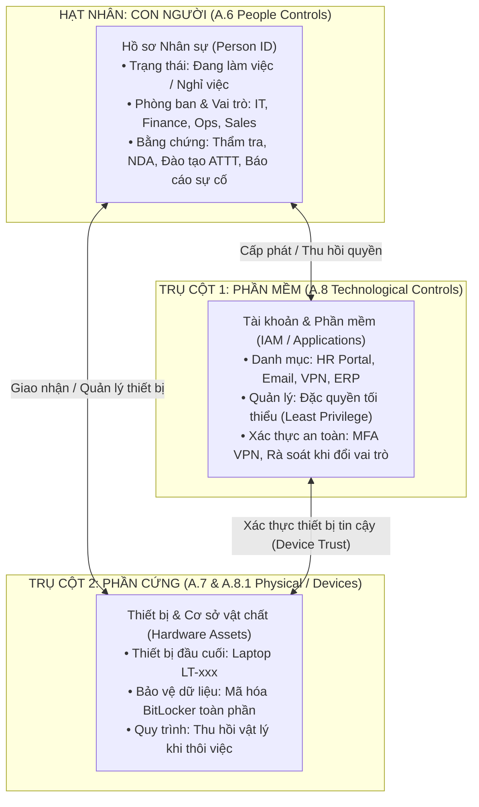

# Kiến trúc Tam giác An toàn thông tin: Con người · Phần mềm · Phần cứng
**Đồ án:** Hệ thống AI Agent Giám sát Tuân thủ ISO/IEC 27001:2022 theo Sự kiện  
**Mô hình hạt nhân:** Con người (Focal Point) liên kết Phần mềm (IAM/Access) và Phần cứng (Devices/Physical)

---

## 1. Giới thiệu & Bối cảnh học thuật

Trong tiêu chuẩn **ISO/IEC 27001:2022**, các biện pháp kiểm soát tại Phụ lục A được cấu trúc lại thành 4 nhóm chính:
- **A.5** Kiểm soát tổ chức (Organizational controls - 37 kiểm soát)
- **A.6** Kiểm soát con người (People controls - 8 kiểm soát) — *Trọng tâm đề tài*
- **A.7** Kiểm soát vật lý (Physical controls - 14 kiểm soát) — *Trụ cột Phần cứng*
- **A.8** Kiểm soát công nghệ (Technological controls - 34 kiểm soát) — *Trụ cột Phần mềm*

Thực tế kiểm toán an toàn thông tin chứng minh rằng **con người là chủ thể tạo ra hành vi**, nhưng hành vi đó luôn tác động thông qua **phần mềm** (tài khoản định danh, quyền truy cập dữ liệu) và **phần cứng** (thiết bị máy tính xách tay, điện thoại, không gian văn phòng). Một vi phạm an toàn thông tin hiếm khi chỉ tồn tại ở một thực thể đơn lẻ; nó luôn lan truyền theo chuỗi quan hệ liên thực thể.

Đồ án này đề xuất và hiện thực hóa **Mô hình Tam giác An toàn thông tin (Security Triad Model)**, lấy **Con người làm hạt nhân**, kết nối trực tiếp với **Phần mềm** và **Phần cứng**.

---

## 2. Ma trận Ánh xạ Tiêu chuẩn ISO/IEC 27002:2022

Hệ thống tích hợp sẵn kho tri thức tra cứu tiêu chuẩn (ISO Knowledge Base) tại `agent_core/triad.py`, đối chiếu từng kiểm soát với điều khoản và hướng dẫn thực thi:

| Trụ cột | Mã kiểm soát | Điều khoản ISO 27002:2022 | Mục tiêu kiểm soát | Trọng số CIA |
|---|---|---|---|:---:|
| **Con người** | **A.6.1** | Clause 6.1 (Screening) | Thẩm tra lý lịch và độ tin cậy của nhân sự trước khi tuyển dụng. | C:3, I:3, A:1 |
| **Con người** | **A.6.2** | Clause 6.2 (Terms of employment) | Ràng buộc trách nhiệm ATTT trong điều khoản hợp đồng lao động. | C:4, I:2, A:1 |
| **Con người** | **A.6.3** | Clause 6.3 (Security awareness) | Đào tạo, phổ biến nhận thức và kiểm tra định kỳ hàng năm. | C:4, I:4, A:3 |
| **Con người** | **A.6.4** | Clause 6.4 (Disciplinary process) | Thiết lập và truyền đạt quy trình xử lý kỷ luật vi phạm an toàn. | C:3, I:3, A:2 |
| **Liên thực thể** | **A.6.5** | Clause 6.5 (Termination/change) | Thu hồi tài khoản phần mềm và nhận lại thiết bị phần cứng khi thôi việc. | C:5, I:4, A:3 |
| **Con người** | **A.6.6** | Clause 6.6 (Confidentiality/NDA) | Thỏa thuận bảo mật thông tin trước khi cấp bất kỳ tài khoản nào. | C:5, I:2, A:1 |
| **Liên thực thể** | **A.6.7** | Clause 6.7 (Remote working) | Bắt buộc mã hóa laptop phần cứng và MFA phần mềm khi làm việc ngoài trụ sở. | C:5, I:4, A:3 |
| **Con người** | **A.6.8** | Clause 6.8 (Reporting events) | Hướng dẫn kênh báo cáo và ghi nhận sự kiện ATTT bất thường. | C:4, I:4, A:4 |
| **Phần mềm** | **A.8.2** | Clause 8.2 (Privileged access) | Kiểm soát đặc quyền tối thiểu (Least Privilege) đối với tài khoản quản trị. | C:5, I:5, A:5 |
| **Phần mềm** | **A.8.3** | Clause 8.3 (Access restriction) | Rà soát và thu hồi quyền truy cập khi nhân sự chuyển đổi vị trí công tác. | C:5, I:4, A:3 |
| **Phần mềm** | **A.8.5** | Clause 8.5 (Secure authentication) | Xác thực đa yếu tố (MFA) cho mọi kết nối từ xa. | C:5, I:4, A:3 |
| **Phần cứng** | **A.8.1** | Clause 8.1 (Endpoint devices) | Mã hóa ổ đĩa (BitLocker), cấu hình bảo vệ thiết bị đầu cuối. | C:5, I:4, A:3 |
| **Phần cứng** | **A.7.9** | Clause 7.9 (Off-premises assets) | Quản lý và bảo vệ thiết bị khi mang ra ngoài cơ sở của tổ chức. | C:4, I:3, A:4 |

---

## 3. Mô hình Toán học: Đánh giá Rủi ro CIA Đa thực thể

Hệ thống cài đặt giải thuật định lượng rủi ro $R$ (Quantitative Risk Calculation) dựa trên ma trận:

$$\text{Risk Score} = \text{Likelihood} \times \text{Impact}$$

Trong đó:
1. **Khả năng xảy ra ($\text{Likelihood}$)**:
   - Vi phạm đã xác nhận ($\text{violation}$): $4.5$
   - Thiếu bằng chứng / Chưa xác minh ($\text{missing}$): $3.0$
   - Hồ sơ tuân thủ ($\text{clean}$): $1.0$
2. **Mức độ ảnh hưởng ($\text{Impact}$)**: Được tính trọng số từ bộ ba CIA (Bảo mật - Toàn vẹn - Khả dụng) và hệ số nhạy cảm phòng ban:
   $$\text{Base Impact} = 0.5 \times C + 0.3 \times I + 0.2 \times A$$
   $$\text{Impact} = \min\left(5.0, \text{Base Impact} \times W_{\text{dept}}\right)$$
   *Hệ số phòng ban ($W_{\text{dept}}$):*
   - IT (Quản trị hạ tầng kỹ thuật): $1.4$
   - Finance (Dữ liệu tài chính, tiền lương): $1.3$
   - Ops (Vận hành nội bộ): $1.1$
   - Sales (Kinh doanh, khách hàng): $1.0$
3. **Phân loại cấp độ rủi ro ($\text{Risk Level}$)**:
   - $\text{Risk Score} \ge 18.0$: **Rất cao (Critical)** — Báo động đỏ, yêu cầu xử lý ngay.
   - $12.0 \le \text{Risk Score} < 18.0$: **Cao (High)** — Cần xử lý trong phiên làm việc.
   - $6.0 \le \text{Risk Score} < 12.0$: **Trung bình (Medium)** — Bổ sung chứng từ.
   - $\text{Risk Score} < 6.0$: **Thấp (Low)** — Duy trì theo dõi định kỳ.

---

## 4. Các Chuỗi Lan truyền Rủi ro Bắc cầu (Cross-Entity Risk Chains)

Khi có một sự kiện nghiệp vụ xảy ra, Agent không chỉ kiểm tra riêng hồ sơ nhân sự mà quét toàn bộ đồ thị liên kết:

### Chuỗi 1: Nghỉ việc chưa thu hồi tài sản (Offboarding Cascade)
- **Kích hoạt:** Nhân sự chuyển sang trạng thái `terminated`.
- **Lan truyền Phần mềm:** Phát hiện còn tài khoản `active: true` mà không có ngoại lệ giữ bàn giao hợp lệ $\rightarrow$ Gắn mã `OFFBOARDING_UNREVOKED_SOFTWARE` (Vi phạm A.6.5 + A.8.2).
- **Lan truyền Phần cứng:** Phát hiện laptop có `returned: false` $\rightarrow$ Gắn mã `OFFBOARDING_UNRETURNED_HARDWARE` (Vi phạm A.6.5 + A.7.9).
- **Điểm rủi ro:** Đạt mức **Cao / Rất cao (14.0 - 22.5)** do nguy cơ rò rỉ dữ liệu trực tiếp.

### Chuỗi 2: Làm việc từ xa thiếu kiểm soát (Remote Working Cascade)
- **Kích hoạt:** Nhân sự bật chế độ `remote: true`.
- **Lan truyền Phần cứng:** Laptop mang về nhà chưa bật mã hóa BitLocker (`encrypted: false`) $\rightarrow$ Vi phạm A.8.1.
- **Lan truyền Phần mềm:** Tài khoản VPN chưa bật xác thực 2 bước (`mfa: false`) $\rightarrow$ Vi phạm A.8.5.
- **Tổng hợp:** Gắn cờ `REMOTE_WORK_VULNERABILITY` (A.6.7 + A.8.1 + A.8.5).

### Chuỗi 3: Luân chuyển vai trò chưa rà soát quyền (Role Change Cascade)
- **Kích hoạt:** Nhân sự đổi phòng ban hoặc vai trò mới (`role_change`).
- **Lan truyền Phần mềm:** Quyền truy cập các hệ thống nghiệp vụ cũ chưa được rà soát (`role_reviewed: false`) $\rightarrow$ Vi phạm nguyên tắc Cần biết (Need-to-know / A.8.3).
- **Hành động Agent:** Tự động phát hành tác vụ rà soát quyền cho Quản lý trước khi cho phép đóng hồ sơ.

### Chuỗi 4: Cấp quyền sớm trước khi hoàn tất thủ tục pháp lý (Onboarding Cascade)
- **Kích hoạt:** Nhân viên mới vào làm nhưng chưa ký cam kết NDA (`nda_signed: false`).
- **Lan truyền Phần mềm:** Tài khoản hệ thống đã được mở sẵn $\rightarrow$ Gắn cờ `ONBOARDING_PREMATURE_SOFTWARE` (A.6.6 + A.8.2).

---

## 5. Hiện thực hóa Kỹ thuật & Kiểm chứng Phần mềm

Toàn bộ mô hình đã được hiện thực hóa và kiểm thử nghiêm ngặt:
1. **Lõi Engine Tam giác (`agent_core/triad.py`):**
   - Định nghĩa từ điển ISO 27002, giải thuật tính điểm CIA và hàm `analyze_triad(enterprise)`.
2. **Tích hợp Giám sát Sự kiện (`agent_core/live.py` & `agent_core/autonomous.py`):**
   - Mọi bản tin trạng thái `state()` và báo cáo kiểm toán `report` đều đính kèm cấu trúc `triad` hoàn chỉnh.
3. **Giao diện Người dùng (`backend/static/live.js`, `index.html`, `cases.css`):**
   - Bổ sung thẻ tương tác 3 cột: **1. Con người (Trọng tâm)** · **2. Phần mềm & IAM** · **3. Phần cứng & Thiết bị**.
   - Hiển thị bảng cảnh báo chuỗi rủi ro liên thực thể và trích dẫn chuẩn mực ISO 27002 cho từng mục kiểm soát.
4. **Bộ kiểm thử tự động (Unit Tests):**
   - Đạt **54/54 tests** (100% Passed), bao gồm 7 test case chuyên sâu kiểm chứng các chuỗi lan truyền rủi ro tại `tests/test_triad.py`.
