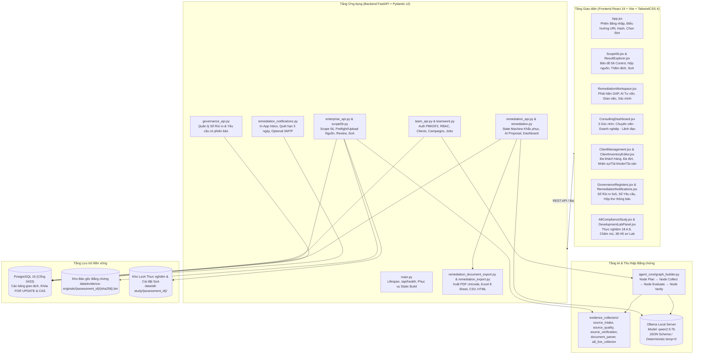
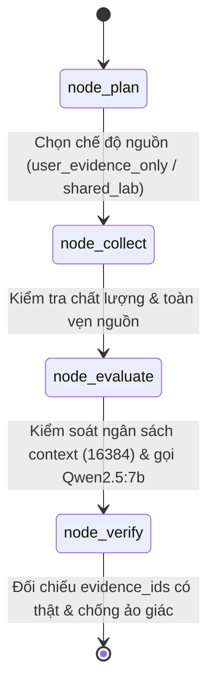
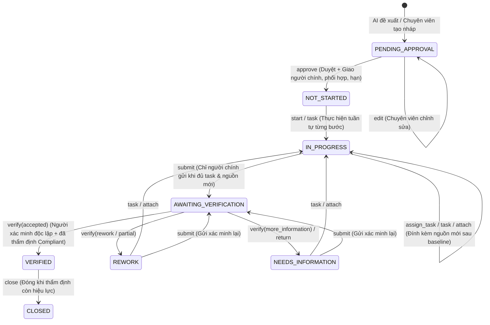

# BÁO CÁO KIẾN TRÚC HỆ THỐNG — ISO27001-AI-AGENT

**Đề tài:** Hệ thống AI Agent hỗ trợ đánh giá và tư vấn khắc phục tuân thủ an toàn thông tin theo tiêu chuẩn ISO/IEC 27001:2022.

> **Lưu ý học thuật và nghiệp vụ:** Tài liệu này mô tả đúng kiến trúc thực tế của mã nguồn hiện hành trong repository. Hệ thống đóng vai trò là nền tảng kỹ thuật hỗ trợ thu thập bằng chứng, đánh giá sơ bộ bằng AI Agent, quản lý vòng đời tư vấn – khắc phục và xác minh độc lập; **không thay thế tổ chức chứng nhận ISO và không tự động phê duyệt kết luận chuyên môn thay con người**.

---

## 1. Tổng quan hệ thống

Hệ thống **ISO27001-AI-Agent** giải quyết bài toán quản lý xuyên suốt quy trình đánh giá và tư vấn khắc phục theo tiêu chuẩn **ISO/IEC 27001:2022** trong phạm vi **56 biện pháp kiểm soát (Controls)** thuộc Phụ lục A:
- **8 Control nhóm A.6 (Con người / People):** từ `A.6.1` đến `A.6.8`.
- **14 Control nhóm A.7 (Vật lý & Phần cứng / Physical):** từ `A.7.1` đến `A.7.14`.
- **34 Control nhóm A.8 (Kỹ thuật & Phần mềm / Technological):** từ `A.8.1` đến `A.8.34`, trong đó **18 Control A.8** trọng tâm được trang bị thêm môi trường thực nghiệm chuyên sâu (108 kịch bản Raw Replay và 18 Probe Live v2 trên container cô lập).

Hệ thống kết nối khép kín **12 bước nghiệp vụ**:

```mermaid
flowchart LR
    A["1. Đăng ký Khách hàng\n& Đợt đánh giá"] --> B["2. Khai báo Phạm vi ISMS\n& Danh mục Doanh nghiệp"]
    B --> C["3. Thu thập & Kiểm định\nNguồn Bằng chứng (SHA-256)"]
    C --> D["4. AI Agent Đánh giá\n(LangGraph + Qwen2.5:7b)"]
    D --> E["5. Phát hiện Khoảng cách\n(GAP / Finding Baseline)"]
    E --> F["6. AI Tư vấn Phương án\nKhắc phục có cấu trúc"]
    F --> G["7. Chuyên viên Sửa, Duyệt\n& Giao việc / Bước con"]
    G --> H["8. Doanh nghiệp Thực hiện\n& Nộp Bằng chứng sau"]
    H --> I["9. Người Xác minh Độc lập\nKiểm tra & Phản hồi"]
    I --> J["10. Đánh giá lại Control\n& Thẩm định Tiêu chí"]
    J --> K["11. Quyết định Tính áp dụng\n& Dự thảo SoA 56"]
    K --> L["12. Báo cáo Trước–Sau\n(PDF / XLSX / CSV / HTML)"]
```

---

## 2. Kiến trúc tổng thể (Frontend / Backend / AI / Database)

---

## 3. Công nghệ sử dụng

| Tầng | Công nghệ / Thư viện | Vai trò trong hệ thống |
|---|---|---|
| **Frontend** | React 19, Vite 8, TailwindCSS 4, Lucide React | Giao diện SPA phản hồi nhanh, đồng bộ ngữ cảnh qua URL Hash (`#view=...&assessment=...&control=...`), hỗ trợ Back/Forward/F5 không mất trạng thái. |
| **Backend** | Python 3.12, FastAPI, Pydantic v2, Uvicorn | Cung cấp RESTful API, kiểm tra kiểu dữ liệu nghiêm ngặt (`extra='forbid'`, `StrictBool`), quản lý tiến trình nền (worker đánh giá lô và worker nhắc hạn). |
| **AI & LLM** | LangGraph, Ollama (`qwen2.5:7b`), Requests | Điều phối luồng suy luận trạng thái (`StateGraph`) cho đánh giá Control và gọi HTTP `/api/chat` kèm JSON Schema cho tư vấn khắc phục. |
| **Database** | PostgreSQL 16 (Docker cổng `5433`), `psycopg` v3 | Lưu trữ giao dịch ACID, khóa dòng `SELECT ... FOR UPDATE`, khóa tư vấn `pg_advisory_xact_lock`, cột `JSONB` có đánh số phiên bản (`version`). |
| **Xử lý Tài liệu & Báo cáo** | PyPDF, python-docx, ReportLab, OpenPyXL | Bóc tách văn bản từ PDF/DOCX/TXT/JSON/CSV/LOG/CONF; xuất báo cáo PDF tiếng Việt Unicode và Excel `.xlsx` 8 sheet có định dạng chuyên nghiệp. |
| **Kiểm thử & Chất lượng** | Pytest (442 tests), Node Test Runner (14 tests), Playwright MS Edge (17 kịch bản UI + E2E), Oxlint | Kiểm thử đơn vị, kiểm thử hợp đồng API, kiểm thử giao diện và kiểm thử tích hợp ghi thật trên DB cô lập qua khởi động lại. |

---

## 4. Cơ chế hoạt động chi tiết của các phân hệ

### 4.1. Cách hoạt động của AI Agent Đánh giá (`agent_core/graph_builder.py`)
AI Agent đánh giá tuân thủ không phải là một lời gọi prompt đơn lẻ mà được tổ chức thành đồ thị trạng thái **LangGraph (`StateGraph`)** gồm 4 nút tuần tự:

1. **`node_plan`:** Xác định phương thức thu thập dựa trên chế độ của đợt đánh giá (`inventory_mode`). Với đợt khách hàng (`client`), hệ thống bắt buộc chạy ở chế độ `user_evidence_only` (chỉ dùng bằng chứng do doanh nghiệp nộp, tuyệt đối không lấy preset của phòng lab).
2. **`node_collect`:** Truy vấn bằng chứng từ PostgreSQL, chạy bộ lọc toàn vẹn và chất lượng nguồn (`source_verification.py`). Các nguồn bị lỗi hash hoặc không đủ chất lượng văn bản bị loại khỏi đầu vào suy luận và ghi rõ vào `audit_trail`.
3. **`node_evaluate`:**
   - Nếu không có bằng chứng hợp lệ, dừng ngay và trả về `Insufficient Evidence` (không gọi LLM để tránh suy đoán không căn cứ).
   - Quét lọc các mẫu prompt injection (`[SYSTEM INSTRUCTION:...]`), nạp tiêu chí chấm điểm (`compliance_rubrics.json`) của đúng Control đang xét, kiểm tra kích thước byte đầu vào qua `validate_budget()` (không cắt bớt âm thầm) và gọi `qwen2.5:7b` với `temperature = 0.0`.
   - Ép kiểu phản hồi qua Pydantic `ControlEvaluationOutput` (`status`, `confidence`, `rationale`, `evidence_ids`).
4. **`node_verify` (Guardrail hậu kiểm):**
   - Đối chiếu danh sách `evidence_ids` mà LLM viện dẫn với tập `available` thực tế của Control đó.
   - Nếu LLM bịa ra một `evidence_id` không tồn tại, hoặc kết luận đạt/không đạt nhưng không viện dẫn được bất kỳ `evidence_id` hợp lệ nào, `node_verify` tự động hạ kết luận về `Insufficient Evidence` (`confidence = 0.0`) và ghi nhận `VERIFY (REJECTED UNKNOWN EVIDENCE IDS)`.

### 4.2. Cách thu thập và kiểm định bằng chứng (`evidence_collectors/`)
- **Hỗ trợ đa nguồn:** Tiếp nhận tệp `.pdf`, `.docx`, `.txt`, `.md`, `.json`, `.csv`, `.tsv`, `.conf`, `.log` (tối đa 15MB, 100.000 ký tự văn bản).
- **Kiểm tra trước khi lưu (Preflight):** Endpoint `POST .../sources/validate` và CLI kiểm tra độ dài tối thiểu, tỷ lệ ký tự chữ/số, hiện tượng lặp ký tự rác, byte NUL và cú pháp JSON mà chưa ghi vào DB.
- **Bảo toàn bản gốc & chống trùng:** Khi lưu thật (`POST .../sources/upload`), tệp gốc được tính mã băm `SHA-256`, lưu bất biến tại `data/evidence-originals/{assessment_id}/{sha256}.bin` và định danh bằng mã `WEB-{hash}`. Khi đọc lại hoặc đưa vào Agent, hệ thống kiểm tra lại SHA-256 trên đĩa so với DB.

### 4.3. Cách đánh giá 56 Control và quản lý trạng thái (`backend/scope56.py`, `backend/remediation.py`)
- Mỗi Control có `review_token` (SHA-256 đại diện cho toàn bộ snapshot bằng chứng hiện hành + kết quả đánh giá mới nhất).
- Hệ thống phân loại tự động 56 Control theo **9 cờ trạng thái công việc** trên Dashboard:
  1. `missing_sources` (Thiếu nguồn)
  2. `unusable_sources` (Nguồn chưa dùng được)
  3. `needs_assessment_check` (Cần đánh giá / kiểm tra lại)
  4. `needs_review` (Chưa thẩm định hiện hành)
  5. `needs_applicability` (Chưa xác định tính áp dụng)
  6. `has_finding` (Có phát hiện GAP)
  7. `remediating` (Đang khắc phục)
  8. `awaiting_verification` (Chờ xác minh)
  9. `has_verified_action` (Có hành động đã xác minh)
- Từ các cờ này, hệ thống sinh danh sách công việc cụ thể (`required_tasks`) cho từng Control.

### 4.4. Cách xác định GAP (Phát hiện / Findings)
- **Hai cơ chế tạo GAP:**
  1. *Quét ứng viên tự động (`POST /remediation/discover`):* Tự động rà các Control đã đánh giá có nguồn thực tế nhưng kết luận đang là `Non-Compliant`, `Partially Compliant` hoặc `Insufficient Evidence` (và không bị loại trừ) để tạo các phát hiện ứng viên, chống tạo trùng trên cùng `(control_id, review_token)`.
  2. *Ghi nhận thủ công (`POST /remediation/findings`):* Chuyên viên tư vấn tạo phát hiện trực tiếp trên snapshot hiện tại của Control.
- **Khóa Baseline bất biến:** Mỗi phát hiện lưu cứng `baseline` gồm `review_token`, kết luận ban đầu, danh sách bằng chứng ban đầu kèm `sha256_hash`, danh sách tiêu chí rubric và `context_snapshot` của doanh nghiệp tại thời điểm phát hiện.

### 4.5. Cách AI Tư vấn phương án khắc phục (`backend/remediation_api.py`)
- Khi chuyên viên bấm **"AI đề xuất có cấu trúc"**, backend tổng hợp:
  - Mô tả phát hiện, vị trí, giả thuyết nguyên nhân và mức rủi ro đề nghị.
  - Bối cảnh doanh nghiệp và phạm vi ISMS (`company_context_unverified`).
  - Các mục trong **Sổ rủi ro** và **Sổ yêu cầu** đã được rà soát (`ACKNOWLEDGED`) liên quan đến Control.
  - Tối đa **6 trích đoạn nội dung bằng chứng thực tế** (`extracted_text`, mỗi nguồn tối đa 1.500 ký tự) của Control trong đợt đó.
  - Lịch sử các hành động khắc phục trước đó (`prior_actions`).
- Gọi Ollama `qwen2.5:7b` với JSON Schema `Advice` bắt buộc sinh đầy đủ:
  - **Bị sai / thiếu gì:** `problem`, `possible_causes`, `clarification_questions` (bắt buộc phải đặt câu hỏi nếu thiếu nội dung nguồn).
  - **Cần làm gì, ở đâu, vì sao:** `title`, `objective`, `rationale`, `target_location`, `department`, `priority`, `resources`, `estimated_effort`.
  - **Các bước thực hiện & nghiệm thu đạt chuẩn:** `steps`, `tasks` (danh sách bước con), `acceptance`, `required_evidence` (bằng chứng phải nộp thêm), `recheck_method` (cách kiểm tra lại).
- Đề xuất của AI luôn lưu ở trạng thái `PENDING_APPROVAL` (`OLLAMA_DRAFT_REQUIRES_REVIEW`), chờ chuyên viên xem xét.

### 4.6. Cách duyệt, giao việc và phối hợp (`backend/remediation.py`)

- Chuyên viên có thể sửa mọi trường của kế hoạch nháp (`edit`), sau đó phê duyệt (`approve`) để giao cho **1 người chịu trách nhiệm chính (`assignee`)** và **nhiều người phối hợp (`collaborator_ids`)** cùng đợt, đặt thời hạn (`due_date` không ở quá khứ).
- Chuyên viên có thể phân công riêng từng bước công việc con (`assign_task`) cho người chính hoặc người phối hợp.
-Các bước công việc con (`tasks`) có **ràng buộc thứ tự phụ thuộc**: bước sau chỉ được tích hoàn thành khi tất cả các bước đứng trước đã hoàn thành.

### 4.7. Cách xác minh độc lập và đánh giá lại
- **Bằng chứng sau khắc phục:** Người thực hiện phải nộp tệp bằng chứng mới lên Control và đính kèm (`attach`) vào hành động. Hệ thống chặn việc đính kèm lại bằng chứng cũ đã nằm trong `baseline`.
- **Chặn tự xác minh (Separation of Duties):** Backend kiểm tra chặt chẽ: cả người chịu trách nhiệm chính (`assignee`) lẫn người phối hợp (`collaborator_ids`) đều bị từ chối `403 PermissionError` nếu cố tình gọi lệnh `verify`, `return` hoặc `close`. Vai trò doanh nghiệp (`operator`, `business_admin`) cũng bị chặn không được ký thẩm định kỹ thuật (`POST /scope56/reviews`).
- **Điều kiện xác minh đạt (`outcome = 'accepted'`):**
  1. Control phải được đánh giá lại trên nguồn mới và được chính người xác minh ký **thẩm định từng tiêu chí hiện hành (`human_review_current = True`)** với kết luận `Compliant`.
  2. Bản thẩm định đó phải **viện dẫn trực tiếp mã bằng chứng mới sau khắc phục**.
- Nếu chưa đạt, người xác minh có thể chọn `partial` (cải thiện một phần), `rework` (làm lại) hoặc `more_information` (yêu cầu bổ sung), đẩy trạng thái về `REWORK` hoặc `NEEDS_INFORMATION` để doanh nghiệp bổ sung và gửi xác minh lại.

### 4.8. Cách tạo báo cáo đa định dạng (`backend/remediation_document_export.py`, `backend/remediation_export.py`)
Từ cùng một nguồn dữ liệu đã kiểm quyền (`GET /remediation/report`), hệ thống xuất nhất quán ra **5 định dạng**:
1. **PDF Tiếng Việt Unicode (`/report.pdf`):** Sử dụng ReportLab với font TrueType Unicode (`Arial` / `DejaVuSans`) có kiểm tra đủ dấu tiếng Việt; gồm Tổng quan lãnh đạo, Danh sách việc theo Control, Sổ rủi ro/yêu cầu, Đối chiếu Trước–Sau từng Phát hiện, Chi tiết phương án tư vấn AI, Bằng chứng kèm SHA-256 và Lịch sử xác minh.
2. **Excel 8 Sheet (`/report.xlsx`):** Gồm `Summary`, `Findings`, `Actions`, `Tasks`, `Verification`, `Control worklist`, `Risk register`, `Requirements`; tự động đóng băng tiêu đề, bật bộ lọc và trung hòa công thức độc hại (`=`, `+`, `-`, `@`).
3. **Bản in HTML (`/report.html`):** Giao diện trình bày chuẩn A4 có nút in trực tiếp trên trình duyệt, escape toàn bộ thẻ HTML chống XSS.
4. **CSV tương thích Excel (`/report.csv`):** Đính kèm UTF-8 BOM (`\ufeff`) để mở trực tiếp bằng Microsoft Excel không lỗi dấu tiếng Việt.
5. **JSON đầy đủ (`/report`):** Phục vụ lưu trữ hồ sơ kiểm toán và tích hợp hệ thống.
